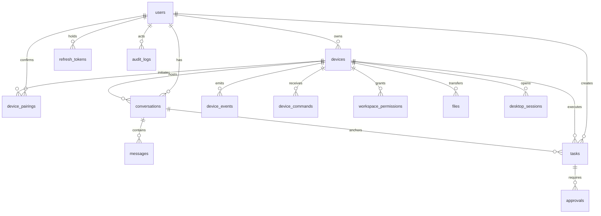
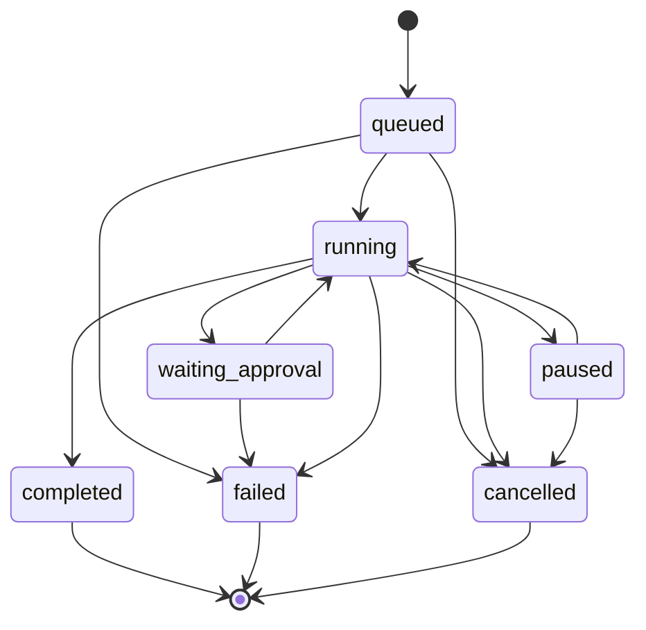

# DATA_MODEL — DeepSeek Remote AI 数据模型设计

| 项目 | 内容 |
| --- | --- |
| 文档编号 | DSRA-DESIGN-002 |
| 版本 | 1.1（2026-10-31） |
| 状态 | 设计基线，可据此建库（PG 未安装，DDL 待真实库验证，见 §10 A-07） |
| 上游依据 | `_docx_dump.txt` 第五章「数据库设计」（表 2，8 张表）+ 第四章 4.2、第七章；[HARNESS_INTERFACES.md](../research/HARNESS_INTERFACES.md)、[ENVIRONMENT_REPORT.md](../research/ENVIRONMENT_REPORT.md) |
| 关联文档 | [PROTOCOL.md](./PROTOCOL.md)、[REMOTE_AGENT.md](./REMOTE_AGENT.md)、[MVP_AND_ROADMAP.md](./MVP_AND_ROADMAP.md) |
| 目标读者 | Java 后端工程师、DBA、Flutter/桌面端需要理解字段语义的工程师 |

> 约定：本文所有「表 2」指策划案第五章的数据表清单；「表 3」指第六章的 17 个 REST API；「表 4」指
> 7.2 的六级权限表。本文给出的是**本项目自有数据库**设计，与 DeepSeek Harness 的内部存储无关。

---

## 0. 结论速览（先读这 12 条）

1. 主键统一使用 **ULID**（26 字符 Crockford Base32，应用侧生成，`CHAR(26)`）：时间有序、天然可排序、
   无需数据库序列协调，且能同时用于 API 路径与 WebSocket `msgId`。**不要用自增 BIGINT 做主键**。
2. 枚举一律使用 **`VARCHAR(32) + CHECK`**，不用 PostgreSQL 原生 `ENUM`（理由见 ADR-001）。
3. 时间统一 `TIMESTAMPTZ`，服务端 UTC 存储，API 输出 ISO-8601 带 `Z`；**禁止** `TIMESTAMP WITHOUT TIME ZONE`。
4. 策划案表 2 的 8 张表全部保留原字段名（`device_status`、`action_type` 等），新增字段只做**追加**，
   不改名、不删字段，保证与策划案逐条可对照。
5. 额外补 8 张支撑表：`refresh_tokens`、`idempotency_keys`、`device_events`、`device_commands`、
   `files`、`approvals`、`desktop_sessions`、`user_settings`。没有这 8 张表，协议层的断线补偿、
   幂等、审批、文件下载都**无法**落地。
6. `device_events` 与 `audit_logs` 从第一天就**按月 RANGE 分区**（只追加、量最大、可整分区删除）；
   `messages` 先不分区，达到 1000 万行再按 `created_at` 分区。
7. 事件投递用 **Outbox 模式**：业务事务内同时写 `tasks`/`messages` 与 `device_events`，同一事务提交；
   投递器只读 `device_events` 按 `seq` 递增推送。这样「任务已落库但事件丢失」不可能发生。
8. `seq` 是**每设备单调递增**的 `BIGINT`，由云端在 `devices.last_seq` 行锁下分配
   （`UPDATE devices SET last_seq = last_seq + 1 ... RETURNING last_seq`），保证同设备无空洞、无重复；
   不用全局序列（避免多设备互相阻塞与跨库不可迁移）。
9. `tasks.task_status` 严格对齐策划案 2.3 的 7 个状态，且状态机在应用层强制 + 数据库 `CHECK` 兜底。
10. `progress` 用 `SMALLINT 0..100`；`task.output` 流式增量**不逐条落库**，按 2 秒窗口合并成
    `device_events.payload` 中的一个块（写放大控制见 §8）。
11. 敏感凭证：`password_hash`（Argon2id）与 `pairing_token_hash`/`device_token_hash`（SHA-256 + 服务端 pepper）
    都只存哈希；明文永不入库、不进日志。
12. 迁移工具 **Flyway**，脚本命名 `V{版本}__{描述}.sql`；交付物中的「数据库初始化脚本」= Flyway 全量迁移 +
    `R__seed_reference_data.sql`。

---

## 1. 设计原则与全局约定

### 1.1 命名与类型规范

| 约定 | 规则 | 理由 |
| --- | --- | --- |
| 表名 | 小写复数蛇形：`task_events` → 本设计用 `device_events` | PostgreSQL 惯例 |
| 列名 | 小写蛇形；外键 `<单数表名>_id`：`device_id` | 机械可读 |
| 主键 | `id CHAR(26)`，ULID | 见 ADR-002 |
| 外键 | `CHAR(26)`，显式 `REFERENCES`，必须建索引 | 避免级联删除全表扫描 |
| 时间 | `TIMESTAMPTZ NOT NULL DEFAULT now()`；审计类表加 `created_at` | 统一 UTC |
| 金额/计数 | `BIGINT`/`SMALLINT`；`progress SMALLINT` | 无浮点 |
| 扩展字段 | `payload JSONB NOT NULL DEFAULT '{}'::jsonb` | 协议演进不频繁 DDL |
| 布尔 | `BOOLEAN NOT NULL DEFAULT false`，命名 `is_*`/`has_*` | 语义明确 |
| 软删除 | **仅** `devices.revoked_at`、`conversations.archived_at`；其余硬删 | 见 ADR-003 |
| 并发 | 需要乐观锁的表（`tasks`、`workspace_permissions`）加 `version INT NOT NULL DEFAULT 0` | 防止手机/Agent 双端覆盖 |
| 字符集 | UTF-8（数据库 `UTF8`），排序规则 `en_US.utf8` 或 `C`；中文展示不依赖 DB 排序 | 跨平台可移植 |

### 1.2 ULID 生成与校验

- 26 字符，Crockford Base32，前 10 字符为 48bit 毫秒时间戳，后 16 字符为 80bit 随机数。
- 应用侧（Java：`com.github.f4b6a3:ulid-creator`，Node：`ulid`，Dart：`ulid`）生成，数据库不参与。
- DB 层 `CHECK (char_length(id) = 26)`；`id` 与 `created_at` 不同源时以 `created_at` 为准（ULID 仅作排序近似）。
- **禁止**在同一毫秒内依赖 ULID 保证严格顺序；严格顺序一律用 `seq`/`created_at` + 次级排序键。

### 1.3 身份与三类令牌

| 令牌 | 持有者 | 形态 | 存储 | TTL |
| --- | --- | --- | --- | --- |
| 用户 access token | 手机 | JWT（RS256），`sub=user_id`，含 `device_scope` | 不入库（无状态） | 15 分钟 |
| 用户 refresh token | 手机 | 不透明随机串 32B | `refresh_tokens.token_hash`（SHA-256） | 30 天，旋转 |
| 设备凭证 `device_token` | Remote Agent | 不透明随机串 32B | `devices.device_token_hash`（SHA-256+pepper） | 长期，可轮换 |
| 配对令牌 `pairing_token` | Agent（二维码内） | 不透明随机串 32B | `device_pairings.pairing_token_hash` | 5 分钟、一次性 |

> 三个域互不复用：用户 JWT 不能调用 Agent 通道，设备凭证不能调用用户 API。详见 PROTOCOL §3。

---

## 2. 实体关系图



> `audit_logs` 与其它表**没有外键**（保留期长于业务数据，且用户注销后仍需留痕），这是刻意设计（ADR-004）。

---

## 3. 核心 8 表逐字段设计（对齐策划案表 2）

字段表图例：`PK` 主键、`FK` 外键、`UQ` 唯一、`IX` 索引、`NN` NOT NULL。

### 3.1 `users` 用户表

| 列 | 类型 | 约束 | 说明 |
| --- | --- | --- | --- |
| id | CHAR(26) | PK | ULID |
| username | VARCHAR(32) | NN, UQ | 登录名，`^[a-zA-Z0-9_-]{3,32}$` |
| password_hash | VARCHAR(255) | NN | Argon2id（`$argon2id$v=19$m=65536,t=3,p=4$...`），禁止 bcrypt 以上限 72 字节为借口降级 |
| email | VARCHAR(254) | NULL | 展示用原始大小写 |
| email_normalized | VARCHAR(254) | NULL, UQ（partial） | `lower(trim(email))`，唯一性以此为准 |
| phone | VARCHAR(32) | NULL | E.164 存储，如 `+8613800000000` |
| avatar | VARCHAR(512) | NULL | 对象存储 key 或 URL；禁止外链任意 URL（由服务端映射） |
| status | VARCHAR(16) | NN, CHECK IN (`active`,`locked`,`deleted`) | 策划案要求 `status` |
| failed_login_count | SMALLINT | NN DEFAULT 0 | 连续失败计数 |
| locked_until | TIMESTAMPTZ | NULL | 连续失败 5 次锁定 15 分钟 |
| last_login_at | TIMESTAMPTZ | NULL | |
| created_at | TIMESTAMPTZ | NN DEFAULT now() | |
| updated_at | TIMESTAMPTZ | NN DEFAULT now() | 触发器维护（见 §7.4） |

索引：`ix_users_email_norm`（partial `WHERE email_normalized IS NOT NULL`）、`ix_users_phone`（partial）。

### 3.2 `devices` 设备表

| 列 | 类型 | 约束 | 说明 |
| --- | --- | --- | --- |
| id | CHAR(26) | PK | 设备在注册（配对会话创建）时即分配，配对完成前 `device_status='pending'` |
| user_id | CHAR(26) | FK→users.id, NULL | 配对完成前为 NULL |
| device_name | VARCHAR(64) | NN | 用户可改，默认 `Windows-PC-01` |
| operating_system | VARCHAR(64) | NN | 例 `Windows 11 23H2 (22631.4169)` |
| agent_version | VARCHAR(32) | NN | 例 `0.4.1` |
| harness_version | VARCHAR(64) | NULL | 最近一次探测到的 Harness 版本，探测失败保留上次值 |
| device_status | VARCHAR(16) | NN, CHECK IN (`pending`,`active`,`revoked`) | 策划案要求；在线与否**不落此列**（见下） |
| last_online_at | TIMESTAMPTZ | NULL | 心跳/连接成功时更新 |
| last_seq | BIGINT | NN DEFAULT 0 | 该设备事件通道的已分配序号高水位（ADR-005） |
| device_token_hash | VARCHAR(64) | NULL | SHA-256(pepper‖token)，`device_token` 仅配对成功时下发一次 |
| device_public_key | TEXT | NULL | Agent 生成的 Ed25519 公钥（配对证明用，PEM/Base64） |
| capabilities | JSONB | NN DEFAULT '{}' | Agent 上报的能力快照：`{"terminal":false,"desktop":true,"fileWrite":true}` |
| app_version | VARCHAR(32) | NULL | 手机端版本仅对 App 会话有意义，这里存 Agent 自报版本（冗余便于排障） |
| revoked_at | TIMESTAMPTZ | NULL | 撤销时间，撤销后 `device_status='revoked'` |
| remote_enabled | BOOLEAN | NN DEFAULT true | 紧急停止后置 `false`；云端据此拒绝一切新指令（PROTOCOL §9.2），**只能电脑本地恢复** |
| emergency_stopped_at | TIMESTAMPTZ | NULL | 最近一次紧急停止时间；`remote_enabled=false` 时必有值，形成「停止—恢复」审计锚点 |
| created_at | TIMESTAMPTZ | NN DEFAULT now() | |
| updated_at | TIMESTAMPTZ | NN DEFAULT now() | |

**为什么没有 `online` 布尔列（ADR-006）**：在线是 TTL 型瞬时状态，写库会造成「进程崩溃后永远 online」的脏数据。
在线判定 = `device_status='active' AND last_online_at > now() - interval '90 seconds'` **或** Redis presence 键存在。
`last_online_at` 每 30 秒最多落库一次（节流），不是每次心跳都写。

索引：`ix_devices_user` (user_id, created_at DESC)、`uq_devices_token_hash`（`WHERE device_token_hash IS NOT NULL`）。

### 3.3 `device_pairings` 配对表

| 列 | 类型 | 约束 | 说明 |
| --- | --- | --- | --- |
| id | CHAR(26) | PK | = 二维码里的 `pid` |
| pairing_token_hash | VARCHAR(64) | NN | SHA-256(pepper‖pairing_token) |
| device_id | CHAR(26) | NN, FK→devices.id | 配对会话创建时设备已存在（pending） |
| user_id | CHAR(26) | NULL, FK→users.id | 手机确认配对时写入 |
| expires_at | TIMESTAMPTZ | NN | `created_at + 5 min` |
| used_at | TIMESTAMPTZ | NULL | 一次性使用时间 |
| status | VARCHAR(16) | NN, CHECK IN (`pending`,`used`,`expired`,`revoked`) | |
| attempt_count | SMALLINT | NN DEFAULT 0 | 扫码校验失败次数，>5 直接 revoke |
| created_ip | INET | NULL | 排障用，日志脱敏后保留 |
| created_at | TIMESTAMPTZ | NN DEFAULT now() | |

唯一约束：`uq_pairings_device_pending` UNIQUE (device_id) `WHERE status = 'pending'`（同一设备同时只允许 1 个有效配对会话，重新生成二维码即旧码失效）。

### 3.4 `conversations` 会话表

| 列 | 类型 | 约束 | 说明 |
| --- | --- | --- | --- |
| id | CHAR(26) | PK | |
| user_id | CHAR(26) | NN, FK→users.id | |
| device_id | CHAR(26) | NN, FK→devices.id | 会话绑定电脑（策划案 2.2「关联指定电脑」） |
| harness_session_id | VARCHAR(128) | NULL | **ACP `sessionId`（裸 UUID，已实测确认存在）**；同一 cwd 下可 `session/resume`；headless 降级模式为本地调用映射（通常 NULL）。`device_id + harness_session_id` 唯一（同一 ACP 会话可被跨进程列表/resume） |
| title | VARCHAR(120) | NN DEFAULT '新对话' | 首条用户消息截断 30 字生成 |
| session_state | VARCHAR(16) | NN DEFAULT 'active', CHECK IN (`active`,`closed`,`error`) | |
| last_message_at | TIMESTAMPTZ | NULL | 列表排序用，避免 JOIN messages |
| message_count | INT | NN DEFAULT 0 | 冗余计数，写入时 +1 |
| archived_at | TIMESTAMPTZ | NULL | 用户归档（不删数据） |
| created_at / updated_at | TIMESTAMPTZ | NN | |

索引：`ix_conv_user_updated` (user_id, COALESCE(last_message_at, created_at) DESC)、`ix_conv_device` (device_id)。
唯一：`uq_conv_harness_session` UNIQUE (device_id, harness_session_id) `WHERE harness_session_id IS NOT NULL`。

### 3.5 `messages` 消息表

| 列 | 类型 | 约束 | 说明 |
| --- | --- | --- | --- |
| id | CHAR(26) | PK | |
| conversation_id | CHAR(26) | NN, FK→conversations.id ON DELETE CASCADE | |
| role | VARCHAR(16) | NN, CHECK IN (`user`,`assistant`,`system`,`tool`) | |
| content | TEXT | NN DEFAULT '' | Markdown/纯文本/代码，统一存正文；二进制走 `files` |
| content_type | VARCHAR(16) | NN, CHECK IN (`text`,`markdown`,`code`,`image`,`file`,`audio`,`json`,`tool_call`,`tool_result`) | 策划案要求 |
| seq_in_conversation | BIGINT | NN | 会话内严格递增，用于稳定排序与分页游标 |
| client_msg_id | VARCHAR(64) | NULL | 手机生成的幂等 ID（同会话内唯一），重试不重复插入 |
| tool_name | VARCHAR(64) | NULL | `role='tool'` 时使用 |
| metadata | JSONB | NN DEFAULT '{}' | 附件列表、模型信息、耗时、token 数 |
| token_count | INT | NULL | 展示/计费留用（本期不计费，仅展示） |
| created_at | TIMESTAMPTZ | NN DEFAULT now() | |

唯一：`uq_msg_seq` UNIQUE (conversation_id, seq_in_conversation)、`uq_msg_client` UNIQUE (conversation_id, client_msg_id) `WHERE client_msg_id IS NOT NULL`。
索引：`ix_msg_conv_created` (conversation_id, created_at DESC)。
`seq_in_conversation` 分配方式与 `devices.last_seq` 同法：`UPDATE conversations SET message_count = message_count + 1 RETURNING message_count`（同事务行锁）。

### 3.6 `tasks` 任务表

| 列 | 类型 | 约束 | 说明 |
| --- | --- | --- | --- |
| id | CHAR(26) | PK | |
| user_id | CHAR(26) | NN, FK→users.id | |
| device_id | CHAR(26) | NN, FK→devices.id | |
| conversation_id | CHAR(26) | NULL, FK→conversations.id | 从对话发起的任务必填 |
| task_name | VARCHAR(200) | NN | 意图摘要，手机列表展示 |
| task_type | VARCHAR(32) | NN, CHECK IN (`chat`,`code_analysis`,`file_operation`,`terminal`,`desktop`,`custom`) | 决定权限判定与审计分类 |
| task_status | VARCHAR(20) | NN, CHECK IN (`queued`,`running`,`waiting_approval`,`paused`,`completed`,`failed`,`cancelled`) | **严格对齐策划案 2.3 七状态** |
| progress | SMALLINT | NN DEFAULT 0, CHECK (progress BETWEEN 0 AND 100) | |
| payload | JSONB | NN DEFAULT '{}' | 指令原文、模型参数、附件引用等 |
| result | JSONB | NULL | 最终结果摘要（`{"summary":...,"files":[...],"exitCode":...}`） |
| error_message | TEXT | NULL | 面向用户的可读错误（脱敏后） |
| error_code | VARCHAR(32) | NULL | 机读错误码，对应 PROTOCOL 错误码或 Agent 内部码 |
| harness_task_ref | VARCHAR(128) | NULL | Harness 侧引用；**ACP 无独立 task id**（一个 session 内多个 prompt 回合），通常 NULL；需要时可存 `sessionId#turn` 便于审计对账 |
| permission_level | SMALLINT | NN DEFAULT 2, CHECK BETWEEN 1 AND 6 | 本任务需要的最高权限级别 |
| idempotency_key | VARCHAR(64) | NULL | 创建任务的幂等键（与 `idempotency_keys` 联动） |
| cancel_requested_at | TIMESTAMPTZ | NULL | 取消请求时间；Harness 不支持硬取消时靠它让 Agent 停止采纳后续输出 |
| started_at | TIMESTAMPTZ | NULL | |
| finished_at | TIMESTAMPTZ | NULL | |
| last_event_seq | BIGINT | NULL | 该任务最后一条事件的设备级 `seq`，用于详情页增量拉取 |
| version | INT | NN DEFAULT 0 | 乐观锁 |
| created_at | TIMESTAMPTZ | NN DEFAULT now() | |
| updated_at | TIMESTAMPTZ | NN DEFAULT now() | |

索引：`ix_tasks_user_created` (user_id, created_at DESC)、`ix_tasks_device_status` (device_id, task_status)、
`ix_tasks_conv` (conversation_id, created_at DESC)、`uq_tasks_idem` UNIQUE (user_id, idempotency_key) `WHERE idempotency_key IS NOT NULL`。

**七状态中文对照（验收时逐条核对）**：
`queued` 等待执行 / `running` 正在执行 / `waiting_approval` 等待用户授权 / `paused` 暂停中 /
`completed` 已完成 / `failed` 执行失败 / `cancelled` 已取消。

**状态机（应用层强制，见 §7.3）**：



### 3.7 `audit_logs` 操作日志表（按月分区）

| 列 | 类型 | 约束 | 说明 |
| --- | --- | --- | --- |
| id | CHAR(26) | NN | ULID；分区表**不设全局 PK**（PG 要求 PK 含分区键，成本无收益） |
| user_id | CHAR(26) | NULL | **无外键**（ADR-004）；匿名设备事件为 NULL |
| device_id | CHAR(26) | NULL | 无外键 |
| action_type | VARCHAR(64) | NN | 例 `auth.login`、`device.pair`、`task.create`、`file.download`、`permission.grant`、`emergency.stop`、`approval.decide` |
| action_result | VARCHAR(16) | NN, CHECK IN (`success`,`denied`,`failed`) | 策划案要求 `action_result` |
| permission_level | SMALLINT | NULL, CHECK BETWEEN 1 AND 6 | 触发该操作时使用的权限级别（审计六级权限的关键证据） |
| target_type | VARCHAR(32) | NULL | `device`/`task`/`workspace`/`file`/`approval` |
| target_id | VARCHAR(64) | NULL | 目标标识（文件路径等敏感值只存哈希后 8 位 + 长度） |
| action_detail | JSONB | NN DEFAULT '{}' | 结构化细节；**不得**含明文令牌/密码/文件内容 |
| ip | INET | NULL | |
| user_agent | VARCHAR(255) | NULL | 截断 |
| trace_id | VARCHAR(64) | NULL | 与 API 响应 `traceId` 对应，贯通排障 |
| severity | VARCHAR(8) | NN DEFAULT 'info', CHECK IN (`info`,`warn`,`critical`) | `emergency.stop`/高风险操作 = `critical` |
| created_at | TIMESTAMPTZ | NN DEFAULT now() | 分区键 |

索引（每个分区本地）：`ix_audit_user_time` (user_id, created_at DESC)、`ix_audit_device_time` (device_id, created_at DESC)、
`ix_audit_action` (action_type, created_at DESC)、`ix_audit_target` (target_type, target_id)。

### 3.8 `workspace_permissions` 项目授权表

| 列 | 类型 | 约束 | 说明 |
| --- | --- | --- | --- |
| id | CHAR(26) | PK | |
| user_id | CHAR(26) | NN, FK→users.id | |
| device_id | CHAR(26) | NN, FK→devices.id | 授权是「某用户在某台电脑上」的授权 |
| workspace_path | VARCHAR(1024) | NN | 规范化绝对路径，Windows 用 `D:\work\proj-a`；入库前 `path.resolve` 归一 |
| path_key | VARCHAR(1024) | NN | `lower(workspace_path)` + 统一 `\` → 用于大小写不敏感唯一性 |
| permission_level | SMALLINT | NN, CHECK BETWEEN 1 AND 6 | 该目录授予的最高级别：3=读、4=读写+终端、5=+远程桌面交互，6 级本身不可作为常驻授权（见下） |
| can_read | BOOLEAN | NN DEFAULT true | 派生冗余，便于查询 |
| can_write | BOOLEAN | NN DEFAULT false | |
| granted_by | CHAR(26) | NULL | 在电脑本地 UI 点「授权」的用户（预留多用户） |
| revoked_at | TIMESTAMPTZ | NULL | 撤销时间；撤销后立即拒绝新操作（策划案 4.2） |
| created_at | TIMESTAMPTZ | NN DEFAULT now() | |
| updated_at | TIMESTAMPTZ | NN DEFAULT now() | |
| version | INT | NN DEFAULT 0 | |

唯一：`uq_ws_perm` UNIQUE (device_id, path_key) `WHERE revoked_at IS NULL` —— 同一目录只能有一条有效授权。
**6 级（高风险）不作为 `permission_level` 的常驻值**：`permission_level` 最大到 5，6 级是「在 3/4/5 级之上追加一次
审批」的修饰符，因此 DDL 保留 `BETWEEN 1 AND 6` 以兼容策划案表 4，但应用层写入时若为 6 会被规范化为
「基础级别 + `requires_approval=true`」，见 PROTOCOL §8 与 REMOTE_AGENT §6。

---

## 4. 支撑表设计（协议层必需）

### 4.1 `refresh_tokens`

| 列 | 类型 | 约束 | 说明 |
| --- | --- | --- | --- |
| id | CHAR(26) | PK | |
| user_id | CHAR(26) | NN, FK→users.id ON DELETE CASCADE | |
| token_hash | VARCHAR(64) | NN, UQ | SHA-256(随机串) |
| family_id | CHAR(26) | NN | 旋转家族；检测到复用则整族撤销（token reuse detection） |
| client_info | VARCHAR(255) | NULL | 设备型号/系统，脱敏 |
| issued_at | TIMESTAMPTZ | NN DEFAULT now() | |
| expires_at | TIMESTAMPTZ | NN | issued_at + 30d |
| revoked_at | TIMESTAMPTZ | NULL | |
| replaced_by | CHAR(26) | NULL | 旋转后的新 token id |

索引：`ix_rt_user` (user_id, expires_at DESC)、`ix_rt_family` (family_id)。

### 4.2 `idempotency_keys`

| 列 | 类型 | 约束 | 说明 |
| --- | --- | --- | --- |
| user_id | CHAR(26) | NN | |
| idem_key | VARCHAR(64) | NN | 客户端 `Idempotency-Key` 头，ULID |
| request_hash | VARCHAR(64) | NN | method+path+body 的 SHA-256，同键不同体 → 409 |
| response_code | VARCHAR(16) | NULL | 首次完成后写入，如 `0`/`50003` |
| response_body | JSONB | NULL | 完整 envelope，重放时原样返回 |
| status | VARCHAR(16) | NN CHECK IN (`in_progress`,`completed`) | |
| created_at | TIMESTAMPTZ | NN DEFAULT now() | |
| expires_at | TIMESTAMPTZ | NN DEFAULT now() + 24h | 过期由清理任务删除 |

PK：`(user_id, idem_key)`。索引：`ix_idem_expires` (expires_at)。

### 4.3 `device_events` 设备事件通道（Outbox + 断线补偿，按月分区）

| 列 | 类型 | 约束 | 说明 |
| --- | --- | --- | --- |
| id | CHAR(26) | NN | ULID |
| device_id | CHAR(26) | NN | 通道分区键（逻辑） |
| seq | BIGINT | NN | 设备级递增序号，**断线补偿游标** |
| type | VARCHAR(48) | NN | 事件类型，与 PROTOCOL §6 完全一致，如 `task.progress` |
| user_id | CHAR(26) | NULL | 路由/鉴权冗余 |
| conversation_id | CHAR(26) | NULL | |
| task_id | CHAR(26) | NULL | |
| payload | JSONB | NN DEFAULT '{}' | 完整事件体（含流式增量块） |
| trace_id | VARCHAR(64) | NULL | |
| created_at | TIMESTAMPTZ | NN DEFAULT now() | 分区键 |

索引（每分区）：`uq_de_device_seq` UNIQUE (device_id, seq)（分区内唯一，全局由单写者保证，ADR-005）、
`ix_de_task` (task_id, seq)、`ix_de_conv_time` (conversation_id, created_at DESC)、`ix_de_created` (created_at)
（供归档/清理按分区删除无需此索引，保留给按时间查询）。

### 4.4 `device_commands` 下行指令（去重与确认）

| 列 | 类型 | 约束 | 说明 |
| --- | --- | --- | --- |
| id | CHAR(26) | PK | = 手机侧 `msgId`，天然幂等 |
| device_id | CHAR(26) | NN | |
| user_id | CHAR(26) | NN | |
| command_type | VARCHAR(48) | NN | `task.create`/`task.cancel`/`desktop.input`/`emergency.stop`… |
| payload | JSONB | NN | |
| status | VARCHAR(16) | NN CHECK IN (`queued`,`sent`,`acked`,`failed`,`expired`) | |
| attempt_count | SMALLINT | NN DEFAULT 0 | |
| expires_at | TIMESTAMPTZ | NN | 默认 +60s；超时置 `expired` 并回 `task.failed` |
| acked_at | TIMESTAMPTZ | NULL | |
| created_at | TIMESTAMPTZ | NN DEFAULT now() | |

索引：`ix_dc_device_status` (device_id, status, created_at)。
**MVP 策略**：`task.create` 在电脑离线时**不排队**，直接回 `30002 DEVICE_OFFLINE`（诚实优于假排队）；
排队重放是 P2 增强，表结构已为其预留。

### 4.5 `files` 传输文件元数据

| 列 | 类型 | 约束 | 说明 |
| --- | --- | --- | --- |
| id | CHAR(26) | PK | API 里的 `{fileId}` |
| user_id | CHAR(26) | NN | |
| device_id | CHAR(26) | NN | |
| direction | VARCHAR(8) | NN CHECK IN (`up`,`down`) | 手机→电脑 / 电脑→手机 |
| workspace_permission_id | CHAR(26) | NULL | 若属于授权目录则关联 |
| file_name | VARCHAR(255) | NN | 原始文件名（存储时随机化 key） |
| relative_path | VARCHAR(1024) | NULL | 相对授权目录的路径，禁止 `..`（应用层校验） |
| size_bytes | BIGINT | NN CHECK (size_bytes >= 0) | |
| sha256 | CHAR(64) | NN | 完整性校验 + 秒传判定 |
| mime_type | VARCHAR(128) | NULL | |
| storage_key | VARCHAR(512) | NN | 对象存储 key，绝不暴露给手机 |
| status | VARCHAR(16) | NN CHECK IN (`pending`,`uploading`,`available`,`expired`,`failed`) | |
| expires_at | TIMESTAMPTZ | NULL | 下载链接 TTL，默认 +7 天 |
| created_at | TIMESTAMPTZ | NN DEFAULT now() | |

索引：`ix_files_user_created` (user_id, created_at DESC)、`ix_files_device` (device_id, created_at DESC)、`ix_files_sha` (sha256)。

### 4.6 `approvals` 审批请求（六级权限 + `task.waiting_approval` 的持久化载体）

| 列 | 类型 | 约束 | 说明 |
| --- | --- | --- | --- |
| id | CHAR(26) | PK | 审批票据 ID |
| user_id | CHAR(26) | NN | 需确认的人 |
| device_id | CHAR(26) | NN | |
| task_id | CHAR(26) | NULL | |
| approval_type | VARCHAR(32) | NN CHECK IN (`high_risk_operation`,`file_overwrite`,`file_delete`,`terminal_command`,`system_config`,`install_software`,`unlisted_directory`,`desktop_control`,`pairing_confirm`) | |
| permission_level | SMALLINT | NN CHECK BETWEEN 3 AND 6 | 触发级别 |
| action_hash | CHAR(64) | NN | 待执行动作的规范化摘要（下发给 Agent 的票据绑定它，防替换） |
| action_summary | TEXT | NN | 展示给用户的中文摘要（脱敏） |
| payload | JSONB | NN DEFAULT '{}' | 完整动作参数（加密/脱敏策略见 REMOTE_AGENT §7） |
| risk_level | VARCHAR(8) | NN CHECK IN (`low`,`medium`,`high`,`critical`) | |
| status | VARCHAR(16) | NN CHECK IN (`pending`,`approved`,`denied`,`expired`,`consumed`) | |
| ticket_hash | VARCHAR(64) | NULL | 批准后签发的一次性票据哈希（Agent 校验用） |
| requested_at | TIMESTAMPTZ | NN DEFAULT now() | |
| expires_at | TIMESTAMPTZ | NN | 默认 +120s |
| decided_at | TIMESTAMPTZ | NULL | |
| decided_via | VARCHAR(16) | NULL CHECK IN (`app_pin`,`app_biometric`,`agent_local`,`timeout`) | 谁确认的，审计要求 |
| consumed_at | TIMESTAMPTZ | NULL | 票据被 Agent 消费的时间（一次性） |

索引：`ix_appr_pending` (user_id, status, expires_at) `WHERE status='pending'`、`ix_appr_device` (device_id, created_at DESC)、`ix_appr_task` (task_id)。

### 4.7 `desktop_sessions`

| 列 | 类型 | 约束 | 说明 |
| --- | --- | --- | --- |
| id | CHAR(26) | PK | |
| device_id | CHAR(26) | NN | |
| user_id | CHAR(26) | NN | |
| mode | VARCHAR(8) | NN CHECK IN (`view`,`control`) | 屏幕查看与输入控制分开授权（策划案 4.3） |
| status | VARCHAR(16) | NN CHECK IN (`starting`,`active`,`ended`,`failed`) | |
| transport | VARCHAR(16) | NN DEFAULT 'wss_media' | 见 REMOTE_AGENT ADR-010 |
| started_at | TIMESTAMPTZ | NN DEFAULT now() | |
| ended_at | TIMESTAMPTZ | NULL | |
| end_reason | VARCHAR(32) | NULL | `user_stop`/`agent_stop`/`estop`/`timeout`/`error` |
| bytes_sent | BIGINT | NN DEFAULT 0 | 质量统计 |
| frames_dropped | BIGINT | NN DEFAULT 0 | |
| created_at | TIMESTAMPTZ | NN DEFAULT now() | |

索引：`ix_ds_device_time` (device_id, started_at DESC)、`ix_ds_active` (device_id) `WHERE status IN ('starting','active')`。

### 4.8 `user_settings`（个人中心跨设备同步，可选启用）

| 列 | 类型 | 约束 | 说明 |
| --- | --- | --- | --- |
| user_id | CHAR(26) | PK, FK→users.id ON DELETE CASCADE | 1:1 |
| theme | VARCHAR(16) | NN DEFAULT 'system' | `light`/`dark`/`system` |
| language | VARCHAR(8) | NN DEFAULT 'zh-CN' | |
| notification | JSONB | NN DEFAULT '{"taskDone":true,"approval":true,"deviceOffline":true}' | |
| connection | JSONB | NN DEFAULT '{"preferWifiOnly":false,"autoReconnect":true}' | |
| updated_at | TIMESTAMPTZ | NN DEFAULT now() | |

---

## 5. 完整 PostgreSQL DDL

> 目标版本 **PostgreSQL 16**（14+ 兼容）。按顺序执行；分区表子分区由迁移脚本 `V3__partitions.sql` 用
> PL/pgSQL 函数批量创建，并配 `pg_cron`（或 Java 定时任务）预建未来 3 个月分区。

```sql
-- =========================================================
-- V1__extensions_and_base.sql
-- =========================================================
CREATE EXTENSION IF NOT EXISTS pgcrypto;   -- gen_random_uuid() 备用
CREATE EXTENSION IF NOT EXISTS pg_stat_statements;

-- 通用 updated_at 触发器
CREATE OR REPLACE FUNCTION set_updated_at() RETURNS trigger
LANGUAGE plpgsql AS $$
BEGIN
  NEW.updated_at = now();
  RETURN NEW;
END;
$$;

-- =========================================================
-- V2__core_tables.sql
-- =========================================================

-- 用户
CREATE TABLE users (
  id                 CHAR(26)     PRIMARY KEY CHECK (char_length(id) = 26),
  username           VARCHAR(32)  NOT NULL UNIQUE,
  password_hash      VARCHAR(255) NOT NULL,
  email              VARCHAR(254),
  email_normalized   VARCHAR(254),
  phone              VARCHAR(32),
  avatar             VARCHAR(512),
  status             VARCHAR(16)  NOT NULL DEFAULT 'active'
                     CHECK (status IN ('active','locked','deleted')),
  failed_login_count SMALLINT     NOT NULL DEFAULT 0 CHECK (failed_login_count >= 0),
  locked_until       TIMESTAMPTZ,
  last_login_at      TIMESTAMPTZ,
  created_at         TIMESTAMPTZ  NOT NULL DEFAULT now(),
  updated_at         TIMESTAMPTZ  NOT NULL DEFAULT now(),
  CONSTRAINT ck_users_username_fmt CHECK (username ~ '^[A-Za-z0-9_-]{3,32}$'),
  CONSTRAINT ck_users_email_fmt    CHECK (email IS NULL OR email ~* '^[^@\s]+@[^@\s]+\.[^@\s]+$')
);
CREATE UNIQUE INDEX ux_users_email_norm ON users (email_normalized)
  WHERE email_normalized IS NOT NULL;
CREATE INDEX ix_users_phone ON users (phone) WHERE phone IS NOT NULL;
CREATE TRIGGER trg_users_updated BEFORE UPDATE ON users
  FOR EACH ROW EXECUTE FUNCTION set_updated_at();

-- 设备
CREATE TABLE devices (
  id                CHAR(26)    PRIMARY KEY CHECK (char_length(id) = 26),
  user_id           CHAR(26)    REFERENCES users(id) ON DELETE SET NULL,
  device_name       VARCHAR(64) NOT NULL,
  operating_system  VARCHAR(64) NOT NULL,
  agent_version     VARCHAR(32) NOT NULL,
  harness_version   VARCHAR(64),
  device_status     VARCHAR(16) NOT NULL DEFAULT 'pending'
                    CHECK (device_status IN ('pending','active','revoked')),
  last_online_at    TIMESTAMPTZ,
  last_seq          BIGINT      NOT NULL DEFAULT 0 CHECK (last_seq >= 0),
  device_token_hash VARCHAR(64),
  device_public_key TEXT,
  capabilities      JSONB       NOT NULL DEFAULT '{}'::jsonb,
  app_version       VARCHAR(32),
  revoked_at        TIMESTAMPTZ,
  remote_enabled    BOOLEAN     NOT NULL DEFAULT true,
  emergency_stopped_at TIMESTAMPTZ,
  created_at        TIMESTAMPTZ NOT NULL DEFAULT now(),
  updated_at        TIMESTAMPTZ NOT NULL DEFAULT now(),
  CONSTRAINT ck_devices_pending_has_no_user
    CHECK (device_status <> 'pending' OR user_id IS NULL)
);
CREATE INDEX ix_devices_user ON devices (user_id, created_at DESC);
CREATE UNIQUE INDEX ux_devices_token_hash ON devices (device_token_hash)
  WHERE device_token_hash IS NOT NULL;
CREATE INDEX ix_devices_presence ON devices (last_online_at DESC)
  WHERE device_status = 'active';
CREATE TRIGGER trg_devices_updated BEFORE UPDATE ON devices
  FOR EACH ROW EXECUTE FUNCTION set_updated_at();

-- 配对
CREATE TABLE device_pairings (
  id                 CHAR(26)    PRIMARY KEY,
  pairing_token_hash VARCHAR(64) NOT NULL,
  device_id          CHAR(26)    NOT NULL REFERENCES devices(id) ON DELETE CASCADE,
  user_id            CHAR(26)    REFERENCES users(id) ON DELETE SET NULL,
  expires_at         TIMESTAMPTZ NOT NULL,
  used_at            TIMESTAMPTZ,
  status             VARCHAR(16) NOT NULL DEFAULT 'pending'
                     CHECK (status IN ('pending','used','expired','revoked')),
  attempt_count      SMALLINT    NOT NULL DEFAULT 0 CHECK (attempt_count >= 0),
  created_ip         INET,
  created_at         TIMESTAMPTZ NOT NULL DEFAULT now(),
  CONSTRAINT ck_pairings_expiry CHECK (expires_at > created_at)
);
CREATE UNIQUE INDEX ux_pairings_pending_per_device ON device_pairings (device_id)
  WHERE status = 'pending';
CREATE INDEX ix_pairings_token_hash ON device_pairings (pairing_token_hash);
CREATE INDEX ix_pairings_expiry ON device_pairings (expires_at) WHERE status = 'pending';

-- 会话
CREATE TABLE conversations (
  id                 CHAR(26)     PRIMARY KEY,
  user_id            CHAR(26)     NOT NULL REFERENCES users(id) ON DELETE CASCADE,
  device_id          CHAR(26)     NOT NULL REFERENCES devices(id) ON DELETE CASCADE,
  harness_session_id VARCHAR(128),
  title              VARCHAR(120) NOT NULL DEFAULT '新对话',
  session_state      VARCHAR(16)  NOT NULL DEFAULT 'active'
                     CHECK (session_state IN ('active','closed','error')),
  last_message_at    TIMESTAMPTZ,
  message_count      INT          NOT NULL DEFAULT 0 CHECK (message_count >= 0),
  archived_at        TIMESTAMPTZ,
  created_at         TIMESTAMPTZ  NOT NULL DEFAULT now(),
  updated_at         TIMESTAMPTZ  NOT NULL DEFAULT now()
);
CREATE INDEX ix_conv_user_updated ON conversations (user_id, COALESCE(last_message_at, created_at) DESC);
CREATE INDEX ix_conv_device ON conversations (device_id, created_at DESC);
CREATE UNIQUE INDEX ux_conv_harness_session ON conversations (device_id, harness_session_id)
  WHERE harness_session_id IS NOT NULL;
CREATE TRIGGER trg_conv_updated BEFORE UPDATE ON conversations
  FOR EACH ROW EXECUTE FUNCTION set_updated_at();

-- 消息
CREATE TABLE messages (
  id                  CHAR(26)     PRIMARY KEY,
  conversation_id     CHAR(26)     NOT NULL REFERENCES conversations(id) ON DELETE CASCADE,
  role                VARCHAR(16)  NOT NULL CHECK (role IN ('user','assistant','system','tool')),
  content             TEXT         NOT NULL DEFAULT '',
  content_type        VARCHAR(16)  NOT NULL DEFAULT 'text'
                      CHECK (content_type IN ('text','markdown','code','image','file','audio','json','tool_call','tool_result')),
  seq_in_conversation BIGINT       NOT NULL CHECK (seq_in_conversation > 0),
  client_msg_id       VARCHAR(64),
  tool_name           VARCHAR(64),
  metadata            JSONB        NOT NULL DEFAULT '{}'::jsonb,
  token_count         INT,
  created_at          TIMESTAMPTZ  NOT NULL DEFAULT now()
);
CREATE UNIQUE INDEX ux_msg_seq ON messages (conversation_id, seq_in_conversation);
CREATE UNIQUE INDEX ux_msg_client ON messages (conversation_id, client_msg_id)
  WHERE client_msg_id IS NOT NULL;
CREATE INDEX ix_msg_conv_created ON messages (conversation_id, created_at DESC);

-- 任务
CREATE TABLE tasks (
  id                   CHAR(26)     PRIMARY KEY,
  user_id              CHAR(26)     NOT NULL REFERENCES users(id) ON DELETE CASCADE,
  device_id            CHAR(26)     NOT NULL REFERENCES devices(id) ON DELETE CASCADE,
  conversation_id      CHAR(26)     REFERENCES conversations(id) ON DELETE SET NULL,
  task_name            VARCHAR(200) NOT NULL,
  task_type            VARCHAR(32)  NOT NULL DEFAULT 'chat'
                       CHECK (task_type IN ('chat','code_analysis','file_operation','terminal','desktop','custom')),
  task_status          VARCHAR(20)  NOT NULL DEFAULT 'queued'
                       CHECK (task_status IN ('queued','running','waiting_approval','paused',
                                              'completed','failed','cancelled')),
  progress             SMALLINT     NOT NULL DEFAULT 0 CHECK (progress BETWEEN 0 AND 100),
  payload              JSONB        NOT NULL DEFAULT '{}'::jsonb,
  result               JSONB,
  error_message        TEXT,
  error_code           VARCHAR(32),
  harness_task_ref     VARCHAR(128),
  permission_level     SMALLINT     NOT NULL DEFAULT 2 CHECK (permission_level BETWEEN 1 AND 6),
  idempotency_key      VARCHAR(64),
  cancel_requested_at  TIMESTAMPTZ,
  started_at           TIMESTAMPTZ,
  finished_at          TIMESTAMPTZ,
  last_event_seq       BIGINT,
  version              INT          NOT NULL DEFAULT 0,
  created_at           TIMESTAMPTZ  NOT NULL DEFAULT now(),
  updated_at           TIMESTAMPTZ  NOT NULL DEFAULT now(),
  CONSTRAINT ck_tasks_finished_order
    CHECK (finished_at IS NULL OR started_at IS NULL OR finished_at >= started_at)
);
CREATE INDEX ix_tasks_user_created ON tasks (user_id, created_at DESC);
CREATE INDEX ix_tasks_device_status ON tasks (device_id, task_status);
CREATE INDEX ix_tasks_conv ON tasks (conversation_id, created_at DESC);
CREATE UNIQUE INDEX ux_tasks_idem ON tasks (user_id, idempotency_key)
  WHERE idempotency_key IS NOT NULL;
CREATE TRIGGER trg_tasks_updated BEFORE UPDATE ON tasks
  FOR EACH ROW EXECUTE FUNCTION set_updated_at();

-- 项目授权
CREATE TABLE workspace_permissions (
  id                     CHAR(26)     PRIMARY KEY,
  user_id                CHAR(26)     NOT NULL REFERENCES users(id) ON DELETE CASCADE,
  device_id              CHAR(26)     NOT NULL REFERENCES devices(id) ON DELETE CASCADE,
  workspace_path         VARCHAR(1024) NOT NULL,
  path_key               VARCHAR(1024) NOT NULL,
  permission_level       SMALLINT     NOT NULL DEFAULT 3 CHECK (permission_level BETWEEN 1 AND 6),
  can_read               BOOLEAN      NOT NULL DEFAULT true,
  can_write              BOOLEAN      NOT NULL DEFAULT false,
  granted_by             CHAR(26),
  revoked_at             TIMESTAMPTZ,
  created_at             TIMESTAMPTZ  NOT NULL DEFAULT now(),
  updated_at             TIMESTAMPTZ  NOT NULL DEFAULT now(),
  version                INT          NOT NULL DEFAULT 0,
  CONSTRAINT ck_ws_path_abs CHECK (char_length(workspace_path) >= 3)
);
CREATE UNIQUE INDEX ux_ws_perm ON workspace_permissions (device_id, path_key)
  WHERE revoked_at IS NULL;
CREATE INDEX ix_ws_perm_user ON workspace_permissions (user_id, device_id);
CREATE TRIGGER trg_ws_perm_updated BEFORE UPDATE ON workspace_permissions
  FOR EACH ROW EXECUTE FUNCTION set_updated_at();

-- =========================================================
-- V3__support_tables.sql
-- =========================================================

CREATE TABLE refresh_tokens (
  id          CHAR(26)    PRIMARY KEY,
  user_id     CHAR(26)    NOT NULL REFERENCES users(id) ON DELETE CASCADE,
  token_hash  VARCHAR(64) NOT NULL UNIQUE,
  family_id   CHAR(26)    NOT NULL,
  client_info VARCHAR(255),
  issued_at   TIMESTAMPTZ NOT NULL DEFAULT now(),
  expires_at  TIMESTAMPTZ NOT NULL,
  revoked_at  TIMESTAMPTZ,
  replaced_by CHAR(26)
);
CREATE INDEX ix_rt_user ON refresh_tokens (user_id, expires_at DESC);
CREATE INDEX ix_rt_family ON refresh_tokens (family_id);

CREATE TABLE idempotency_keys (
  user_id       CHAR(26)    NOT NULL,
  idem_key      VARCHAR(64) NOT NULL,
  request_hash  VARCHAR(64) NOT NULL,
  response_code VARCHAR(16),
  response_body JSONB,
  status        VARCHAR(16) NOT NULL DEFAULT 'in_progress'
                CHECK (status IN ('in_progress','completed')),
  created_at    TIMESTAMPTZ NOT NULL DEFAULT now(),
  expires_at    TIMESTAMPTZ NOT NULL DEFAULT now() + interval '24 hours',
  PRIMARY KEY (user_id, idem_key)
);
CREATE INDEX ix_idem_expires ON idempotency_keys (expires_at);

CREATE TABLE device_commands (
  id            CHAR(26)    PRIMARY KEY,
  device_id     CHAR(26)    NOT NULL REFERENCES devices(id) ON DELETE CASCADE,
  user_id       CHAR(26)    NOT NULL REFERENCES users(id) ON DELETE CASCADE,
  command_type  VARCHAR(48) NOT NULL,
  payload       JSONB       NOT NULL DEFAULT '{}'::jsonb,
  status        VARCHAR(16) NOT NULL DEFAULT 'queued'
                CHECK (status IN ('queued','sent','acked','failed','expired')),
  attempt_count SMALLINT    NOT NULL DEFAULT 0,
  expires_at    TIMESTAMPTZ NOT NULL DEFAULT now() + interval '60 seconds',
  acked_at      TIMESTAMPTZ,
  created_at    TIMESTAMPTZ NOT NULL DEFAULT now()
);
CREATE INDEX ix_dc_device_status ON device_commands (device_id, status, created_at);

CREATE TABLE files (
  id                      CHAR(26)     PRIMARY KEY,
  user_id                 CHAR(26)     NOT NULL REFERENCES users(id) ON DELETE CASCADE,
  device_id               CHAR(26)     NOT NULL REFERENCES devices(id) ON DELETE CASCADE,
  direction               VARCHAR(8)   NOT NULL CHECK (direction IN ('up','down')),
  workspace_permission_id CHAR(26)     REFERENCES workspace_permissions(id) ON DELETE SET NULL,
  file_name               VARCHAR(255) NOT NULL,
  relative_path           VARCHAR(1024),
  size_bytes              BIGINT       NOT NULL CHECK (size_bytes >= 0),
  sha256                  CHAR(64)     NOT NULL,
  mime_type               VARCHAR(128),
  storage_key             VARCHAR(512) NOT NULL,
  status                  VARCHAR(16)  NOT NULL DEFAULT 'pending'
                          CHECK (status IN ('pending','uploading','available','expired','failed')),
  expires_at              TIMESTAMPTZ,
  created_at              TIMESTAMPTZ  NOT NULL DEFAULT now()
);
CREATE INDEX ix_files_user_created ON files (user_id, created_at DESC);
CREATE INDEX ix_files_device ON files (device_id, created_at DESC);
CREATE INDEX ix_files_sha ON files (sha256);

CREATE TABLE approvals (
  id               CHAR(26)    PRIMARY KEY,
  user_id          CHAR(26)    NOT NULL REFERENCES users(id) ON DELETE CASCADE,
  device_id        CHAR(26)    NOT NULL REFERENCES devices(id) ON DELETE CASCADE,
  task_id          CHAR(26)    REFERENCES tasks(id) ON DELETE SET NULL,
  approval_type    VARCHAR(32) NOT NULL
                   CHECK (approval_type IN ('high_risk_operation','file_overwrite','file_delete',
                          'terminal_command','system_config','install_software',
                          'unlisted_directory','desktop_control','pairing_confirm')),
  permission_level SMALLINT    NOT NULL CHECK (permission_level BETWEEN 3 AND 6),
  action_hash      CHAR(64)    NOT NULL,
  action_summary   TEXT        NOT NULL,
  payload          JSONB       NOT NULL DEFAULT '{}'::jsonb,
  risk_level       VARCHAR(8)  NOT NULL DEFAULT 'high'
                   CHECK (risk_level IN ('low','medium','high','critical')),
  status           VARCHAR(16) NOT NULL DEFAULT 'pending'
                   CHECK (status IN ('pending','approved','denied','expired','consumed')),
  ticket_hash      VARCHAR(64),
  requested_at     TIMESTAMPTZ NOT NULL DEFAULT now(),
  expires_at       TIMESTAMPTZ NOT NULL DEFAULT now() + interval '120 seconds',
  decided_at       TIMESTAMPTZ,
  decided_via      VARCHAR(16) CHECK (decided_via IN ('app_pin','app_biometric','agent_local','timeout')),
  consumed_at      TIMESTAMPTZ
);
CREATE INDEX ix_appr_pending ON approvals (user_id, status, expires_at) WHERE status = 'pending';
CREATE INDEX ix_appr_device ON approvals (device_id, created_at DESC);
CREATE INDEX ix_appr_task ON approvals (task_id);

CREATE TABLE desktop_sessions (
  id             CHAR(26)    PRIMARY KEY,
  device_id      CHAR(26)    NOT NULL REFERENCES devices(id) ON DELETE CASCADE,
  user_id        CHAR(26)    NOT NULL REFERENCES users(id) ON DELETE CASCADE,
  mode           VARCHAR(8)  NOT NULL CHECK (mode IN ('view','control')),
  status         VARCHAR(16) NOT NULL DEFAULT 'starting'
                 CHECK (status IN ('starting','active','ended','failed')),
  transport      VARCHAR(16) NOT NULL DEFAULT 'wss_media',
  started_at     TIMESTAMPTZ NOT NULL DEFAULT now(),
  ended_at       TIMESTAMPTZ,
  end_reason     VARCHAR(32),
  bytes_sent     BIGINT      NOT NULL DEFAULT 0,
  frames_dropped BIGINT      NOT NULL DEFAULT 0,
  created_at     TIMESTAMPTZ NOT NULL DEFAULT now()
);
CREATE INDEX ix_ds_device_time ON desktop_sessions (device_id, started_at DESC);
CREATE INDEX ix_ds_active ON desktop_sessions (device_id) WHERE status IN ('starting','active');

CREATE TABLE user_settings (
  user_id      CHAR(26)    PRIMARY KEY REFERENCES users(id) ON DELETE CASCADE,
  theme        VARCHAR(16) NOT NULL DEFAULT 'system',
  language     VARCHAR(8)  NOT NULL DEFAULT 'zh-CN',
  notification JSONB       NOT NULL DEFAULT '{"taskDone":true,"approval":true,"deviceOffline":true}'::jsonb,
  connection   JSONB       NOT NULL DEFAULT '{"preferWifiOnly":false,"autoReconnect":true}'::jsonb,
  updated_at   TIMESTAMPTZ NOT NULL DEFAULT now()
);

-- =========================================================
-- V4__event_and_audit_partitioned.sql
-- =========================================================

CREATE TABLE device_events (
  id              CHAR(26)    NOT NULL,
  device_id       CHAR(26)    NOT NULL,
  seq             BIGINT      NOT NULL CHECK (seq > 0),
  type            VARCHAR(48) NOT NULL,
  user_id         CHAR(26),
  conversation_id CHAR(26),
  task_id         CHAR(26),
  payload         JSONB       NOT NULL DEFAULT '{}'::jsonb,
  trace_id        VARCHAR(64),
  created_at      TIMESTAMPTZ NOT NULL DEFAULT now()
) PARTITION BY RANGE (created_at);

CREATE UNIQUE INDEX uq_de_device_seq ON device_events (device_id, seq, created_at);
CREATE INDEX ix_de_task ON device_events (task_id, seq);
CREATE INDEX ix_de_conv_time ON device_events (conversation_id, created_at DESC);
CREATE INDEX ix_de_created ON device_events (created_at);

CREATE TABLE audit_logs (
  id               CHAR(26)    NOT NULL,
  user_id          CHAR(26),
  device_id        CHAR(26),
  action_type      VARCHAR(64) NOT NULL,
  action_result    VARCHAR(16) NOT NULL CHECK (action_result IN ('success','denied','failed')),
  permission_level SMALLINT    CHECK (permission_level BETWEEN 1 AND 6),
  target_type      VARCHAR(32),
  target_id        VARCHAR(64),
  action_detail    JSONB       NOT NULL DEFAULT '{}'::jsonb,
  ip               INET,
  user_agent       VARCHAR(255),
  trace_id         VARCHAR(64),
  severity         VARCHAR(8)  NOT NULL DEFAULT 'info'
                   CHECK (severity IN ('info','warn','critical')),
  created_at       TIMESTAMPTZ NOT NULL DEFAULT now()
) PARTITION BY RANGE (created_at);

CREATE INDEX ix_audit_user_time ON audit_logs (user_id, created_at DESC);
CREATE INDEX ix_audit_device_time ON audit_logs (device_id, created_at DESC);
CREATE INDEX ix_audit_action ON audit_logs (action_type, created_at DESC);
CREATE INDEX ix_audit_target ON audit_logs (target_type, target_id);

-- 分区批量创建函数：为指定月份创建 device_events / audit_logs 两个分区
CREATE OR REPLACE FUNCTION create_monthly_partitions(p_month date)
RETURNS void LANGUAGE plpgsql AS $$
DECLARE
  start_ts timestamptz := (date_trunc('month', p_month) AT TIME ZONE 'UTC');
  end_ts   timestamptz := start_ts + interval '1 month';
  suffix   text        := to_char(start_ts, 'YYYYMM');
BEGIN
  EXECUTE format(
    'CREATE TABLE IF NOT EXISTS device_events_%s PARTITION OF device_events
     FOR VALUES FROM (%L) TO (%L)', suffix, start_ts, end_ts);
  EXECUTE format(
    'CREATE TABLE IF NOT EXISTS audit_logs_%s PARTITION OF audit_logs
     FOR VALUES FROM (%L) TO (%L)', suffix, start_ts, end_ts);
END;
$$;

-- 初始预建：当月 + 未来 2 个月（用 DO 块避免依赖扩展）
DO $$
DECLARE m date := date_trunc('month', now())::date;
        i int;
BEGIN
  FOR i IN 0..2 LOOP
    PERFORM create_monthly_partitions(m + (i || ' month')::interval);
  END LOOP;
END;
$$;

-- 每日 02:00 预建 3 个月后的分区（若启用 pg_cron）
-- SELECT cron.schedule('dsra-partitions', '0 2 * * *',
--   $$SELECT create_monthly_partitions((date_trunc('month', now()) + interval '3 month')::date)$$);
```

**DDL 自检要点**（供后端同学执行后核对）：

- `\d+ tasks` 中 `task_status` 的 CHECK 必须列出全部 7 个状态；
- `\d+ device_events` 显示 `Partitioned table`，且当月分区存在；
- `ux_pairings_pending_per_device` 与 `ux_ws_perm` 都是 **partial unique index**；
- `audit_logs` 与 `device_events` **没有** `REFERENCES`（刻意为之）；
- `tasks.finished_at` 的时序 CHECK 与 `progress` 范围 CHECK 均生效。

---

## 6. 与策划案的逐条对照

| 策划案原文（章节） | 本设计落点 | 状态 |
| --- | --- | --- |
| 表 2 `users` 10 字段 | §3.1 全保留 + 登录安全 4 字段 | ✅ |
| 表 2 `devices` 9 字段 | §3.2 全保留 + `last_seq`/`device_token_hash`/`capabilities`/`remote_enabled`/`emergency_stopped_at` | ✅ |
| 表 2 `device_pairings` 7 字段 | §3.3 全保留 + `attempt_count`/`created_ip` | ✅ |
| 表 2 `conversations` 6 字段 | §3.4 全保留 + `session_state`/`message_count` | ✅ |
| 表 2 `messages` 5 字段 | §3.5 全保留 + `seq_in_conversation`/`client_msg_id`/`metadata` | ✅ |
| 表 2 `tasks` 11 字段 | §3.6 全保留 + 取消/幂等/事件游标 | ✅ |
| 表 2 `audit_logs` 5 字段 | §3.7 全保留 + `permission_level`/`severity`/`trace_id` | ✅ |
| 表 2 `workspace_permissions` 5 字段 | §3.8 全保留 + `path_key`/`revoked_at`/`version` | ✅ |
| 5.2「敏感凭证不得明文存储」 | `password_hash`(Argon2id)、三种 token 只存 SHA-256 | ✅ |
| 4.2「设备撤销授权后立即拒绝新操作」 | `devices.revoked_at` + `device_status`；鉴权每帧检查 | ✅ |
| 7.2 六级权限 | `tasks.permission_level`、`audit_logs.permission_level`、`approvals.permission_level` | ✅ |
| 2.3 七种任务状态 | `tasks.task_status` 枚举 + CHECK + 状态机 | ✅ |
| 2.5「默认只开放授权目录」 | `workspace_permissions` + §3.8 唯一索引/撤销 | ✅ |

---

## 7. 一致性、状态机与并发

### 7.1 Outbox：事件与业务同事务（ADR-007）

```
BEGIN;
  UPDATE devices SET last_seq = last_seq + 1 WHERE id = :deviceId RETURNING last_seq;  -- 分配序号
  UPDATE tasks SET task_status='running', started_at=now(), progress=5, version=version+1
    WHERE id=:taskId AND version=:expectedVersion;                                      -- 业务写
  INSERT INTO device_events (id, device_id, seq, type, task_id, payload, trace_id)
    VALUES (:ulid, :deviceId, :seq, 'task.started', :taskId, :payload, :traceId);        -- 同事务
COMMIT;
```

- 投递器（`EventDispatcher`）不轮询业务表，只按 `(device_id, seq)` 读 `device_events`；设备在线即推送。
- 失败补偿：投递器维护内存游标；进程重启后从 `min(last_ack_seq)` 重新读（客户端 ack 记录在 Redis，
  丢失则退化为客户端 `lastSeq` 重同步，见 PROTOCOL §5.6）。
- 好处：不会出现「任务状态已变但手机没收到事件」；坏处：事件表成为写热点，靠分区 + 追加写缓解。

### 7.2 幂等三层

| 层 | 机制 | 键 |
| --- | --- | --- |
| HTTP 层 | `Idempotency-Key` 头 + `idempotency_keys` 表 | (user_id, idem_key) |
| 业务层 | `tasks.idempotency_key` 唯一索引 | (user_id, idempotency_key) |
| 消息层 | `messages.client_msg_id` 唯一索引 | (conversation_id, client_msg_id) |
| 指令层 | `device_commands.id` = 手机 `msgId`（PK） | 主键冲突即重复，直接回 ack |

### 7.3 任务状态机强校验（应用层）

Java 侧用状态迁移表（`Map<TaskStatus, Set<TaskStatus>>`）集中校验；所有更新走
`TaskStateMachine.transition(taskId, target, expectedVersion)`，非法迁移抛 `50002 TASK_STATE_CONFLICT`。
数据库只做枚举兜底，不做触发器强校验（避免与业务并发争锁）。

### 7.4 `updated_at` 触发器

已在 DDL 中为 `users`/`devices`/`conversations`/`tasks`/`workspace_permissions` 挂载；
高写频表（`messages`、`device_events`）**不挂**触发器，避免每行 plpgsql 开销。

---

## 8. 写放大分析与优化

### 8.1 一次典型任务（约 90 秒、流式输出 120 个增量）的写入估算

| 写入对象 | 行数 | 说明 |
| --- | --- | --- |
| `tasks` INSERT | 1 | 创建 |
| `tasks` UPDATE | ~8 | 状态迁移 + 进度节流（2 秒一次） |
| `device_events` INSERT | ~65 | 12 个状态事件 + 50 个合并后的输出块（2 秒合并）+ 心跳不落库 |
| `messages` INSERT | 2 | 用户指令 1 + 最终回答 1 |
| `conversations` UPDATE | 2 | `last_message_at`/`message_count` |
| `audit_logs` INSERT | 1–3 | `task.create` + 可能的 `approval.decide`/`file.write` |
| `approvals` INSERT/UPDATE | 0–2 | 仅高风险任务 |
| **合计** | **≈ 80–85 行/任务** | 未合并输出时为 ~350 行，**合并策略减少 75%** |

**合并规则（必须实现）**：

1. `task.output` 增量在 `AgentOutputBuffer` 中按 **2 秒或 4KB** 二者先到为准聚合成一个 `device_events` 行；
2. `task.progress` 30 秒节流写 `tasks`，但事件每次变化都发（事件表比业务表便宜）；
3. 心跳（`device.heartbeat`）**不落事件表**，只更新 `devices.last_online_at`（且 30 秒节流）；
4. `messages` 只在「一轮对话完成」时写入，流式过程不写。

### 8.2 容量与分区/归档

假设：1 万注册用户、1000 台活跃电脑、每台每天 10 个任务、每任务 65 条事件 →
**65 万事件/天 ≈ 2.3 亿行/年**（每行平均 ~1.2KB，含 JSONB）→ **约 280GB/年**，必须分区 + 归档。

| 表 | 策略 | 热保留 | 归档 | 删除方式 |
| --- | --- | --- | --- | --- |
| `device_events` | 月分区 | 30 天 | 31 天前导出 NDJSON/Parquet 到对象存储 | `DROP PARTITION`（秒级、无 vacuum） |
| `audit_logs` | 月分区 | 180 天 | 180 天前冷存（合规要求，不可删） | 仅归档，不 DROP（或转 `audit_logs_archive` 普通表压缩） |
| `messages` | 先普通表 | 永久（用户数据） | >12 个月转冷（大文本转对象存储，`content` 保留前 2KB 摘要） | 用户主动删除 |
| `device_commands` | 普通表 | 7 天 | 无 | 定时 DELETE（有索引） |
| `idempotency_keys` | 普通表 | 24 小时 | 无 | 定时 DELETE |
| `refresh_tokens` | 普通表 | 过期即删 | 无 | 定时 DELETE |
| `files` | 普通表 | 元数据永久 | 对象存储生命周期策略（S3 lifecycle / OSS 规则） | 定时置 `expired` |

**归档作业伪代码**（Java 定时任务或 `pg_cron` + `COPY`）：

```sql
-- 1) 导出（外部工具执行，不在事务内）
COPY (SELECT * FROM device_events WHERE created_at >= '2026-09-01' AND created_at < '2026-10-01')
  TO PROGRAM 'gzip > /archive/device_events_202609.ndjson.gz' WITH (FORMAT csv, HEADER true);
-- 2) 校验行数与抽样 checksum 后
DROP TABLE device_events_202609;
-- 3) 记录归档清单到 audit_logs（action_type='archive.partition'）
```

**不要**用 `DELETE ... WHERE created_at < ...` 清理大表：会产生大量死元组、触发 autovacuum 抖动；
分区 `DROP` 是元数据操作，毫秒级。这是选择「从第一天就分区」的根本理由（ADR-008）。

### 8.3 索引预算

- 单表索引数控制在 6 个以内；`device_events` 有 4 个（含唯一），每分区建一次。
- `messages` 的 `content` 若未来需要全文检索，加 `GIN (to_tsvector('simple', content))` 并限制在 90 天分区，
  否则不要加（GIN 写放大 3–5 倍）。
- 定期检查 `pg_stat_user_indexes.idx_scan = 0` 的索引并下线。

---

## 9. 迁移、初始化与交付物

### 9.1 Flyway 迁移清单

| 版本 | 文件 | 内容 |
| --- | --- | --- |
| V1 | `V1__extensions_and_base.sql` | 扩展、`set_updated_at()` |
| V2 | `V2__core_tables.sql` | 核心 8 表 + 索引 + 触发器 |
| V3 | `V3__support_tables.sql` | §4 支撑表 |
| V4 | `V4__event_and_audit_partitioned.sql` | 分区表 + 分区函数 + 初始分区 |
| V5 | `V5__seed_dev_data.sql` | 仅 `dev` profile 执行：2 个测试用户、1 台设备、1 个会话、1 个任务 |
| R__ | `R__reference_data.sql` | 可重跑：枚举字典表（可选）、默认 `user_settings` 行 |

### 9.2 命名与规范

- 索引：`ix_<表缩写>_<列>`；唯一索引 `ux_`/`uq_`；约束 `ck_`/`fk_`。
- 迁移脚本**只前进不回滚**；回滚用「前向修复」迁移。
- 生产 DDL 必须 `CONCURRENTLY` 建索引（Flyway 配置 `flyway.postgresql.transactional=false` 的脚本单独拆 `V*__c_idx.sql`）。

### 9.3 初始化脚本交付形态

策划案第十二章要求「数据库迁移脚本、初始化脚本」，交付物对应：

```
server/src/main/resources/db/migration/V1__*.sql ... V5__*.sql
server/src/main/resources/db/migration/R__reference_data.sql
deploy/init-db.sh        # 建库/建角色/执行 flyway
deploy/docker-compose.yml# postgres:16 + redis:7 + pgbouncer
docs/design/DATA_MODEL.md # 本文件（ER 图 + 表语义）
```

---

## 10. 待验证项与假设

| 编号 | 事项 | 影响 | 验证方式 | 责任 |
| --- | --- | --- | --- | --- |
| A-01 | Harness 是否提供 `session_id` 可被外部引用 | `conversations.harness_session_id` 是否可用 | ✅ 已确认（ACP `sessionId` 裸 UUID，可 list/resume） | harness-scout |
| A-02 | Harness 任务取消是否可编程 | `tasks.cancelled` 是否可达；否则只能「停止采纳输出」 | ✅ 已确认（ACP `session/cancel` 实测 2.5s 返回 `stopReason=cancelled`；headless 只能 kill） | harness-scout |
| A-03 | 流式输出粒度（逐 token / 逐块 / 仅最终） | 决定 `device_events` 合并窗口（默认 2s 是否合适） | ✅ 已确认：**步骤级（提交点）粒度**，非逐字；2s/4KB 合并窗口仍适用（M1 按真实节奏微调） | harness-scout |
| A-04 | 对象存储选型（MinIO/OSS/S3） | `files.storage_key` 前缀与生命周期策略 | M3 决策 | Lead |
| A-05 | 是否引入 Redis | 在线状态、事件 ack 游标、限流窗口 | ✅ 环境确认未安装（[ENVIRONMENT_REPORT.md](../research/ENVIRONMENT_REPORT.md) §5.5）：MVP 用内存实现降级，云部署时再引入 | env-scout |
| A-06 | 单库还是分库（设备通道写热点） | `device_events` 是否需独立库 | 压测 100 台并发设备后评估 | 后端 |
| A-07 | PostgreSQL DDL / Flyway 迁移脚本是否可执行 | 建库（枚举 CHECK、分区函数、索引名长度） | ⚠️ 本机无 PG（ENVIRONMENT_REPORT §5.5），需云 PG 或本机安装后跑 V1–V5 验证 | 后端 |

---

## 11. ADR 索引（数据模型相关）

> 完整格式的 ADR 见 [REMOTE_AGENT.md](./REMOTE_AGENT.md) 附录；此处列出与数据模型直接相关、必须在建库前
> 拍板的决策。

| ADR | 决策 | 理由（摘要） | 替代方案与代价 |
| --- | --- | --- | --- |
| ADR-001 | 枚举用 `VARCHAR + CHECK`，不用 PG `ENUM` | `ENUM` 加值需 `ALTER TYPE`（PG12+ 可事务内执行但仍有锁与迁移耦合）；Java 枚举映射与灰度发布更简单；`CHECK` 可随时调整 | PG `ENUM`：类型安全强，但迁移痛、跨库导出兼容差 |
| ADR-002 | 主键用 ULID（`CHAR(26)`） | 时间有序→索引局部性好、可作 WS `msgId`、无需序列；不泄露自增基数 | `BIGSERIAL`（易枚举、跨服务协调难）；`UUIDv4`（随机→索引膨胀、不可排序） |
| ADR-003 | 只对 `devices`/`conversations` 做软删 | 设备撤销需保留审计与历史消息引用；其余数据硬删降低复杂度 | 全表软删：查询到处 `IS NULL` 过滤，索引膨胀 |
| ADR-004 | `audit_logs` 不建外键 | 保留期长于业务数据；用户注销后仍需留痕；避免级联删除破坏审计 | 建 FK + `ON DELETE SET NULL`：注销时会 UPDATE 全审计表，锁表风险 |
| ADR-005 | 每设备 `seq`，单写者分配 | 无全局序列瓶颈；同设备严格有序；断线补偿只需一个游标 | 全局序列（跨设备阻塞）；时间戳排序（同毫秒歧义） |
| ADR-006 | 在线状态不落布尔列 | 避免进程崩溃产生永久 online 脏数据；TTL 语义天然 | `is_online` 列 + 定时清扫：清扫周期内误判 |
| ADR-007 | 事件用 Outbox 同事务写 | 消除「状态已变、事件丢失」；重放只读事件表 | 直接推送后落库：崩溃窗口丢事件 |
| ADR-008 | 高写量表按月分区（Day 1） | 归档/清理由 `DROP PARTITION` 完成，避免大删与 vacuum 抖动 | 单表 + 定期 DELETE：dead tuple 膨胀、索引碎片 |
| ADR-009 | 保留策划案字段名，仅追加新列 | 交付物可逐条对照验收；降低与策划案的沟通成本 | 重命名规范化：对照成本高、易漏需求 |

---

## 12. 变更记录

| 版本 | 日期 | 变更 | 作者 |
| --- | --- | --- | --- |
| 1.1 | 2026-10-31 | 依据 `HARNESS_INTERFACES.md` 与 `ENVIRONMENT_REPORT.md` 回写：`conversations.harness_session_id` 注释确认 ACP 裸 UUID；A-01/A-02/A-03/A-05 转 ✅；新增 A-07（PG 未安装、DDL 待真实库验证）；头部版本与上游依据更新 | protocol-architect |
| 1.0 | 2026-10-31 | 初版：8 核心表 + 8 支撑表 DDL、Outbox/幂等/分区/归档 | protocol-architect |
