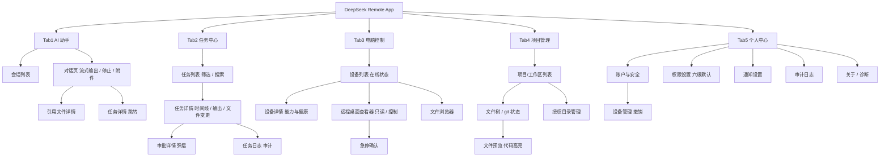
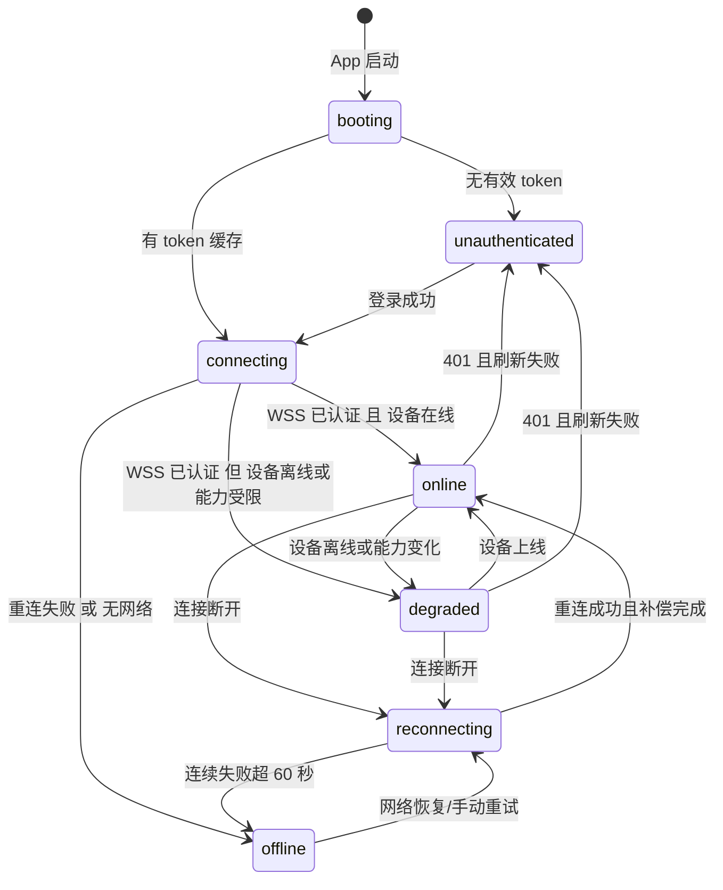
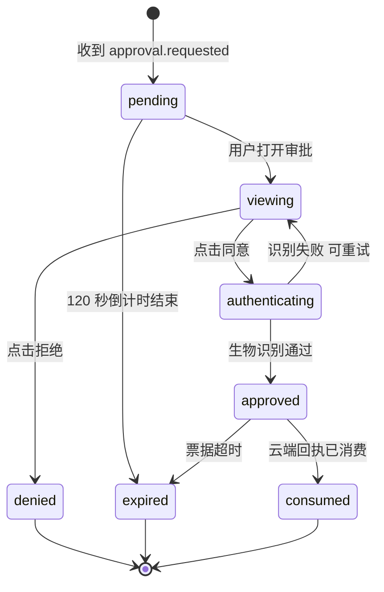
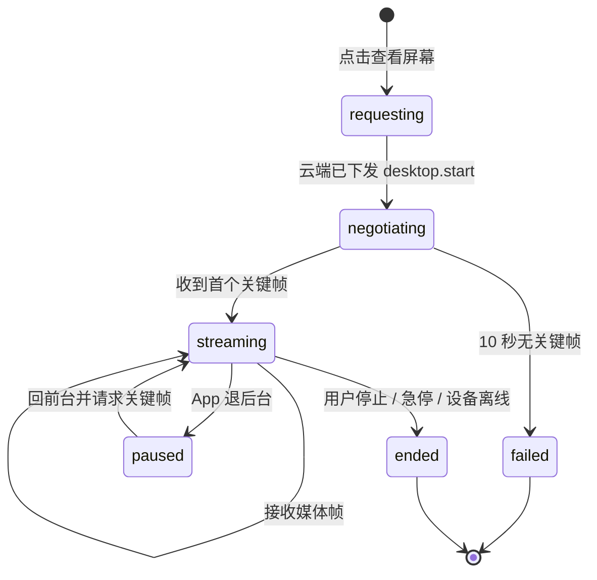

# DSRA-DESIGN-004 · 手机端 App 设计

| 项 | 内容 |
| --- | --- |
| 文档编号 | DSRA-DESIGN-004 |
| 版本 | v1.0 |
| 日期 | 2026-10-31 |
| 作者 | protocol-architect（Team Lead: lead） |
| 相关文档 | [PROTOCOL](./PROTOCOL.md)（DSRA-DESIGN-001）、[DATA_MODEL](./DATA_MODEL.md)（002）、[REMOTE_AGENT](./REMOTE_AGENT.md)（003）、[MVP_AND_ROADMAP](./MVP_AND_ROADMAP.md）（005） |
| 状态 | 评审稿（依赖 Harness 能力的入口按能力矩阵动态显隐） |
| 适用版本 | App 1.0.x；协议 `dsremote.v1` |

> 本文的目标：让 Flutter 工程师拿到它就能开始搭页面、接协议、写状态机，不需要再猜「这个状态显示什么」「按钮什么时候出现」。
> **UI 的第一原则是诚实**：不确定的状态不装确定，不支持的能力不显示假按钮。

---

## 0. 结论先行

1. **五个 Tab 严格按策划案 2.1 顺序**：AI 助手（首屏）、任务中心、电脑控制、项目管理、个人中心；Tab 切换保留各自导航栈与滚动位置。
2. **首页 = 「一句话能干活」**：顶部全局状态条（设备/连接/待审批）、中部输入框（默认设备 + 工作区）、底部最近任务与待办；**待审批置顶**，不能藏在二级页。
3. **状态管理选 Riverpod（`flutter_riverpod` + `riverpod_annotation` 代码生成），不用 Bloc**（ADR-UI-001）。理由：异步数据（`AsyncValue`）、可组合性、编译期安全、跨 Tab 共享连接状态天然合适；Bloc 的事件/状态样板在「大量实时流 + 局部刷新」场景收益低。
4. **路由用 `go_router`**（深链：通知点开直接到审批/任务详情）。
5. **实时数据两层**：WebSocket 事件流（Riverpod `StreamProvider`）驱动 UI，REST 只做首屏、历史分页与兜底刷新；本地 `drift`（SQLite）持久化会话/任务游标，冷启动先显示缓存再校正。
6. **能力门控（capability gating）**：所有依赖 Harness 能力的按钮（取消、继续、实时输出、文件变更）都由 `device.capabilities` 决定是否渲染，不猜版本、不显示假按钮。
7. **审批是产品差异点**：底部抽屉 + 风险摘要 + 倒计时环 + 系统生物识别；高风险操作双因子（生物识别 + App PIN），拒绝/超时都有明确结果页。
8. **紧急停止常驻可达**：「电脑控制」页与任务详情页有红色 Slide-to-Stop；触发后全局红色状态，直到电脑本地恢复，期间不显示「重试」误导。
9. **状态诚实**：7 个任务状态各有唯一文案与颜色；「已取消但进程可能仍在运行」必须显式提示；进度无可信来源时标注「估算」。
10. **离线可读、不可写**：断网时任务/消息从本地缓存只读展示，顶部黄色横幅「离线，操作将在恢复后可用」；**不排队用户指令**（避免用户以为已执行）。

---

## 1. 设计原则

| 原则 | 含义 | 落地 |
| --- | --- | --- |
| 一眼看清 | 打开 App 3 秒内知道：电脑在不在、有没有任务在跑、有没有事等我确认 | 首页状态条 + 待审批置顶 |
| 状态诚实 | 不确定的不装确定；不可用的不显示假按钮 | 能力门控、估算标注、「可能仍在运行」提示 |
| 一句话能干活 | 输入即任务，不强迫用户先选一堆参数 | 默认设备/工作区 + 智能回填 |
| 安全可见 | 高风险操作、远程桌面、屏幕共享都有持续可见的指示 | 顶部常驻状态条、红色录制指示 |
| 弱网优先 | 家庭网络/移动网络都可能差 | 本地缓存、重连补偿、增量渲染、骨架屏 |

---

## 2. 信息架构

### 2.1 页面树



### 2.2 五个 Tab 定义

| Tab | 核心问题 | 首屏必须出现 | 主要数据源 |
| --- | --- | --- | --- |
| AI 助手 | 「我现在想让它干活」 | 输入框、默认设备、最近会话 | `POST /api/tasks`、WS `task.output`、`session.message` |
| 任务中心 | 「任务都怎么样了」 | 进行中任务、**待我确认**、失败任务 | `GET /api/tasks`、WS `task.*`、`approval.*` |
| 电脑控制 | 「电脑现在什么样」 | 设备在线状态、桌面入口、急停 | `GET /api/devices`、WS `device.*`/`desktop.*` |
| 项目管理 | 「项目文件/进度怎么样」 | 工作区列表、最近变更 | `GET /api/workspaces`、`GET /api/workspaces/files` |
| 个人中心 | 「账号与安全设置」 | 账户、安全状态、通知 | `GET /api/auth/me`、`/api/devices`、`/api/users/settings` |

### 2.3 全局导航规则

1. Tab 各自保留导航栈（`StatefulShellRoute`），从通知进入详情后返回回到原 Tab；
2. 深链：`dsremote://task/{taskId}`、`dsremote://approval/{approvalId}`、`dsremote://device/{deviceId}`；
3. **待审批全局可达**：任意页面顶部状态条出现「1 项待确认」红点，点击直达审批；
4. 未登录/未配对：只显示「登录 → 配对」引导页，不显示空 Tab。

---

## 3. 首页信息层级（AI 助手 Tab）

### 3.1 层级定义

| 层级 | 内容 | 说明 |
| --- | --- | --- |
| L0 全局状态条（常驻顶部） | 设备名 + 在线点 + 待审批数 + 离线横幅 | 高 40dp，任何滚动都可见（`SliverAppBar` pinned） |
| L1 主行动区 | 输入框「告诉电脑要做什么」+ 发送按钮 | 首屏最大视觉权重；空状态时展示 3 个示例指令 |
| L2 目标选择 | 设备选择器（多设备时）+ 工作区选择器 | 默认上次使用的组合，记住用户选择 |
| L3 最近任务/会话 | 最多 3 条，带状态徽标 | 点击进入对话/任务详情 |
| L4 待办（如有） | 待审批卡片、失败任务重试卡片 | **置顶于 L1 之上**，处理完自动消失 |

### 3.2 首页线框（文字版）

```
┌─────────────────────────────────────────┐
│ ● 书房的电脑 · 在线      ⚠ 1 项待确认  │ ← L0 全局状态条
├─────────────────────────────────────────┤
│ ⚠ 任务「清理构建产物」等待你确认   [去确认] │ ← L4 待办（置顶）
├─────────────────────────────────────────┤
│                                         │
│   告诉电脑要做什么…                     │ ← L1 输入框
│   [工作区: proj-a ▾]        [➤ 发送]    │ ← L2 目标选择
│                                         │
│   示例：帮我跑一遍测试                  │
│         把登录改成 JWT                  │
│         看看 dist 目录多大              │
│                                         │
├─────────────────────────────────────────┤
│ 最近任务                                 │ ← L3
│ ● 已定位登录逻辑…            执行中 42%  │
│ ✓ 补充单元测试                已完成    │
│ ✕ 修改配置文件                已失败    │
└─────────────────────────────────────────┘
```

### 3.3 状态条规则（策划案第八章要求）

| 状态 | 视觉 | 文案 | 可操作 |
| --- | --- | --- | --- |
| 连接中 | 灰色脉冲点 | 「正在连接云服务…」 | 无（3 秒后显示重试） |
| 在线 | 绿色点 | 「书房的电脑 · 在线」 | 可发指令 |
| 设备离线 | 黄色点 + 横幅 | 「电脑离线，指令将在上线后送达」 | **可发**（进队列，明确提示） |
| 降级（能力受限） | 橙色点 + 横幅 | 「当前接入方式能力受限，部分功能不可用」 | 显示能力说明 |
| 已急停 | 红色点 + 红色横幅 | 「远程控制已停止，请在电脑本地恢复」 | 只读 |
| 未配对 | — | 引导页「先配对一台电脑」 | 去配对 |

> 「离线可发指令」是刻意的：PROTOCOL 的 `device_commands` 支持离线排队，用户发完就能走；但如果离线超过 90 秒，
> 任务状态是「等待执行」而非「执行中」，UI 必须区分。

---

## 4. 关键状态机

### 4.1 全局连接状态机



- `reconnecting` 时顶部显示「正在重新连接…」，**不阻塞**用户浏览缓存内容；
- 离线超过 60 秒才切 `offline`（避免电梯/地铁短暂断网造成 UI 抖动）。

### 4.2 任务状态 → UI 映射（7 态，严格一一对应）

| `task_status` | 中文文案 | 颜色 | 图标 | 可操作 |
| --- | --- | --- | --- | --- |
| `queued`（等待执行） | 等待执行 | 灰 `neutral` | 时钟 | 取消 |
| `running`（正在执行） | 执行中 · {进度}% | 蓝 `primary` | 旋转 | 取消、查看实时输出 |
| `waiting_approval`（等待用户授权） | **等待你的确认** | 橙 `warning` | 盾牌 | 去确认、拒绝 |
| `paused`（暂停中） | 已暂停 | 灰蓝 | 暂停 | 恢复、取消（能力支持时） |
| `completed`（已完成） | 已完成 · {耗时} | 绿 `success` | 对勾 | 查看结果、继续对话、重试 |
| `failed`（执行失败） | 执行失败：{原因} | 红 `danger` | 感叹号 | 重试、查看错误详情 |
| `cancelled`（已取消） | 已取消 | 灰 | 停止 | 重新发起 |

**特殊文案（不新增状态，只修文案）**：

- `cancelled` 且 `harnessAck=false` → 「已停止接收输出，任务进程可能仍在运行」；
- `failed` 且 `reason=device_lost` → 「电脑掉线，任务中断」；
- `failed` 且 `reason=approval_timeout` → 「确认超时，任务未执行」；
- `running` 且存在未闭环的审批（已收 `approval.requested`、未收 `approval.decided`）→ 文案「执行中 · 等待你确认」+ 盾牌角标，点击直达审批弹层。**in-flight 审批不改变 `task_status`**（任务仍是 `running`），这与任务开始前的 `waiting_approval` 是两种不同场景，UI 不得混淆（[PROTOCOL.md](./PROTOCOL.md) §8）；
- `running` 但进度来自估算 → 「执行中 · 约 40%」；有可信进度才显示精确值。

### 4.3 审批状态机（UI）



- 倒计时环显示剩余秒数（服务端时间校准，PROTOCOL §5.1）；
- 到 0 不自动关闭弹层，而是变为「已超时，操作未执行」并展示原因（避免用户以为还在等）；in-flight 场景下 Agent 会回 `cancelled`，任务随后按真实 `stopReason` 结束，UI 不显示红色失败态；
- 审批被其他设备处理时，收到 `approval.decided` 后 UI 同步为结果态。

### 4.4 桌面会话状态机



- `streaming` 期间顶部**常驻红色「正在查看/控制电脑屏幕」**指示，不可被滚动隐藏；
- `mode=view` 不显示鼠标/键盘控制层；切到 `control` 必须二次确认（首次控制还要过审批，PROTOCOL §8.4）。

---

## 5. 五个 Tab 的详细设计

### 5.1 AI 助手

**结构**：会话列表（抽屉/首屏下方）→ 对话页。

| 元素 | 规范 |
| --- | --- |
| 输入框 | 多行自适应（最多 5 行），支持语音转文字（系统能力）；发送后清空并保持键盘 |
| 设备/工作区选择 | 胶囊按钮，未选择时用默认值；对话中切换设备需新建会话 |
| 步骤级输出 | 气泡内按**事件块**追加渲染（`agent_message_chunk` 到达即追加，通常一句/一段），块尾显示「···」而非模拟逐字光标；**不做自动滚屏打断用户上滑**（用户上滑后停止跟随，显示「回到最新」按钮） |
| 停止按钮 | 生成中显示「■ 停止」；点击后发 `task.cancel`，状态变「正在停止…」直到收到 `task.cancelled`/`task.failed` |
| 附件 | 图片/文档上传走文件接口；上传中显示进度与可取消；单文件 ≤100MB |
| 引用文件 | 任务完成后的文件变更以 chip 展示，点击预览（代码高亮） |
| 错误 | 气泡下方错误条 + 「重试」；重试 = 新建任务并带上原 prompt（不覆盖原任务记录） |
| 上下文 | 会话内显示「关联设备/工作区」；跨设备继续会话时提示上下文可能不连续 |
| 历史 | 分页 `GET /api/conversations`，下拉刷新；本地缓存最近 50 条消息 |

**能力门控与诚实文案**：ACP 正常时输出为**步骤级实时**（事件块到达即追加，非逐字）；`adapter=headless` 降级时改为「阶段性输出」折叠块并标注「执行结束后一次性回传」；`cancel` 不支持时按钮文案为「停止接收输出」，并如实提示「进程可能仍在运行」。不得用假光标/打字机动画伪装逐字流式（ADR-AGENT-013 / ADR-ROAD-010）。

### 5.2 任务中心

**列表页**：

| 元素 | 规范 |
| --- | --- |
| 顶部筛选 | 「全部 / 进行中 / 待确认 / 已完成 / 失败」，默认「进行中 + 待确认」 |
| 分组 | 待确认 > 进行中 > 最近结束；待确认区永远置顶且带橙色左边条 |
| 卡片字段 | 任务名（首行截断）、状态徽标、进度条、设备名、耗时/开始时间、发起来源（对话/快捷指令/桌面操作） |
| 搜索 | 按任务名/设备名，服务端 `GET /api/tasks?search=` |
| 空状态 | 「还没有任务，去 AI 助手说一句话」+ 跳转按钮 |
| 下拉刷新 | 仅刷新 REST；实时更新由 WS 负责（不破坏滚动） |

**详情页**（信息密度最高，需分区块）：

1. **头部**：任务名、状态、设备、时间、耗时、权限级别；主操作（取消/重试/继续/去确认）；
2. **进度区**：进度条 + 当前 stage 文案 + 「估算」标注（如适用）；
3. **输出区**：流式文本 + 代码块高亮 + 「复制全部」；`stream=stdout/stderr` 折叠在「执行输出」里；未完成时随事件增量追加，完成后显示最终结果；
4. **文件变更区**：`created/modified/deleted` 列表，点击预览；若 `result.files` 为空且有 `resultNote` 则显示说明（**不伪造变更**）；
5. **时间线**：`task.created → started → progress → waiting_approval → completed`，每步带时间戳，审批步骤显示「谁在什么时间批准/拒绝」；
6. **审计与错误**：失败原因、错误码、可展开的日志（脱敏后）、审计事件列表（L4 以上操作）；
7. **底部操作栏**：取消（仅运行/排队）、重试（失败/取消）、继续对话（完成）、查看关联会话。

**能力门控**：`cancel=false` 时主按钮为「停止接收输出」并附提示；`continue=false` 时隐藏继续按钮；
`structuredResult=false` 时隐藏文件变更区（或显示「当前接入方式无法获取文件变更」）。

### 5.3 电脑控制

**设备列表**：在线/离线分组，卡片显示设备名、系统、Agent 版本、当前任务数、最近在线时间、能力徽标（受限/完整）。

**设备详情**：健康信息（PROTOCOL `device.status.probe` RPC）、能力矩阵（只读展示，解释「为什么某些按钮不可用」）、操作按钮（查看屏幕、文件浏览、急停）。

**远程桌面查看器**：

| 项 | 规范 |
| --- | --- |
| 手势 | 双指缩放、单指拖动；双击复位；摇杆/触控板模式切换（控制模式） |
| 帧率适配 | 显示实时 FPS 与网络质量；弱网自动降级并在角标提示 |
| 画质与编码 | 默认 **H.264**（实测约 1.8–3.0 Mbps，公网可用）；提供「流畅/自动/清晰」三档（目标码率 1 / 2.5 / 4 Mbps），默认「自动」；MJPEG 仅局域网/演示档（约 13.3 Mbps，公网不选，见 [ENVIRONMENT_REPORT.md](../research/ENVIRONMENT_REPORT.md) §5.4）。角标显示当前编码与码率，不显示「高清」等无依据宣传 |
| 只读/控制 | 顶部 Segmented Control；切换控制需二次确认；首次控制走审批 |
| 状态指示 | 顶部红色常驻指示「正在查看屏幕」/「正在控制电脑」，不可隐藏 |
| 急停 | 底部居中红色 Slide-to-Stop 常驻；滑动后立即发 `emergency.stop`（免审批、最高优先级） |
| 结束 | 返回键弹「结束共享」确认；结束发 `desktop.stop` |

**文件浏览器**：工作区选择 → 目录列表 → 预览（文本/图片/下载）；上传入口在项目 Tab（避免与控制页混杂）。

### 5.4 项目管理

| 区块 | 内容 |
| --- | --- |
| 工作区列表 | 名称、本地路径（脱敏显示末两级）、是否 git、当前分支、最近任务数 |
| 文件树 | 懒加载目录，支持按名称过滤；文件图标区分类型；git 状态角标（M/A/D） |
| 文件预览 | 文本/代码高亮（≤2MB）、图片、二进制显示「仅下载」 |
| 授权目录管理 | 查看/新增/删除 `workspace_permissions`；新增需电脑端确认（安全设计：手机不能单方面扩大权限）——**待产品确认**，默认实现为「手机发起申请，电脑端弹窗授权」 |
| 项目任务 | 该工作区最近任务列表，点击跳任务详情 |

> 授权目录**不允许手机单方面新增**：否则手机丢失 = 攻击者可以把 `C:\` 加入白名单。这条是安全底线，写进验收。

### 5.5 个人中心

| 分组 | 项 |
| --- | --- |
| 账户 | 头像/昵称、邮箱/手机号（脱敏）、退出登录 |
| 安全 | 修改密码、两步验证开关、登录设备管理（手机端会话列表，可踢出）、**App PIN 设置**（高风险审批双因子用） |
| 设备管理 | 已配对电脑列表（在线状态、最近活跃）、撤销授权（需二次确认 + 输入「撤销」） |
| 权限设置 | 六级权限默认值（L1–L6 说明）、「每个新目录都需授权」开关、自动停止高风险输出开关 |
| 通知 | 审批通知、任务完成通知、设备上下线通知；免打扰时段 |
| 审计日志 | 分页查看（时间、动作、设备、结果、IP 脱敏） |
| 关于 | 版本、协议版本、诊断包导出、隐私政策、开源许可 |
| 配对新设备 | 扫码入口（二维码扫描页） |

---

## 6. 关键交互深入

### 6.1 审批弹层（Bottom Sheet）

```
┌───────────────────────────────────┐
│  ⚠ 高风险操作需要你确认        ✕ │
│                                   │
│  删除文件                          │
│  将删除目录 D:\work\proj-a\dist   │
│  （共 1,284 个文件）               │
│                                   │
│  任务：清理构建产物                │
│  设备：书房的电脑                  │
│                                   │
│       ⏱ 剩余 01:32               │
│                                   │
│  [拒绝]        [生物识别并同意]    │
└───────────────────────────────────┘
```

规则：

1. **必须先展示再验证**：`actionSummary` 是 Agent 生成的一句话 + 结构化 `payload`（目标路径、命令、数量），不允许只显示「是否同意？」；
2. **两种来源都要支持**：`source=acp_permission`（in-flight，执行中拦截，**此时电脑上动作尚未发生**）与 `source=preflight_rule`（任务开始前拦截），UI 在标题处标注「执行中确认 / 开始前确认」，但确认流程与按钮一致（[PROTOCOL.md](./PROTOCOL.md) §8）；
3. **生物识别**：`local_auth` 拉起系统验证；高风险（critical）**额外要求 App PIN**（REMOTE_AGENT §6.4 的信任边界）；
4. **倒计时**：120 秒（服务端时间），剩余 ≤30 秒变红；到 0 显示「已超时，操作未执行」并关闭（in-flight 时 Agent 回 `cancelled`，任务按真实 `stopReason` 上报）；
5. **没有「永久允许」**：ACP 只提供 `allow_once` / `reject_once` 两个选项，因此界面**只有「允许本次」「拒绝」两个按钮**，不得出现「本任务内不再询问 / 记住选择」；
6. **拒绝**：直接 `POST /api/approvals/{id}/decide {decision:"deny"}`，危险动作不执行；任务**不得被伪造成 `failed`**——按 Agent 上报的真实 stopReason 展示（通常是正常结束，提示「你拒绝了该操作」）；
7. **并发**：多设备同时审批时，先到先得；后到的收到「已被其他设备处理」并关闭。

### 6.2 紧急停止

| 项 | 规范 |
| --- | --- |
| 位置 | 电脑控制页底部常驻 + 桌面查看器内 + 任务详情页（运行中任务）|
| 交互 | **Slide-to-Stop**（滑动 3 秒或滑过 80% 才触发），避免误触；不使用单点按钮 |
| 文案 | 「立即停止这台电脑的所有远程操作」 |
| 反馈 | 成功：全屏红色状态页 + 触觉反馈 + 「已停止，请在电脑本地恢复」；失败（断网）：提示「指令未送达，请在电脑端按 Ctrl+Alt+Shift+F12」 |
| 之后 | 全局顶部红色横幅常驻；禁用所有发指令入口；不显示「重试」 |
| 恢复 | **App 无恢复入口**（安全设计），只能电脑本地解除；解除后横幅自动消失（收到 `device.capabilities_updated`/重新在线） |

### 6.3 其他关键交互

| 场景 | 规范 |
| --- | --- |
| 取消任务 | 二次确认（「任务将停止，已产生的输出会保留」）→ 乐观显示「正在停止…」→ 以 `task.cancelled` 为准；ACP 原生取消成功时文案「已原生取消」，超时杀进程时按 `CancelResult` 如实显示 |
| 重试任务 | 复用原 prompt/工作区新建任务，**新任务 ID**，详情页显示「由任务 xxx 重试」 |
| 离线发指令 | 允许发送但明确提示「电脑离线，上线后执行」；任务状态先 `queued` |
| 长文本 | 代码块可横向滚动 + 复制；超长输出折叠「展开全部」 |
| 通知点击 | 审批通知直达审批弹层；完成通知直达任务详情；冷启动时由 deep link 恢复 |

---

## 7. 组件库与目录结构

### 7.1 复用组件清单

| 组件 | 用途 | 关键 props |
| --- | --- | --- |
| `GlobalStatusBar` | 顶部全局状态条 | `connectionState`, `device`, `pendingApprovals`, `estop` |
| `TaskStatusBadge` | 7 态徽标 | `status`, `harnessAck`, `reason`, `estimated` |
| `TaskCard` | 任务卡片 | `task`, `onTap`, `onCancel` |
| `ProgressRing`/`ProgressBar` | 进度（估算标注） | `value`, `estimated`, `stage` |
| `ApprovalSheet` | 审批弹层 | `approval`, `onDecide` |
| `DeviceCard` | 设备卡片 | `device`, `online`, `capabilities` |
| `CapabilityGate` | 能力门控包装器 | `capability`, `child`, `fallback` |
| `StreamingText` | 流式文本渲染 | `text`, `isStreaming`, `onFollowLatest` |
| `EmptyState` / `ErrorState` | 空态/错误态 | `icon`, `title`, `action` |
| `EstopSlider` | 滑动急停 | `onConfirm`, `disabled` |
| `ConnectionBanner` | 离线/重连/降级横幅 | `state`, `retry` |
| `CodeBlock` | 代码高亮 + 复制 | `code`, `language` |
| `AuditTimeline` | 审批/审计时间线 | `events` |

### 7.2 目录结构（Flutter）

```
mobile/
├─ pubspec.yaml
├─ lib/
│  ├─ main.dart                     # ProviderScope + go_router + 启动引导
│  ├─ app/
│  │  ├─ router.dart                # go_router 路由表 + 深链
│  │  ├─ theme/                     # 设计令牌（颜色/字体/间距/暗色）
│  │  └─ bootstrap.dart             # 启动：读缓存 token → 建连 → 拉首屏
│  ├─ core/
│  │  ├─ api/                       # dio 客户端 + 拦截器（auth/重试/traceId）
│  │  ├─ ws/                        # WebSocket 客户端：心跳/重连/seq/ack/去重
│  │  ├─ storage/                   # drift 数据库 + 安全存储（flutter_secure_storage）
│  │  ├─ models/                    # freezed 数据模型 + json_serializable
│  │  └─ utils/                     # 时间/格式化/脱敏/能力判断
│  ├─ features/
│  │  ├─ auth/                      # 登录/注册/刷新
│  │  ├─ pairing/                   # 扫码配对
│  │  ├─ chat/                      # AI 助手
│  │  ├─ tasks/                     # 任务中心
│  │  ├─ devices/                   # 电脑控制 + 远程桌面
│  │  ├─ projects/                  # 项目管理
│  │  ├─ profile/                   # 个人中心
│  │  └─ approvals/                 # 审批
│  └─ shared/
│     ├─ widgets/                   # §7.1 复用组件
│     └─ l10n/                      # 中英文文案
└─ test/
   ├─ unit/                         # 状态机、去重、能力门控
   ├─ widget/                       # 关键组件金样测试
   └─ integration/                  # 假后端端到端
```

**分层约定**：`features/*/` 内部分 `data/`（repository）→ `domain/`（model/状态机）→ `presentation/`（widget/provider）；
跨 feature 只允许通过 `core/` 与 `shared/` 复用，禁止 feature 互相 import。

---

## 8. 状态管理 ADR：Riverpod（ADR-UI-001）

**决策**：`flutter_riverpod` + `riverpod_annotation` 代码生成；数据模型 `freezed`；路由 `go_router`。

**对比**：

| 维度 | Riverpod（选中） | Bloc | GetX | Provider（旧） |
| --- | --- | --- | --- | --- |
| 异步数据建模 | `AsyncValue` 原生支持 loading/error/data | 需自行封装状态类 | 弱 | 无 |
| 编译期安全 | Provider 类型由生成器保证，不依赖 BuildContext | 较好，但样板多 | 弱（字符串键/动态） | 弱 |
| 实时流接入 | `StreamProvider` 与 WS 事件流天然契合 | 需 `emit` 转状态 | 一般 | 一般 |
| 样板代码量 | 低（代码生成） | 高（Event/State/Bloc 三件套） | 低 | 中 |
| 测试性 | ProviderContainer 可独立测试 | blocTest 成熟 | 差 | 差 |
| 跨 Tab 共享 | 全局 Provider 简单 | 需全局 Bloc | 简单但隐式 | 需嵌套 |
| 团队上手成本 | 中（需理解 provider 生命周期） | 中高 | 低但易乱 | 低 |
| 社区与生态（2026） | 主流 | 主流 | 下滑 | 维护模式 |

**结论理由**：

1. 本 App 的核心复杂度是**「大量服务端实时事件 + 本地缓存 + 连接状态」**，Riverpod 的 `StreamProvider`/`AsyncNotifier` 与这个模型最贴合；Bloc 的 event→state 单向流在「同一事件要更新 5 个页面局部」时会退化成大量重复事件类。
2. 需要**跨 Tab 共享**连接状态、设备列表、待审批数；Riverpod 的全局 provider 组合比全局 Bloc 更直接。
3. 代码生成（`riverpod_generator`）把样板压到最低，评审时看到的是业务逻辑而不是框架代码。
4. Bloc 不是不能用——若团队已有强 Bloc 规范，可在 `presentation/` 层替换而不影响 `data/`/`domain/` 分层；但**一个项目只能选一种**，不允许混用。

**后果**：需要约定 provider 命名与作用域（页面级 autoDispose，全局 keepAlive）；WS 事件 → provider 的桥接只允许一个入口（`wsEventProvider`），避免多处订阅导致重复处理。

---

## 9. 网络、缓存与离线

| 项 | 方案 |
| --- | --- |
| HTTP | `dio` + 拦截器：注入 JWT、401 自动 refresh（单飞 + 失败跳登录）、`traceId` 透传、错误码 → 用户文案映射 |
| WS | 自研 `WsClient`：首帧 `sys.auth`（带 resume 游标）、25 秒心跳、指数退避重连、`msgId` 去重 LRU 1000、`seq` 空洞缓冲 3s/50 条、`sys.ack` 累计确认（与 PROTOCOL §5 一致） |
| 本地库 | `drift`：`conversations`、`messages`、`tasks`、`device_cursor`、`approvals_cache`；冷启动先渲染缓存再后台校正 |
| 游标 | `device_cursor(deviceId, lastSeq, updatedAt)` 持久化，App 重启可续传 |
| 图片/文件 | 缩略图缓存 + LRU；大文件走预签名 URL 下载（断点续传） |
| 离线 | 只读浏览缓存内容；写操作**不排队**，明确提示「离线，操作将在恢复后可用」；仅「发任务」允许入队（服务端 `device_commands`）|
| 弱网 | 请求超时 10s、重试 2 次（幂等请求）；流式输出 UI 节流 100ms 合并渲染 |

---

## 10. 设计系统

| 项 | 规范 |
| --- | --- |
| 色彩 | 语义色：`primary`（DeepSeek 蓝）、`success`、`warning`（审批橙）、`danger`（急停红）、`neutral`；支持亮/暗主题，对比度 ≥ WCAG AA |
| 字体 | 系统字体优先（中文思源黑体回退）；正文 15sp、辅助 13sp、标题 18/22sp；代码用等宽 |
| 间距 | 4/8/12/16/24/32 栅格 |
| 圆角 | 卡片 12dp、弹层 20dp、按钮 10dp |
| 触达 | 最小点击区域 48×48dp |
| 动效 | 状态切换 150–250ms；流式光标闪烁；尊重系统「减少动态效果」 |
| 图标 | Material Symbols 统一风格；状态色与图标双编码（色盲友好） |
| 无障碍 | 语义标签、屏幕阅读器顺序、动态字体支持 |
| 国际化 | 中文为默认，预留英文（l10n arb 文件） |

---

## 11. 通知与推送

| 通知类型 | 触发 | 点击去向 | 优先级 |
| --- | --- | --- | --- |
| 待审批 | `approval.requested` | 审批弹层 | 高（可响铃/震动，可绕过免打扰） |
| 任务完成/失败 | `task.completed`/`task.failed` | 任务详情 | 中 |
| 设备上线/离线 | `device.online`/`offline` | 设备详情 | 低 |
| 急停 | `device.emergency_stopped` | 设备详情 | 高 |
| 安全告警 | 新设备登录/撤销 | 安全设置 | 高 |

- 推送通道：FCM（Android）/ APNs（iOS），服务端在用户离线或 App 后台时推送；App 前台时用本地通知（避免重复）；
- 通知内容**不含敏感信息**（不显示 prompt 全文、不显示文件路径细节）；
- 免打扰时段内仅审批与安全告警穿透。

---

## 12. 性能目标

| 指标 | 目标 |
| --- | --- |
| 冷启动到可交互 | ≤2.0s（中端机） |
| 首页首屏（有缓存） | ≤500ms |
| 流式渲染 | 100ms 合并一次，丢帧不影响正确性 |
| 任务列表 1000 条 | 流畅滚动（虚拟化） |
| WS 重连补偿 500 条事件 | ≤2s 应用完（批量 insert + 单次刷新） |
| 内存 | 常规 ≤250MB |
| 电量 | 后台不保持 WS（系统允许时用推送唤醒）；前台桌面查看器按需降帧 |

---

## 13. 错误与空状态清单

| 场景 | 展示 |
| --- | --- |
| 无网络 | 顶部黄色横幅「网络不可用」+ 重试 |
| WS 连接中 | 顶部灰色「正在连接…」 |
| 设备离线 | 顶部黄色「电脑离线」+ 任务可入队提示 |
| 能力受限 | 顶部橙色 + 能力说明入口 |
| 401 且刷新失败 | 跳登录页，提示「登录已过期」 |
| 403 权限不足 | 弹层「需要更高权限」+ 去设置 |
| 404 任务/设备不存在 | 空态「已被删除或撤销」+ 返回列表 |
| 409 状态冲突 | 刷新详情，提示「状态已变化」 |
| 429 限流 | 提示「操作过于频繁」+ 倒计时 |
| 500/502 | 「服务暂时不可用」+ 重试；上报 traceId |
| 空任务列表 | 引导去 AI 助手 |
| 空工作区 | 「请先在电脑上添加工作区」 |
| 审批超时 | 结果页「确认超时，任务已取消」 |
| 急停后 | 全屏红色状态 + 本地恢复指引 |

---

## 14. 验收自检（对应策划案第八章与第十章）

| 验收点 | 本文落点 |
| --- | --- |
| 五页结构与导航 | §2 |
| 首页信息层级清楚 | §3 |
| 连接中/离线/等待授权/执行中/失败 状态展示 | §3.3、§4.1、§4.2 |
| 任务状态与进度可视化 | §4.2、§5.2 |
| 高风险操作手机端确认 | §6.1 |
| 紧急停止可见可达 | §6.2 |
| 远程桌面只读/控制区分 | §5.3、§4.4 |
| 不展示伪造结果 | §4.2 特殊文案、§5.2 文件变更区 |
| 断网可继续查看 | §9 |
| 弱网可用 | §9、§12 |

---

## 15. 待验证与依赖

| 项 | 影响 | 处理 |
| --- | --- | --- |
| Harness 能力矩阵（H-01..H-14，见 REMOTE_AGENT §11） | 取消/继续/步骤级实时/文件变更按钮的显隐 | 已实测确认大部分能力；全部由 `device.capabilities` 运行时决定，UI 不硬编码、不显示假按钮 |
| 审批为 in-flight 时的 UX 落差 | 用户可能误以为「任务已失败」 | 拒绝后按真实 stopReason 展示「操作被拒绝，任务已结束」，文案见 §6.1 规则 6；不得显示红色失败态 |
| ACP 输出为步骤级（非逐字） | 对话「流式」观感 | UI 用事件块追加 + 「···」占位，不做打字机动画（ADR-AGENT-013 / ADR-ROAD-010） |
| 推送到达率（国内 Android 无 GMS） | 审批通知及时性 | 兜底：App 前台时用 WS；离线通知依赖厂商通道（P1 评估） |
| `local_auth` 在部分 Android 机型兼容性 | 审批双因子 | 降级为 App PIN；无 PIN 则拒绝高风险审批 |
| 远程桌面输入注入（P2） | 控制模式 | MVP 只读；控制模式待 Agent 原生输入实现 |
| 远程桌面编码与带宽（H-09） | 查看器的默认画质与降级策略 | Windows 已实测：H.264 约 1.8–3.0 Mbps、MJPEG 约 13.3 Mbps 公网不可接受 → 默认 H.264「自动」档，MJPEG 仅局域网演示（[ENVIRONMENT_REPORT.md](../research/ENVIRONMENT_REPORT.md) §5.4） |
| 手机端新增授权目录 | §5.4 | 默认「电脑端确认」，待产品确认 |

---

## 16. ADR 索引

| ADR | 决策 | 理由 | 替代方案与代价 |
| --- | --- | --- | --- |
| ADR-UI-001 | Riverpod + go_router + freezed | 实时流/异步数据契合、跨 Tab 共享、样板少 | Bloc：样板多但规范强；GetX：隐式依赖难测 |
| ADR-UI-002 | WS 事件驱动 + REST 兜底 | 实时性与正确性分离，断网可补偿 | 纯轮询：延迟高、耗电；纯 WS：首屏慢 |
| ADR-UI-003 | 本地缓存先行（drift） | 弱网体验与冷启动速度 | 无缓存：每次白屏等网络 |
| ADR-UI-004 | 能力门控渲染 | 不显示假按钮、不猜版本 | 版本号判断：Harness 更新即失效 |
| ADR-UI-005 | 审批双因子（生物识别 + PIN） | 手机是信任边界，降低被盗用风险 | 仅生物识别：被胁迫/被解锁时无第二道 |
| ADR-UI-006 | 急停 Slide-to-Stop，无恢复入口 | 防误触、防手机端被冒充恢复 | 单点按钮：误触概率高；App 恢复：违背本地权威 |

---

## 17. 变更记录

| 版本 | 日期 | 变更 | 作者 |
| --- | --- | --- | --- |
| 1.0 | 2026-10-31 | 初版：五 Tab 信息架构、首页层级、状态机、Riverpod ADR、审批/急停交互、组件库与目录结构 | protocol-architect |
| 1.1 | 2026-10-31 | 依据 HARNESS_INTERFACES 实测（ACP 路线 ✅）：§5.1 输出改「步骤级实时」并加降级文案；§6.1 审批改为 in-flight/pre-flight 双来源、删除「记住选择」（ACP 无 allow_always）、拒绝不伪造失败；§6.3 取消文案按 `CancelResult`；§15 补充审批 UX 与步骤级措辞两项 | protocol-architect |
| 1.2 | 2026-10-31 | 依据 ENVIRONMENT_REPORT §5.4 实测：远程桌面查看器 §5.3 增「画质与编码」行（默认 H.264、三档码率、MJPEG 仅局域网演示）；§15 增编码带宽待验证行 | protocol-architect |

