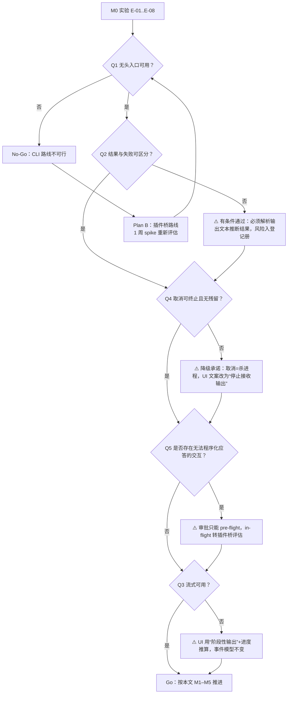
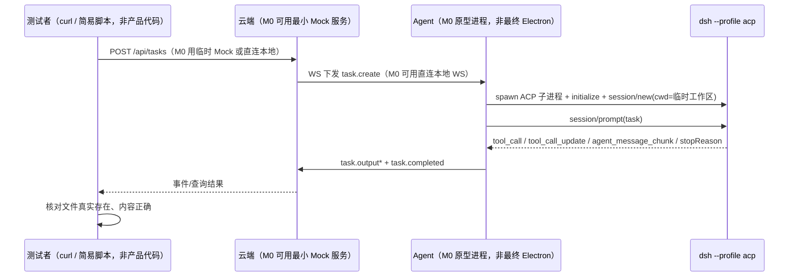
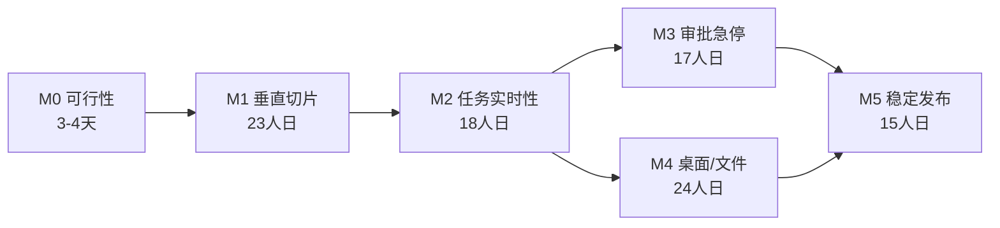

# MVP 与开发路线图

> 文档编号：DSRA-DESIGN-005  
> 版本：v1.2　日期：2026-10-31　作者：protocol-architect  
> 状态：设计基线（待 Lead 拍板 §14 的分歧点）  
> 事实来源：[HARNESS_INTERFACES.md](../research/HARNESS_INTERFACES.md)（2026-10-31 实测，M0 结论已出：ACP 路线 ✅）· [ENVIRONMENT_REPORT.md](../research/ENVIRONMENT_REPORT.md)（2026-10-31 本机环境调查，含桌面采集带宽实测与工具链缺口）  
> 关联：[PROTOCOL.md](./PROTOCOL.md)（协议）· [DATA_MODEL.md](./DATA_MODEL.md)（数据模型）· [REMOTE_AGENT.md](./REMOTE_AGENT.md)（电脑端 Agent）· [MOBILE_UI.md](./MOBILE_UI.md)（手机端 UI）

---

## 0. 结论先行

1. **路线图不是「先做 UI → 再做后端 → 最后接 Harness」，而是以 Harness 可行性为第一优先级**：`M0` 原本用 3 人日把「`dsh` 能否被程序可靠驱动」验证清楚，其余所有里程碑的承诺（实时输出、取消、审批、多轮）都挂在它的结论上（ADR-ROAD-001、ADR-ROAD-002）。**该验证已在 2026-10-31 由 `harness-scout` 在开工前完成**：`dsh --profile acp`（Agent Client Protocol over stdio）实测闭环，结论见 [HARNESS_INTERFACES.md](../research/HARNESS_INTERFACES.md)。因此 M0 在本文中的角色从「未知验证」变为「**固化 + 回归探针**」——把一次性实测变成 CI 里的契约测试。
2. **M0 仍是一道 Go/No-Go 闸门，只是这次已提前通过**：闸门结论 = **Go，接入路线选 ACP**（`dsh --profile acp`）；headless CLI 作为降级路线，Cordis 插件桥降为 P3（仅在官方移除 ACP 或需要附着桌面 live 会话时评估）。闸门机制保留：**每次 DSH 版本升级后重跑 M0 探针（§3.6），不通过则按同一决策树降级，不允许把不确定性藏到后面**。
3. **里程碑按垂直切片组织**：每个 `M*` 结束时都必须是「手机 → 云端 → 电脑 → Harness → 回传」的端到端可演示闭环，禁止「后端做完再联调」的水平分层（ADR-ROAD-003）。
4. **MVP 的「最小」定义**：登录 + 配对 + 一台电脑在线 + 发送真实任务并看到真实输出 + 任务历史 + 取消 + 断网恢复。**不含**远程桌面、文件传输、审批弹层（这些是 M3/M4 的增量），因为它们的成本远高于核心价值。
5. **审批的落地时间被刻意压在 M3**：M1/M2 只允许执行 L1–L2 低风险任务（读状态、只读查询、限定目录内的低风险命令），从流程上绕开「审批尚未实现」的问题；不安全地跳过审批是禁止的（ADR-ROAD-004）。**M0 已证明 in-flight 审批可行**（ACP `session/request_permission`，allow-once 后工具才执行），因此 M3 直接按「in-flight 主路线 + pre-flight 兜底」实现（ADR-ROAD-008 v1.1）。
6. **远程桌面（屏幕查看→控制）放在 M4、且默认 P2**：它是策划案的亮点但不是核心闭环；屏幕采集与输入注入的工程风险（权限、弱网、延迟）最高，先保证任务链路稳定（ADR-ROAD-005）。
7. **总工作量估算 84 人日（含 20% buffer ≈ 101 人日）**：3 人全职（1 后端 + 1 Agent + 1 Flutter），关键路径约 9–10 周；2 人（后端与 Agent 合并）约 15–16 周。
8. **每个里程碑都带「回滚/降级」**：能力探测失败即降级 UI 与功能（与 [REMOTE_AGENT.md](./REMOTE_AGENT.md) §4 的能力矩阵同一套开关），不允许出现「功能在但用不了」。
9. **验收以真实证据为准**：策划案第十章 18 条验收项全部映射到里程碑（§11），每条必须有真实测试记录（截图/日志/录屏/退出码），Mock 只能用于开发阶段。
10. **待确认项集中在 §14**：审批承诺口径（in-flight 已证实，建议直接承诺、headless 降级时明示）、Electron 取舍、ffmpeg 桌面采集（含 H.264 编码）、Riverpod、手机新增授权目录、MVP 白名单任务——这 6 条需要 Lead 拍板后本文才算冻结。
11. **环境就绪度已由 `env-scout` 实测**（[ENVIRONMENT_REPORT.md](../research/ENVIRONMENT_REPORT.md)）：Java 21 + Gradle、Node 24、Android SDK/模拟器、NSIS、Windows ffmpeg 采集编码链**已具备**，M1 编码可立即开工；**硬缺口是 Flutter SDK**（1.81GB，约 0.5–1 天安装）、PostgreSQL（本地未装，阻塞后端联调 0.5–1 天）以及发布/联调所需的外部项（云服务器+域名+TLS、代码签名证书、公网出口）。这些是**日历风险而非技术风险**，前置条件与排期影响见 §9.4 与 §12 R13–R15。

---

## 1. 路线图总览

| 里程碑 | 主题 | 策划案第九章映射 | 核心产出 | 人日（含 buffer） | 前置依赖 |
| --- | --- | --- | --- | --- | --- |
| **M0** | Harness 可行性验证（**结论已出，剩余固化**） | 第一阶段 | `HARNESS_INTERFACES.md` 定稿（已完成）+ ACP 契约测试 / CI 探针 + 最小链路固化 | 3（4） | 无 |
| **M1** | 骨架与端到端垂直切片 | 第二 + 三 + 四阶段（部分） | 登录、配对、Agent 在线、单任务真实执行回传（L1–L2） | 19（23） | M0 Go（已通过） |
| **M2** | 任务中心与实时性 | 第三 + 四 + 五阶段（部分） | 7 状态、**步骤级实时输出**、历史、取消、断网恢复、审计雏形 | 15（18） | M1 |
| **M3** | 权限、审批与急停 | 第三 + 四 + 五阶段（安全） | 六级权限、审批弹层、**in-flight 审批（ACP permission）+ pre-flight 兜底**、急停、审计完整 | 14（17） | M2 |
| **M4** | 远程桌面 / 文件 / 项目管理 | 第五 + 六阶段 | 屏幕查看（**H.264 over WSS**，MJPEG 仅局域网降级）、只读控制申请、文件浏览与传输、工作区授权 | 20（24） | M2（可与 M3 并行） |
| **M5** | 稳定性、发布与文档 | 第七 + 八阶段 | 弱网/断网/压力测试、打包发布、部署文档、灰度 | 13（15） | M3 + M4 |
| 合计 | | | | **84（101）** | |

时间假设（3 人全职：后端 / Agent / Flutter，QA 兼职 0.5）：

```
M0   第 1 周            （后端 + Agent 各 1.5 天，串行验证）
M1   第 2–4 周          （三方并行，第 4 周末端到端 demo）
M2   第 5–6 周          （与 M1 尾部重叠 3 天）
M3   第 7–8 周          （与 M4 前段并行）
M4   第 8–10 周         （Flutter 主力 + Agent 屏幕采集）
M5   第 11–12 周        （联调、压测、发布）
```

> 若只有 2 人，把 M4 延后为 M5、发布收敛到 M5 后段，总计约 15–16 周；宁可砍远程桌面的「控制」也不砍 M3 的安全能力。

---

## 2. 为什么 M0 必须先行（ADR-ROAD-001 / 002）

### 2.1 决策

**M0 的产出是「结论」而不是「代码」**：用最多 4 人日，把以下 6 个问题变成有证据的答案（**2026-10-31 已全部回答，见最后一列**）：

| 编号 | 问题 | 为什么它决定后面所有事 | 实测结论（2026-10-31） |
| --- | --- | --- | --- |
| Q1 | `dsh` 是否存在官方的无头/非交互执行入口，能否指定 prompt 与工作目录？ | 决定 Agent 的 `chat` 能力与接入优先级第 1 条是否成立 | ✅ ACP：`dsh --profile acp`，`initialize` → `session/new(cwd)`；cwd 在 session/new 固定，进程本身零启动参数 |
| Q2 | 无头执行的结果是「一次性文本」还是可解析结构（JSON）？退出码语义是否可靠？ | 决定 `task.output`/`task.completed` 怎么建模、失败了怎么区分 | ✅ ACP 为 JSON-RPC/NDJSON，事件与 `stopReason`/`tool_call_update.status` 可判别；headless `--json` 亦可 NDJSON + 退出码 0/1 |
| Q3 | 执行过程中能否拿到**中间输出**（流式），还是只能等结束？ | 决定策划案「实时接收执行输出」能不能真做，还是只能轮询式「阶段性输出」 | ⚠️ **步骤级实时**：`agent_message_chunk` 为提交点粒度（250 字→1 chunk），不是逐字；token 级只有插件桥 B 路线，产品不承诺打字机流式 |
| Q4 | 能否取消/超时终止？终止后退出码与残留进程是否可控？ | 决定「取消任务」的语义（原生取消 vs 杀进程）与产品文案 | ✅ ACP `session/cancel` 实测 2.5s 内返回 `stopReason=cancelled`；10 秒未回由 Agent kill 整个 ACP 进程。headless 只能杀进程 |
| Q5 | 执行中是否会出现**交互式确认**（审批）？程序能否感知/应答？ | 决定审批只能 pre-flight 还是可以做 in-flight（[REMOTE_AGENT.md](./REMOTE_AGENT.md) §6） | ✅ in-flight 可行：`session/request_permission` 实测可编程应答，allow-once 后工具才执行；只有 allow_once/reject_once，**无永久允许** |
| Q6 | 多个任务并发、同一工作区同时写，行为是否可预测？ | 决定 Agent 并发模型（默认 1）是否正确、是否需要队列 | ⚠️ 单 ACP 进程可并发多 session；同 session 同时只能一个 in-flight prompt（报 `-32602`）。采用「单进程 + 每任务一 session + prompt 串行」后并发默认 2 |

### 2.2 理由

1. **不确定性集中在最上游**：DSH 的 CLI 无头模式已被 Lead 实测存在（`dsh headless "..."`），但其**输出契约、实时能力、取消语义、审批交互**曾全部未知。这些未知项每一个都会反向改写协议（事件模型）、Agent（执行引擎）、UI（状态与文案）。本次由 `harness-scout` 在写设计文档的同时完成验证（`dsh --profile acp` 全链路实测），**风险已提前收敛，且五个设计文档已按实测结论定稿**；代价只是多花了约 1 人日的探测时间。
2. **失败的代价不对称**：M0 不通过时，改路线（headless/插件桥/桌面自动化）的成本是「改 Agent 一个适配器 + 协议少量字段」；如果等到 M4 才发现不可行，返工的是协议 + 后端 + Agent + UI 四层。
3. **M0 的结论会直接写进文档**：`HARNESS_INTERFACES.md` 是五个设计文档的共同事实来源；没有它，所有「待 HARNESS_INTERFACES 确认」的标注都悬空（本次已全部落实或降级为 ⚠️ 待验证项）。

### 2.3 替代方案与代价

| 替代方案 | 代价 | 结论 |
| --- | --- | --- |
| 直接按「CLI 什么都能做」假设开工 | 一旦实时/取消/审批不成立，协议与 UI 全部返工，且要向用户解释「实时输出」是假的 | 拒绝 |
| 先做完整后端 + UI，最后接 Harness | 联调风险后置，M1 无法端到端 demo，团队无法尽早看到真实效果 | 拒绝 |
| 一开始就做插件桥（Cordis 插件 + 本地 WS） | 开发量大、依赖 Harness 插件 API 稳定性；ACP 已提供实时事件/审批/取消后，其唯一独有价值只剩「附着桌面 live 会话 + 逐字流式」 | 降为 P3，不作为路线 |
| **M0 先行（选中，且本次已提前完成）** | 多花约 1–3 人日探测，且这几天看起来「没写产品代码」 | 选中；结果为 Go（ACP 路线） |

**后果**：M0 结束必须产出一页结论（含证据命令、原始输出片段、退出码、耗时、失败时的现象），任何人可复核；结论进入 ADR 与 `HARNESS_INTERFACES.md`，否则 M1 不开工。

---

## 3. M0：Harness 可行性验证（**结论已出，本节保留为复跑手册**）

> **状态说明（v1.1）**：本节原计划在 M1 前执行 E-01–E-08 实验。实际执行方式是 `harness-scout` 在 2026-10-31 用比本文更细的实验矩阵完成了验证，并产出 [HARNESS_INTERFACES.md](../research/HARNESS_INTERFACES.md)。**Q1–Q6 已全部有结论（§2.1 表）**：接入路线 = ACP，Go。M0 的剩余工作不是「做实验」，而是三件事，合计仍按 3 人日计：
>
> 1. **把实测固化成 CI 探针**：`probeCapabilities` 契约测试（`dsh --version` → ACP `initialize` 版本比对 → 最小 session 往返），每次 Agent 启动与 DSH 升级后运行。
> 2. **最小链路固化**：把 §3.4 的 Mock 链路换成真实云端 + 真实 ACP，留一条可重复的端到端冒烟脚本，作为 M1 的前置门禁。
> 3. **实验手册复跑**：保留本节 E-01–E-08 作为**升级回归手册**——DSH 版本升级（当前 0.2.1-rc.5 / ACP protocolVersion=1）后逐条复跑，防止契约漂移。

### 3.0 验证结果摘要（2026-10-31）

| 项 | 结论 | 证据（[HARNESS_INTERFACES.md](../research/HARNESS_INTERFACES.md)） |
| --- | --- | --- |
| 外部 HTTP Remote API | ❌ 不存在；`127.0.0.1:62492` 仅为官方 Web 前端↔Host 的内部 RPC 面（随机端口、loopback、launch-token，不可依赖） | §0、§2 |
| 官方外部接入通道 | ✅ 两条 stdio：`dsh --profile acp`（ACP，首选）与 `dsh --profile sdk`（JSON-RPC，无 cancel/approval） | §0、§1 |
| 实时输出 | ⚠️ 步骤级（提交点粒度），非逐字 | §7.1 |
| 取消 | ✅ `session/cancel`，2.5s 返回 `stopReason=cancelled` | §7.1 |
| 审批 | ✅ `session/request_permission`，`allow_once`/`reject_once` 两选一，拒绝后 `end_turn` | §7.1 |
| 文件读写 / terminal | ❌ ACP 无客户端文件/终端方法 → Agent 本地 fs 实现 + 受 `workspace_permissions` 约束 | §7.1 |
| 多轮/续跑 | ✅ `session/list`、`session/resume`（需同 cwd） | §7.1 |

### 3.1 目标与退出标准

**目标**：回答 §2.1 的 Q1–Q6，并产出可被五个设计文档引用的真实接口事实。**（已完成，见 §3.0）**

**退出标准（全部满足才算 M0 完成；当前 X1–X8 均已由 HARNESS_INTERFACES 覆盖，剩余把 X7/X8 固化进仓库）**：

| 编号 | 退出标准 | 证据形式 |
| --- | --- | --- |
| X1 | `dsh` 的无头入口与关键参数被记录（命令、参数、限制） | 命令 + `--help` 原始输出 |
| X2 | 至少 3 个真实任务（简单写文件 / 读代码回答 / 多步骤命令）在无人值守下完成 | 每任务：命令、stdout、stderr、退出码、耗时 |
| X3 | Q3（流式）有明确结论：能 / 不能 / 仅部分（现象） | 时间序列记录（每 1s 采样一次输出文件大小或 stdout 到达时间） |
| X4 | Q4（取消）有明确结论与退出码，并验证无残留子进程 | 进程树截图或 `tasklist` 前后对比 |
| X5 | Q5（审批）有明确结论：是否出现交互、出现的现象、能否程序化应答 | 录屏/终端截图 + 是否超时挂起 |
| X6 | Q6（并发）有结论：并发 2 个任务的资源与冲突现象 | 两次并发记录 |
| X7 | `docs/research/HARNESS_INTERFACES.md` 更新：能力矩阵每项有 ✅/⚠️/❌ + 证据 | 文档 diff |
| X8 | Go/No-Go 结论被明确写出（见 §3.4 决策树） | 结论段落 + 后续路线选择 |

### 3.2 实验矩阵（E-01 ~ E-08）

> 说明：以下命令是**环境验证命令**，不是本项目要交付的工程代码；执行时逐条记录「预期 / 实际 / 结论」。涉及修改系统配置或安装软件的动作一律不做（沿用策划案第九章第一阶段的约束）。**2026-10-31 实际执行以 ACP 为主**（`dsh --profile acp` + initialize/session-new/session-prompt/cancel/request-permission），headless 相关命令保留用于验证降级路线；复跑顺序建议 ACP 优先。

| 编号 | 问题 | 操作（示意） | 记录字段 | 判定 |
| --- | --- | --- | --- | --- |
| E-01 | 无头入口存在性 | `dsh --help`；若 help 中出现 headless 子命令，再 `dsh headless --help` | 全部子命令、参数、是否可传 cwd/prompt/timeout/输出格式 | Q1 |
| E-02 | 单任务非交互执行 | 在临时工作区（如 `%TEMP%\dsra-m0`）执行一次真实任务：创建 `hello.txt` 并写入当前时间；再执行一次「读取当前目录文件列表并总结」 | stdout、stderr、退出码、耗时、是否出现 ANSI 控制字符、结果是否可提取 | Q2 |
| E-03 | 输出结构与失败语义 | 同上，但故意让任务失败（引用不存在的文件/非法命令），观察退出码与错误输出位置 | 成功退出码 vs 失败退出码、错误是否在 stderr、是否带 trace/分类信息 | Q2 |
| E-04 | 流式能力 | 执行一个**耗时 ≥60s** 的多步骤任务（如依次创建 20 个文件，每步 sleep 1–2s），期间每 1s 采样 stdout 到达量（或输出文件大小） | 采样时间序列、首个中间输出出现时间、是否只在结束时一次性输出 | Q3 |
| E-05 | 取消与超时 | 启动一个长任务，2s 后发送 SIGTERM（Windows 用 `taskkill /PID <pid> /T`，先尝试不带 `/F`）；另测 Agent 侧超时 kill | 退出码、耗时、是否有孤儿进程、未完成的文件是否残留、日志是否报错 | Q4 |
| E-06 | 交互/审批现象 | 构造一个可能触发确认的任务（如删除临时目录内文件、写系统目录之外的受限路径），观察是否停在交互提示 | 是否挂起、提示文案（脱敏记录）、能否用 stdin 应答、无应答时的超时行为 | Q5 |
| E-07 | 并发与工作区冲突 | 同时启动 2 个任务：一个写 `a.txt`、一个读目录；再同时启动 2 个都写同一工作区的任务 | 内存/CPU 峰值、是否互相阻塞、文件是否损坏、退出码 | Q6 |
| E-08 | 版本与可重复性 | 记录 `dsh --version`（若存在）、Node 版本、OS 版本；同一任务重复 3 次 | 结果一致性、耗时方差、是否偶发失败 | 可重复性 |

**每条记录的模板（写进 `HARNESS_INTERFACES.md` 或 M0 报告）**：

```
实验编号：E-04
问题：能否在执行过程中获取中间输出
命令/操作：（实际命令，脱敏后）
环境：Windows 版本 / Node 版本 / dsh 版本或构建号
预期：若支持流式，应在任务进行中看到增量输出
实际：（时间序列：t=0 无输出；t≈8s 出现第一段；t≈61s 结束……）
退出码：0
结论：⚠️ 部分支持——中间输出只能在 X 条件下获得 / 不支持
证据文件：docs/research/evidence/m0-e04.log（或截图路径）
```

### 3.3 决策树（Go / No-Go）



**实际走向（2026-10-31 复核）**：Q1/Q2/Q4/Q5 在 ACP 路线全部为「是」，Q3 为「部分（步骤级）」——决策树沿 `B → C → D → E → F` 直达 `GO`，`RISK4` 生效（UI 用「步骤级实时」措辞，事件模型不变）。此即本文 M1–M5 的依据。**注意**：`RISK4` 不是缺陷而是已确认的产品边界，任何 UI 文案不得宣传打字机式逐字流式（ADR-AGENT-013 / ADR-ROAD-010）。

**判读规则（保留，用于 DSH 升级后的回归判读）**：

- **Q1 = 否** → 整个 CLI 路线不成立，立刻转 Plan B（Cordis 插件 + 本地 WS 桥），并重新估 M1（+3–5 人日）；**不允许**用「模拟 Harness」冒充验收。
- **Q2 = 否**（只能拿到文本、无法可靠区分成功/失败）→ 有条件通过：Agent 用「退出码 + 文本末尾模式」启发式判断，并在 UI 上把不确定性告知用户；同时把「结构化结果」列为插件桥的收益点。
- **Q4 = 否**（杀不干净/退出码无意义）→ 降级承诺：取消语义 = 停止接收输出 + 尽力杀进程，UI 明确写「任务进程可能仍在运行」（与 [MOBILE_UI.md](./MOBILE_UI.md) §4.2 文案一致），并在 M3 的急停设计里按「本地强杀」兜底。
- **Q5 = 是**（出现无法应答的交互）→ 这是 **headless** 路线的判读；本次实测在 headless 上确实如此（`no approval channel is available`），因此 headless 降级时审批只能 pre-flight。**ACP 路线实测 Q5 = 否**（`session/request_permission` 可程序化应答），故主路线按 in-flight 实现，无需插件桥。
- **Q3 = 否** → 事件模型不变（`task.output` 仍按块上报，但内容为「阶段性快照」并标 `streaming:false`），UI 用「阶段性输出」而不是「实时」措辞——**这是产品话术必须同步调整的点**。

### 3.4 M0 的最小链路验证（X2/X8 的演示）

M0 除了单点实验，还要做一次**最短链路串联**，证明后续架构没有断点（下图为实际采用的 ACP 路线；headless 仅作为降级备选，不再出现在主链路）：



**通过条件**：目标文件真实生成且内容正确、事件顺序正确、耗时被记录、失败路径（故意让任务失败）也能正确上报。**这一步只验证链路，不实现最终代码**；M1 才把 Mock 替换为真实组件。

### 3.5 M0 交付物

| 交付物 | 位置 | 负责 | 状态 |
| --- | --- | --- | --- |
| `HARNESS_INTERFACES.md` 定稿（能力矩阵 + 证据） | `docs/research/HARNESS_INTERFACES.md` | Agent | ✅ 已完成（2026-10-31，532 行） |
| M0 实验记录（E-01..E-08 原始证据） | `docs/research/` 下证据文件 | Agent | ✅ 已并入 HARNESS_INTERFACES 各节 |
| Go/No-Go 结论 + 对路线的影响 | 本文 §3.3 + ADR-ROAD-001 | Lead | ✅ Go（ACP 路线） |
| 五个设计文档中「待 HARNESS_INTERFACES 确认」的清理 | 各设计文档 | 各作者 | ✅ 已清理/降级为 ⚠️ 待验证项 |
| **ACP 契约测试 + CI 探针** | `agent/test/contract/acp-*.test.ts` | Agent | ⬜ M0 剩余（约 1 人日） |
| **端到端冒烟脚本（真实云端 + 真实 ACP）** | `scripts/smoke/e2e-acp.*` | Agent + 后端 | ⬜ M0 剩余（约 2 人日） |

### 3.6 DSH 升级回归手册（原「M0 风险」）

原 M0 风险大多已消除；保留为**版本升级后的回归清单**：

| 风险 | 概率 | 影响 | 现状 / 缓解 |
| --- | --- | --- | --- |
| DSH 升级后 ACP 契约漂移（方法/事件/审批选项改名） | 中 | 高（适配器失效） | 锁版本 + `probeCapabilities` 比对 `protocolVersion`；升级后按 E-01–E-08 复跑；失败自动降级 headless 并告警 |
| ACP 进程需要交互式登录/授权（凭据过期） | 中 | 计算机上任务全部失败 | 检测 `initialize`/首个 prompt 的凭据错误 → `MISSING_CREDENTIAL` 映射 70002，托盘提示用户在电脑上重新登录 DSH |
| 逐字流式被误宣传 | 中 | 用户预期落差 | 已定 ADR-AGENT-013：UI 一律「步骤级实时」，产品文案同步 |
| 测试污染真实用户目录 | 低 | 数据风险 | 只在临时目录执行，任务内容限定创建/读取临时文件 |

---

## 4. M1：骨架与端到端垂直切片

### 4.1 范围

**做**（端到端一条线，目标：第一次真实「手机发指令 → 电脑执行 → 手机看到结果」）：

| 层 | 内容 |
| --- | --- |
| 后端 | 用户注册/登录/刷新（JWT + refresh 族）、设备列表、**二维码配对**、`/ws/v1/app` 与 `/ws/v1/agent` 握手与心跳、任务创建/查询、事件落库（`device_events` 分区雏形）、幂等键 |
| Agent | Electron 壳（托盘 + 窗口最小化）、配对流程、DPAPI(`safeStorage`) 保存设备凭证、`dsh` 探测（`getCapabilities`）、WSS 客户端（重连 + resume + ack）、**`AcpAdapter`（首选，spawn `dsh --profile acp`）**、执行引擎（单任务）、`task.created/started/output/completed/failed` 上报 |
| Flutter | 登录页、扫码配对页、设备列表（在线状态）、AI 助手单会话（发送 + 输出展示 + 停止）、任务详情只读、全局连接状态条 |
| 协议 | [PROTOCOL.md](./PROTOCOL.md) §2 中认证/设备/配对/任务创建/任务详情/事件 + §6.1 事件子集；WS 首帧认证与心跳 |

**不做**（明确排除，防止 M1 膨胀）：审批、权限分级（仅允许 L1–L2 与只读任务）、远程桌面、文件传输、多轮会话（允许发第二条消息但按新任务处理）、多设备切换、审计 UI。

### 4.2 关键决策

- **ADR-ROAD-003：垂直切片优先**。M1 的最后一天必须能在真机上演示完整链路；任何层没接上就砍功能而不是砍联调。
- **ADR-ROAD-004：M1 只跑低风险任务**。通过「允许的任务类型白名单 + 工作区限定」把审批问题推迟到 M3；这是**流程上的规避**，不是跳过安全——白名单在 Agent 本地硬编码并受云端权限级别双重约束。**⚠️ 需 Lead 拍板**：是否接受 MVP 第一版仅支持白名单任务（建议接受）。
- **ADR-ROAD-006：Mock 与真实接口的边界**。UI 开发允许 Mock（策划案允许），但「M1 验收」必须用真实 `dsh` 与真实后端；Mock 代码不得进入 release build（用编译期开关隔离）。

### 4.3 验收（M1）

| 编号 | 验收项 | 证据 |
| --- | --- | --- |
| A1 | 手机登录、token 过期自动刷新 | 录屏 + 后端日志 |
| A2 | 手机扫码完成配对，Agent 收到设备凭证 | 两端日志 + `devices` 表记录 |
| A3 | 手机看到电脑「在线」，杀 Agent 后变「离线」 | 状态事件 + UI 截图 |
| A4 | 手机发一条真实任务，电脑上真实执行，手机看到真实输出与完成状态 | 录屏 + 文件证据 + 任务详情截图 |
| A5 | 任务历史在 App 重启后仍可查看 | 冷启动录屏 |
| A6 | 拔网线/断 WiFi 30s 再恢复，事件不丢、不重复 | 事件序号对照日志 |

### 4.4 依赖与人日

| 角色 | 内容 | 人日 |
| --- | --- | --- |
| 后端 | 认证、配对、WS 网关、任务/事件最小模型、幂等 | 6 |
| Agent | Electron 壳、配对、凭证存储、WSS 客户端、ACP 适配器、执行引擎 | 6 |
| Flutter | 登录、配对、设备、单会话、任务详情、状态条 | 5 |
| QA | 端到端手工用例、断网用例 | 2 |
| 合计 | | **19（含 buffer 23）** |

### 4.5 风险

| 风险 | 缓解 |
| --- | --- |
| 配对链路涉及二维码与双端状态，容易反复 | 先做「手动输入配对码」跑通，再加二维码；云端配对会话 TTL 5 分钟 |
| WSS 首帧认证与心跳参数两端不一致 | 以 [PROTOCOL.md](./PROTOCOL.md) §3/§4 为准，握手参数由 `auth.ok` 下发 |
| DSH 版本升级导致 ACP 方法/事件漂移 | 适配器隔离 + `probeCapabilities` 版本比对 + 契约测试；参数与映射集中在 `harness/config.ts` 一处 |

---

## 5. M2：任务中心与实时性

### 5.1 范围

| 层 | 内容 |
| --- | --- |
| 后端 | 任务 7 状态完整流转与守卫、取消/继续命令、`device_commands` 与 `command_ack`、断线 resume/replay、事件补偿查询、任务统计、审计事件写入 |
| Agent | 输出合并策略（2s/4KB，事件为**步骤级**）、进度按 step 事件估算（标「估算」）、取消（ACP `session/cancel` 原生；10s 未回 kill 整个 ACP 进程）、继续/续跑（ACP `session/resume`，需同 cwd）、文件变更快照（git status/diff）、超时策略（900s 默认，上限 3600s） |
| Flutter | 任务中心列表/筛选/搜索、任务详情七区块、时间线、取消交互、断网恢复 UI、任务通知 |
| 协议 | [PROTOCOL.md](./PROTOCOL.md) §5 重连/去重/乱序/补偿全量落地；§7 命令目录中 task.* 全部 |

### 5.2 关键决策

- **ADR-ROAD-007：取消必须诚实**。UI 三态文案（「已原生取消」/「已停止接收，进程可能仍在运行」/「取消请求未确认」）由 `CancelResult` 驱动，禁止统一显示「已取消」。ACP 路线下 `session/cancel` 实测 2.5s 返回 `stopReason=cancelled`，因此正常路径能升级为「已原生取消」。
- **ADR-ROAD-010：输出措辞必须诚实**。ACP 的实时事件是**步骤级**（提交点粒度）而非逐字流式，UI 一律使用「步骤级实时 / 执行进展」，禁止使用「打字机流式 / 逐字输出」等文案（ADR-AGENT-013）；进度条标注「约」或「估算」。
- **事件不丢是硬要求**：状态类事件（created/started/waiting_approval/completed/failed/cancelled）绝不丢弃；只有 `task.output` 允许在背压时丢弃实时帧并提示「部分输出被省略」。这与 [PROTOCOL.md](./PROTOCOL.md) §5.6 一致。

### 5.3 验收（M2）

| 编号 | 验收项 |
| --- | --- |
| B1 | 7 种状态在真机可见且文案正确，状态流转无非法跳变 |
| B2 | 执行中取消：任务停止，输出保留，状态正确、无孤儿进程（或如实提示） |
| B3 | 任务完成后可查看历史、筛选、搜索、分页 |
| B4 | 断网 2 分钟后恢复：事件连续（无空洞、无重复）、UI 自动补齐 |
| B5 | 输出长任务（>200KB）不卡顿、可复制、可折叠 |
| B6 | 多轮：在同一会话连续发 2 条消息，行为符合 M2 定义的「新任务」语义 |
| B7 | 审计表记录任务创建/取消/完成（时间、操作者、设备） |

### 5.4 人日

| 角色 | 人日 |
| --- | --- |
| 后端 | 4 |
| Agent | 4 |
| Flutter | 5 |
| QA | 2 |
| 合计 | **15（含 buffer 18）** |

---

## 6. M3：权限、审批与急停（安全里程碑）

### 6.1 范围

| 层 | 内容 |
| --- | --- |
| 后端 | 六级权限模型与判定（云端侧）、`approvals` 表与状态机、审批票据签发/消费（一次性 + 120s + actionHash）、审计完整（含 IP/设备）、急停标志与广播、设备撤销 |
| Agent | RiskEngine（规则数据化）、**in-flight 审批（应答 ACP `session/request_permission`，只有 allow_once/reject_once）**、pre-flight 兜底（headless 降级时 spawn 前拦截）、本地权限复核（L4+ 需票据）、急停处理（本地权威 + 热键 + 托盘按钮）、OutputGuard（输出命中高风险模式告警）、日志脱敏落地 |
| Flutter | 审批 Bottom Sheet（actionSummary + 结构化 payload + 生物识别 + App PIN）、审批状态机、急停 Slide-to-Stop、权限设置页、审计日志页、安全告警 |
| 协议 | [PROTOCOL.md](./PROTOCOL.md) §8 审批、§9 急停、§2.18 审批 REST、§6.2 扩展事件 |

### 6.2 关键决策

- **ADR-ROAD-008（v1.1）：审批以 in-flight 为主（ACP `session/request_permission`），pre-flight 兜底**。M0 已实测 in-flight 可行：危险工具执行前会收到 permission 请求，`allow_once` 后工具才执行；Agent 把该请求转成云端审批单 + 手机确认 + 一次性票据，再回 `allow_once`。pre-flight RiskEngine 保留为 headless 降级路线的兜底（headless 无审批通道，需危险权限的动作必然失败）。**注意两个诚实边界**：① ACP 只提供 `allow_once`/`reject_once`，没有「永久允许」，UI 不得提供「记住选择」；② 用户拒绝时 ACP 返回 `stopReason=end_turn`（任务正常结束，不是失败），云端不得把拒绝写成 `task.failed`，应记 `task.cancelled`/真实 stopReason + 审计 `approval.decide(denied)`。
- **审批不是「弹窗确认」而是「危险动作零发生」**：pre-flight 命中 → 不 spawn 子进程；这就要求 RiskEngine 的规则在 **spawn 之前** 基于「任务描述 + 目标工作区 + 附件 + 权限级别」判断，宁可误报（多问一次）不可漏报。
- **急停是本地权威**：手机端只能触发不能解除；恢复只能在电脑本地（[PROTOCOL.md](./PROTOCOL.md) §9.2、[REMOTE_AGENT.md](./REMOTE_AGENT.md) §7.5）。
- **⚠️ 需 Lead 拍板**：审批的双因子（生物识别 + App PIN）是否在 M3 就完整实现？建议是——安全能力不能后补，且 App PIN 复用率高。

### 6.3 验收（M3）

| 编号 | 验收项 |
| --- | --- |
| C1 | 高风险任务（如删除目录、批量覆盖）在手机端弹出审批，**确认前电脑上无任何危险动作发生** |
| C2 | 未确认/拒绝/超时：任务不执行，状态与文案正确（70003） |
| C3 | L1–L6 六级权限行为符合 [PROTOCOL.md](./PROTOCOL.md) §1.6 判定表；越权返回 403 |
| C4 | 急停：手机滑动 → 电脑 3 秒内停止新指令、终止任务；电脑本地热键同样有效 |
| C5 | 急停后手机端所有发指令入口禁用、无恢复入口；电脑本地恢复后自动恢复 |
| C6 | 未授权设备无法控制电脑（配对撤销/伪造 token 均失败） |
| C7 | 审计日志记录审批、急停、撤销、敏感操作，且可导出/查询 |
| C8 | 日志中搜索不到 prompt 原文、文件内容、完整路径（脱敏验证） |
| C9 | **in-flight 审批语义**：执行中命中危险工具 → 手机弹审批、电脑上该动作尚未发生；拒绝后动作未执行、任务按真实 `stopReason` 上报（不伪造成 failed）、会话仍可继续；审批 120s 超时 → 回 `cancelled`、动作不执行；界面只有「允许本次 / 拒绝」两个按钮，无「永久允许 / 记住」 |
| C10 | **降级路线声明**：无 ACP（headless 降级）时，需审批的动作由 pre-flight 拦截；UI 明确显示「审批能力受限」而非静默放行 |

### 6.4 人日

| 角色 | 人日 |
| --- | --- |
| 后端 | 4 |
| Agent | 5 |
| Flutter | 3 |
| QA | 2 |
| 合计 | **14（含 buffer 17）** |

> 说明：in-flight 相对 pre-flight 不增加后端人日（`approvals` 表、票据、审计是同一套），只增加 Agent 约 1 人日用于 permission 事件适配与 option 回传，已含在 Agent 的 5 人日内。这是 M0 提前验证带来的红利——若 M0 结论相反，M3 反而要多花 3–5 人日做插件桥。

---

## 7. M4：远程桌面、文件与项目管理

### 7.1 范围

| 层 | 内容 |
| --- | --- |
| Agent | 屏幕采集（ffmpeg gdigrab/avfoundation/x11grab 采集 + **H.264 编码**：`h264_nvenc` 优先、`libx264` 兜底；MJPEG 仅局域网降级）、帧编码与节流、自适应码率/帧率、桌面会话生命周期、输入注入（先只读，后控制）、文件读取/上传（白名单 + 100MB 限制）、工作区与文件树接口 |
| 后端 | 桌面会话管理（`desktop_sessions`）、二进制帧转发（WSS 二进制帧）、文件预签名 URL 与传输状态、工作区/授权目录 REST |
| Flutter | 桌面查看器（缩放/平移/FPS/只读与控制模式切换/Slide-to-Stop 常驻）、文件浏览器、项目管理页（工作区/文件树/预览/授权目录申请） |
| 协议 | [PROTOCOL.md](./PROTOCOL.md) §7.5 桌面命令与二进制帧格式、§6.2 文件相关事件、§2 中文件/工作区 REST |

### 7.2 关键决策

- **ADR-ROAD-011：桌面媒体默认 H.264、MJPEG 仅降级**。依据 [ENVIRONMENT_REPORT.md](../research/ENVIRONMENT_REPORT.md) §5.4 本机真机实测：MJPEG 1280 宽 10fps 约 13.3 Mbps、全分辨率 12fps 约 36 Mbps，公网/4G 不可接受；H.264 软编约 3.0 Mbps、NVENC 约 1.76 Mbps。因此 M4 的「查看」按 H.264 + 自适应码率实现，MJPEG 只用于局域网/演示，UI 显示真实编码与码率（不宣传「高清」）。
- **ADR-ROAD-005：屏幕查看先于控制**。只读查看必须先通过验收，控制模式（输入注入）后置且默认关闭（开关灰度）；这符合策划案第六章「先查看再控制」。
- **ADR-ROAD-009：文件传输走云端预签名 URL，不走 WSS 数据通道**。WSS 只传控制帧与桌面媒体；文件走对象存储避免挤占实时通道。
- **⚠️ 需 Lead 拍板**：手机端「新增授权目录」是否必须电脑端确认？[MOBILE_UI.md](./MOBILE_UI.md) §5.4 按「必须确认」设计（安全优先），若产品要求手机可直接加，则改成「App PIN + 二次确认」。

### 7.3 验收（M4）

| 编号 | 验收项 |
| --- | --- |
| D1 | 手机可查看电脑屏幕（≤1.5s 首帧，720p 下可辨认文字） |
| D2 | 弱网（模拟 200kbps/200ms）下不崩溃、自动降帧、有清晰提示 |
| D3 | 只读模式无输入注入；控制模式需审批且可随时结束 |
| D4 | 文件浏览/预览/上传/下载均可用，超大文件被明确拒绝 |
| D5 | 未授权目录不可读写；越权请求被 Agent 本地拦截并审计 |
| D6 | 授权目录变更有记录，手机不能单方面扩大权限（或按拍板结论实现） |

### 7.4 人日

| 角色 | 人日 |
| --- | --- |
| 后端 | 4 |
| Agent | 7 |
| Flutter | 6 |
| QA | 3 |
| 合计 | **20（含 buffer 24）** |

---

## 8. M5：稳定性、发布与文档

### 8.1 范围

| 类别 | 内容 |
| --- | --- |
| 稳定性 | 30 分钟长稳（连续任务）、100 任务压力（排队/内存/事件量）、断网 10 分钟恢复、休眠/唤醒、DSH 重启、Agent 崩溃自恢复 |
| 多设备 | 同一账号 2 台电脑在线，任务路由与状态互不串扰；手机端设备切换 |
| 性能 | 冷启动 ≤2s、首屏 ≤500ms、事件延迟（云→手机）P95 ≤800ms、桌面首帧 ≤1.5s（[MOBILE_UI.md](./MOBILE_UI.md) §12 目标） |
| 安全 | 越权矩阵测试（未配对/已撤销/越级/伪造 token/重放）、依赖漏洞扫描、日志脱敏抽查、密钥不落盘检查 |
| 打包发布 | Android APK（签名、混淆、版本号）、Windows 安装程序（Electron builder/签名）、后端部署包（jar + Flyway + 配置模板）、Dockerfile（可选） |
| 文档 | 部署文档、运维手册、用户手册、测试报告、验收报告、`PROJECT_STATUS.md` |
| 灰度 | 内测 APK → 小范围分发 → 正式；Agent 自动更新分阶段（与 [REMOTE_AGENT.md](./REMOTE_AGENT.md) §7.6 一致） |

### 8.2 验收（M5）

| 编号 | 验收项 |
| --- | --- |
| E1 | 策划案第十章 18 条验收项全部有真实测试证据（§11 映射表逐条打勾） |
| E2 | 30 分钟连续 10 个任务无崩溃、无内存泄漏（RSS 增长 ≤20%） |
| E3 | 100 个排队任务：状态全部正确、事件不丢、DB 无异常增长 |
| E4 | 断网 10 分钟再恢复：事件完整补偿，UI 无错乱 |
| E5 | 升级：Agent 从旧版升级后凭证与配对保留；后端 Flyway 升级可重复执行 |
| E6 | 安全测试清单全过：未授权设备无法控制、越权被拒、日志无敏感明文 |
| E7 | 安装包可干净安装/卸载；卸载不留凭证（或明确保留策略） |
| E8 | 部署文档在干净机器上按文档可跑通（另一人复现） |

### 8.3 人日

| 角色 | 人日 |
| --- | --- |
| 后端 | 3 |
| Agent | 3 |
| Flutter | 3 |
| QA | 4 |
| 合计 | **13（含 buffer 15）** |

---

## 9. 工作量汇总与团队配置

### 9.1 按角色汇总

| 角色 | M0 | M1 | M2 | M3 | M4 | M5 | 合计 |
| --- | --- | --- | --- | --- | --- | --- | --- |
| 后端（Java） | 1 | 6 | 4 | 4 | 4 | 3 | **22** |
| Agent（Node/TS） | 2 | 6 | 4 | 5 | 7 | 3 | **27** |
| Flutter | 0 | 5 | 5 | 3 | 6 | 3 | **22** |
| QA | 0 | 2 | 2 | 2 | 3 | 4 | **13** |
| **合计** | **3** | **19** | **15** | **14** | **20** | **13** | **84** |

含 20% buffer：**≈101 人日**。

### 9.2 团队配置建议

| 方案 | 人员 | 关键路径 | 总周期 |
| --- | --- | --- | --- |
| A（推荐） | 1 后端 + 1 Agent + 1 Flutter + 0.5 QA | 101 / 3.5 ≈ 29 个工作日 + 日历损耗 | **约 9–10 周** |
| B（最小） | 1 后端兼 Agent + 1 Flutter + 0.5 QA | 101 / 2.5 ≈ 40 个工作日 | 约 15–16 周，M4 风险高 |
| C（加速） | 方案 A + 1 全职 QA | QA 提前介入（M1 起写自动化） | 约 8 周，质量门禁更强 |

**结论**：采用方案 A；QA 在 M2 起必须介入自动化（WS 重连、事件补偿可用脚本验证）。**若时间压力大，砍 M4 的「控制模式」，不砍 M3 安全能力与 M5 安全测试。**

### 9.3 关键路径



关键路径 = M0 → M1 → M2 → M3 → M5（约 77 人日）；M4 可与 M3 并行，但 M4 的 Agent 工作量最大，需提前排。

### 9.4 开工前置条件（不计入里程碑人日，但影响日历）

依据 [ENVIRONMENT_REPORT.md](../research/ENVIRONMENT_REPORT.md) §1.1 与 §10：

| 前置项 | 现状 | 处理 | 阻塞 |
| --- | --- | --- | --- |
| Flutter SDK 3.47.9 | 未安装（唯一 P0 硬缺口） | 下载官方 zip（1.81GB）解压到 ASCII 路径并加 PATH，约 0.5–1 天 | 阻塞 Flutter 编码（M1 起） |
| PostgreSQL | 本机未安装 | 云 PG（推荐，需采购）或本机安装（需管理员，约 0.5 天） | 阻塞后端本地联调（M1 起） |
| Java 21 / Gradle 8.14.3 / Android SDK / 模拟器 | 已具备但环境变量未配置 | 用户级环境变量脚本（`tools/env/setup_dev_env.ps1`） | 不阻塞（1 分钟配置） |
| Node 24 / npm / MSVC / NSIS | 已具备 | — | 不阻塞 Agent 开发（M1 起） |
| ffmpeg | 仅有第三方 GPL 构建 | 引入官方构建（gyan.dev/BtbN）、锁版本、评估 GPL 合规 | 不阻塞开发，阻塞 M4 发布 |
| 云服务器 + 域名 + TLS、代码签名证书 | 均不具备（外部采购/用户决策） | 阶段 7 联调与发布前必须到位 | 阻塞 M5 前公网联调与正式分发 |

> 结论：**M1 编码可在补齐 Flutter 与 PG 后立即开工**；真正的外部依赖是云服务器与签名证书，须尽早启动采购，否则 M5 会空等。

---

## 10. 与策划案第九章八阶段的映射

| 策划案阶段 | 内容 | 本文对应 | 说明 |
| --- | --- | --- | --- |
| 第一阶段：环境调查 | 系统/Harness/插件调查，产出 `ENVIRONMENT_REPORT.md` | **M0** | ✅ 已产出（[ENVIRONMENT_REPORT.md](../research/ENVIRONMENT_REPORT.md)，2026-10-31）；Harness 接口结论由 M0 定稿 |
| 第二阶段：项目初始化 | 目录、规范、README、架构文档、`PROJECT_STATUS.md` | **M0/M1 之间（1 人日）** | 含 CI 骨架、代码规范、分支策略；不单独设里程碑 |
| 第三阶段：电脑端 Agent | 启动、注册、配对、安全连接、Harness 适配、任务调用与推送 | **M1 + M2 + M3** | M1 打通链路，M2 做可靠性，M3 做安全 |
| 第四阶段：Java 后端 | 认证、设备、连接、WS、消息转发、任务、持久化、审计 | **M1 + M2 + M3** | 与 Agent 同时推进 |
| 第五阶段：Flutter 手机端 | 五页、真实 API、实时对话、任务、设备、文件 | **M1–M4** | 逐里程碑增量；Mock 仅开发期 |
| 第六阶段：远程桌面 | 屏幕采集、传输、展示；先查看再控制；弱网测试 | **M4** | 只读优先，控制后置 |
| 第七阶段：整体联调 | 登录/配对/在线/Harness 真实执行/实时输出/多轮/取消/文件/桌面/断网/权限 | **M2 起每里程碑联调，M5 总联调** | 禁止「最后统一联调」 |
| 第八阶段：构建发布 | APK、Windows 安装程序、后端部署包、文档 | **M5** | 含灰度与回滚 |

---

## 11. 策划案第十章 18 条验收项 → 里程碑映射

| # | 验收项（策划案原文） | 里程碑 | 验证方式 |
| --- | --- | --- | --- |
| 1 | 手机可以成功登录 | M1 | 真机录屏 + 后端日志 |
| 2 | 手机可以通过二维码连接电脑 | M1 | 配对录屏 + `device_pairings` 记录 |
| 3 | 手机可以识别电脑在线状态 | M1 | 杀 Agent 前后对比 |
| 4 | 手机可以连接指定 DeepSeek Harness | M1 | 能力探测截图 + 真实任务 |
| 5 | 手机可以发送真实指令 | M1 | 端到端录屏 |
| 6 | Harness 能够真实接收并执行任务 | M1 | 电脑侧文件/输出证据 |
| 7 | 手机可以实时接收执行输出 | M2（M1 为阶段性） | 时间戳对照 + 录屏（**步骤级实时**，非逐字） |
| 8 | 手机可以进行连续多轮对话 | M2 | 两轮对话录屏（含会话模型） |
| 9 | 手机可以查看任务历史 | M2 | 冷启动后查看 |
| 10 | 手机可以取消任务 | M2 | 取消录屏 + 进程树证据 |
| 11 | 手机可以查看已授权项目 | M4 | 工作区/文件树截图 |
| 12 | 手机可以传输项目文件 | M4 | 上传/下载 + 校验 hash |
| 13 | 手机可以查看电脑屏幕 | M4 | 桌面查看录屏 + 首帧时间 |
| 14 | 授权后可以控制电脑 | M4 | 控制模式 + 审批记录（P2，可延期） |
| 15 | 电脑断网后可以恢复连接 | M2 | 断网 2 分钟恢复录屏 + 事件序列 |
| 16 | 未授权设备不能控制电脑 | M3 | 越权测试矩阵 |
| 17 | 高风险操作需要确认 | M3 | 审批弹层录屏 + 无危险动作证据 |
| 18 | 手机可以随时断开电脑连接 | M1（桌面 stop 对应 M4） | 断连 + 桌面 stop 录屏 |

> 「M1 为阶段性」指第 7 条：M1 只能拿到任务结束后的输出快照；M2 才做实时增量。

---

## 12. 风险登记册

| # | 风险 | 概率 | 影响 | 触发信号 | 缓解 / 应对 | 归属 |
| --- | --- | --- | --- | --- | --- | --- |
| R1 | ~~`dsh` 无头模式能力不足（无法流式/取消/结构化）~~ **已消除** | 低 | 低 | 2026-10-31 HARNESS_INTERFACES 实测：结构化 ✅、取消 ✅、审批 ✅；实时为步骤级 | 保留为「升级回归」检查项，见 R8 | Lead + Agent |
| R2 | ~~审批无法 in-flight~~ **已消除** | 低 | 低 | ACP `session/request_permission` 实测 allow-once 后工具才执行 | 按「in-flight 主 + pre-flight 兜底」实现（ADR-ROAD-008） | Agent |
| R3 | 取消不彻底导致「已取消」但进程仍在跑 | 中 | 高（安全/信任） | 10s 内未收 `stopReason` | ACP `session/cancel` 2.5s 实测；超时 kill 整个 ACP 进程；UI 三态文案；急停本地强杀 | Agent |
| R4 | 62492 只绑 loopback，用户误以为可远程互联 | 低 | 中（认知） | 文档/支持问题 | 架构固定「Agent 出站 WSS」；文档明确 | Lead |
| R5 | 远程桌面工程风险（权限、弱网、macOS 录屏授权） | 高 | 中 | M4 首帧 >2s / 帧率不稳 | 只读先上线；自适应降帧；控制模式灰度 | Agent + Flutter |
| R6 | 国内 Android 推送不可达（无 GMS） | 高 | 中（审批通知延迟） | M4/M5 真机测试 | 前台 WS 兜底；厂商通道评估；关键通知重试 | Flutter |
| R7 | Electron 体积/内存被用户诟病 | 中 | 低 | 安装包 >150MB | 可选 Tauri 作为体积优化退出条件（重写适配层） | Lead |
| R8 | DSH 版本升级破坏 ACP/CLI 契约 | 中 | 高 | 升级后 `protocolVersion` 或方法名变化 | 适配器 `probeCapabilities` + 版本白名单 + 契约测试 + 自动更新分阶段；锁 0.2.1-rc.5 | Agent |
| R9 | 后端单机部署撑不住事件量 | 低 | 中 | 压力测试事件 >100/s | 分区表 + 归档；WS 分片；读写分离预案 | 后端 |
| R10 | 安全评审发现越权路径 | 中 | 高 | 越权矩阵测试失败 | M3 前先做威胁建模评审；M5 全量渗透测试 | 全体 |
| R11 | 需求膨胀（文件/桌面/多设备同时要） | 高 | 中 | 里程碑延期 >1 周 | 冻结本文范围；变更走 Lead 拍板 | Lead |
| R12 | ~~M0 结论拖延导致 M1 无法开工~~ **已消除** | 低 | 低 | — | 结论已于 2026-10-31 产出（ACP Go）；M0 剩余工作转为探针/契约测试，不再阻塞 M1 设计 | Lead |
| R13 | **开发环境缺口**：Flutter SDK 未装（1.81GB）、PostgreSQL/Redis 未装；本机为非管理员会话，系统级安装需用户执行 | 高 | 中 | M1 开工前 Flutter/PG 仍缺 | 前置条件表 §9.4；用户级安装优先（Flutter/PG 免安装 zip）；云 PG 兜底 | Lead + 全体 |
| R14 | **外部依赖未到位**：无云服务器/域名/TLS、无代码签名证书、家庭 NAT + Public 防火墙 | 中 | 高（阻塞 M5 与公网联调） | 阶段 7 无法开始 | 尽早启动采购；先局域网（`10.0.2.2`/`adb reverse`）联调；签名证书可接受未签名内测 | Lead |
| R15 | **桌面带宽被低估**：MJPEG 实测 13.3 Mbps（1280×10fps），公网/4G 不可用 | 中 | 中（体验/流量） | M4 首验带宽超预算 | 已改为 H.264（约 1.8–3.0 Mbps）+ 自适应码率；MJPEG 仅局域网；UI 显示真实码率（ADR-ROAD-011） | Agent + Flutter |

---

## 13. 发布策略、质量门禁与回滚

### 13.1 版本节奏

| 版本 | 时间点 | 范围 | 分发 |
| --- | --- | --- | --- |
| `0.1.0` 内部 dogfood | M2 末 | 登录/配对/任务/取消/断网恢复 | 内测 APK + 本地后端 |
| `0.2.0` Alpha | M3 末 | + 审批/权限/急停/审计 | 小范围（团队成员 + 3–5 用户） |
| `0.5.0` Beta | M4 末 | + 只读桌面/文件/项目 | 邀请制 |
| `1.0.0` | M5 末 | 全部（控制模式按灰度开关） | 正式 |

### 13.2 质量门禁（每个里程碑）

| 门禁 | 标准 |
| --- | --- |
| 编译与静态检查 | 后端 `mvn verify`、Agent `tsc --noEmit` + ESLint、Flutter `flutter analyze` 全绿 |
| 单元测试 | 后端核心服务 ≥60%、Agent 执行引擎/适配器 ≥60%、Flutter 状态机与去重逻辑 ≥60% |
| 集成测试 | 每个里程碑必须有 1 条端到端自动化用例（登录→配对→任务→完成） |
| 安全 | 无硬编码密钥；依赖漏洞扫描无 high；日志脱敏抽查通过 |
| 性能 | 满足 §8.1 指标；不达标不发布 |
| 文档 | 对应 API/协议/DDL 变更同步更新设计文档与 `PROJECT_STATUS.md` |

### 13.3 回滚

| 对象 | 回滚方式 |
| --- | --- |
| 后端 | 镜像/jar 上一版本 + Flyway 只做向后兼容迁移（禁止删列/改名，删表延后一个版本） |
| Agent | 自动更新分阶段（10%→50%→100%），保留上一版本；崩溃率 >2% 自动暂停 |
| 手机 App | 商店分阶段发布；后端保持旧版本 App 兼容 ≥2 个 minor |
| 功能 | 服务端 feature flag：审批、桌面控制、文件传输、多设备可独立关闭；关闭后 UI 走能力门控降级 |

---

## 14. 需 Lead 拍板的分歧点（冻结本文前必须确认）

| # | 分歧点 | 选项 | 我的建议 | 若选另一选项的影响 |
| --- | --- | --- | --- | --- |
| 1 | MVP 第一版是否只允许**白名单任务**（避开审批未实现期） | A. 白名单（M1/M2 仅低风险）<br/>B. 全任务 + 先做简化审批 | **A** | 选 B：M1/M2 各 +3 人日，且审批在 M1 质量难保证 |
| 2 | 审批承诺到哪一步（M0 已证实 in-flight 可行） | A. 承诺 **in-flight 主路线（ACP）** + pre-flight 兜底，headless 降级时明示「审批能力受限」<br/>B. 保守：仍只承诺 pre-flight，in-flight 列为 P1 增强 | **A**（证据充分，见 ADR-ROAD-008 v1.1） | 选 B：M3 少写约 1 人日但产品明显弱于策划案 7.3「高风险操作需确认」的体验；且 ACP 能力闲置 |
| 3 | Agent 技术栈 | A. Node 24 + TS + Electron（已按此设计）<br/>B. 改 Tauri/Rust 缩体积，或 C. Java | **A** | 选 B：M1 +5 人日、双语言维护；选 C：+200MB JRE 且桌面能力弱 |
| 4 | 桌面采集与编码实现 | A. ffmpeg 子进程 + **H.264 编码**（NVENC 优先 → libx264 兜底），MJPEG 仅局域网/演示（已按此设计）<br/>B. 平台原生（Windows WGC / macOS ScreenCaptureKit） | **A**（MVP），B 作为 P2 优化 | 选 B：M4 +6 人日、平台分支复杂；**不选「继续用 MJPEG 公网传输」**——实测 13.3 Mbps 不可接受（ADR-ROAD-011） |
| 5 | Flutter 状态管理 | A. Riverpod（已按此设计）<br/>B. Bloc（若团队既有规范） | **A**；若团队已强 Bloc 则 B 且全项目统一 | 改 B：presentation 层重写约 +4 人日，不影响 data/domain 分层 |
| 6 | 手机端能否单方面新增授权目录 | A. 必须电脑端确认（安全优先）<br/>B. 手机可加（App PIN + 二次确认） | **A** | 选 B：增加「手机丢失=权限扩大」风险，需额外风控 |

---

## 15. 待验证清单（M0 输入 / HARNESS_INTERFACES 依赖）

| 编号 | 待验证项 | 影响文档 | 验证时机 |
| --- | --- | --- | --- |
| H-01 | CLI/ACP 入口与参数 | 全部 | ✅ 已确认（`dsh --profile acp`；headless `--json`/`--session-id`） |
| H-02 | 实时输出能力 | PROTOCOL §6、MOBILE_UI §4 | ✅ 步骤级实时（非逐字） |
| H-03 | 多轮会话 / 会话恢复 | PROTOCOL §2、REMOTE_AGENT §4 | ✅ `session/resume`（需同 cwd）、headless `--session-id` |
| H-04 | 取消/终止语义 | PROTOCOL §7、REMOTE_AGENT §5 | ✅ `session/cancel`，2.5s 返回 cancelled |
| H-05 | 执行中审批拦截 | REMOTE_AGENT §6、PROTOCOL §8 | ✅ `session/request_permission`（allow_once/reject_once） |
| H-06 | 工作区文件读写接口 | REMOTE_AGENT §7、PROTOCOL §2.18 | ✅ 已确认「无」→ Agent 本地 fs 兜底 |
| H-07 | 并发限制与资源占用 | REMOTE_AGENT §5.2 | ✅ 单进程多 session；同 session 串行 |
| H-08 | 屏幕采集可行性（平台权限/API） | REMOTE_AGENT §2、MVP M4 | ⚠️ **Windows 已实测**：gdigrab 抓屏 2560×1600 + H.264/NVENC 出帧（ENVIRONMENT_REPORT §5.4）；macOS/Linux 与录屏授权待验证 |
| H-09 | 62492 仅回环证据与远程访问边界 | REMOTE_AGENT §1 | ✅ 已确认不可依赖（随机端口 + 内部 RPC） |
| H-13 | ACP per-session 权限 preset | REMOTE_AGENT §4.3 | ⚠️ M1 前验证 |
| H-14 | ACP 跨进程 live 同一 session | REMOTE_AGENT §4.3 | ⚠️ 非 MVP 需求，M2 后验证 |
| A-01 | `actions/` 风险规则库完整度 | REMOTE_AGENT §6 | M3 |
| A-02 | Electron `safeStorage` 在多平台可用性 | REMOTE_AGENT §7 | M1 |
| A-03 | 国内 Android 推送通道 | MOBILE_UI §11 | M4 |
| A-04 | `local_auth` 机型兼容性 | MOBILE_UI §6.1 | M3 |
| E-01 | 开发环境就绪度（Flutter/PG/云服务器/签名证书） | 全部里程碑的日历排期 | ✅ 已调查（[ENVIRONMENT_REPORT.md](../research/ENVIRONMENT_REPORT.md)）：Flutter 与 PG 是 P0/P1 缺口，云服务器/签名证书为外部依赖；处理见 §9.4、风险 R13/R14 |

> 本表与 [REMOTE_AGENT.md](./REMOTE_AGENT.md) §11 保持一致；事实来源为 [HARNESS_INTERFACES.md](../research/HARNESS_INTERFACES.md)（已落盘）。本文只保留「对路线的影响」，细节看该文件。

---

## 16. ADR 索引

| ADR | 决策 | 理由 | 替代方案与代价 |
| --- | --- | --- | --- |
| ADR-ROAD-001 | M0 可行性验证先行，且是 Go/No-Go 闸门 | 不确定性在最上游，返工成本不对称 | 直接按假设开工：后期四层返工 |
| ADR-ROAD-002 | M0 产出是「结论/证据」而非产品代码 | 避免用原型冒充能力，结论可复核 | 直接写适配器代码：无证据、易误判 |
| ADR-ROAD-003 | 里程碑按垂直切片，每个都端到端可演示 | 尽早暴露联调问题；避免水平分层最后爆雷 | 分层交付：联调风险后置 |
| ADR-ROAD-004 | M1/M2 仅白名单低风险任务 | 审批未实现前不放开危险动作，质量可控 | 全任务 + 简化审批：M1 风险与工作量上升 |
| ADR-ROAD-005 | 桌面先只读、控制后置且灰度 | 工程风险最高、价值非核心 | 直接做控制：M4 延期与安全风险 |
| ADR-ROAD-006 | Mock 仅开发期，验收必须真实接口 | 策划案明确要求真实证据 | Mock 验收：自欺欺人 |
| ADR-ROAD-007 | 取消语义如实三态，不统一显示「已取消」 | 信任与安全；能力不足时诚实告知 | 统一文案：用户以为停了实际还在跑 |
| ADR-ROAD-008 | 审批以 in-flight 为主（ACP permission），pre-flight 兜底 | M0 实测 in-flight 可行且无额外后端成本；更贴近策划案 7.3 | 只做 pre-flight：能力闲置、体验弱 |
| ADR-ROAD-009 | 文件走预签名 URL，不占 WSS 通道 | 实时通道带宽优先；对象存储更稳 | 走 WSS：挤占输出/桌面通道 |
| ADR-ROAD-010 | 输出措辞诚实：步骤级实时，不承诺逐字流式 | ACP 事件为提交点粒度；避免预期落差（ADR-AGENT-013） | 宣传逐字流式：用户会看到「卡顿/分批到达」 |
| ADR-ROAD-011 | 桌面媒体默认 **H.264**、MJPEG 仅局域网降级 | 实测 MJPEG 1280×10fps ≈13.3 Mbps 公网不可接受；H.264 ≈1.8–3.0 Mbps 可用（ENVIRONMENT_REPORT §5.4） | 继续用 MJPEG 公网传输：流量与卡顿不可接受；改原生 WGC：M4 +6 人日 |

---

## 17. 变更记录

| 版本 | 日期 | 变更 | 作者 |
| --- | --- | --- | --- |
| 1.0 | 2026-10-31 | 初版：M0–M5 里程碑、M0 实验矩阵与 Go/No-Go 决策树、工作量与团队配置、策划案八阶段与 18 条验收映射、风险登记册、发布/门禁/回滚、待拍板分歧点 | protocol-architect |
| 1.2 | 2026-10-31 | 依据 [ENVIRONMENT_REPORT.md](../research/ENVIRONMENT_REPORT.md) 回写环境结论：§0 增第 11 条（环境就绪度、硬缺口 Flutter/PG）；§1 M4 产出与 §4.1 Agent 行改 **H.264 编码**；§7 新增 ADR-ROAD-011（MJPEG 13.3 Mbps 不可用→H.264）与 §14 第 4 条同步；§9 新增 9.4 开工前置条件；§10 环境阶段标 ✅；§12 新增 R13/R14/R15；§15 H-08 更新并新增 E-01；§16 新增 ADR-ROAD-011；本文从 v1.1 升至 v1.2 | protocol-architect |

