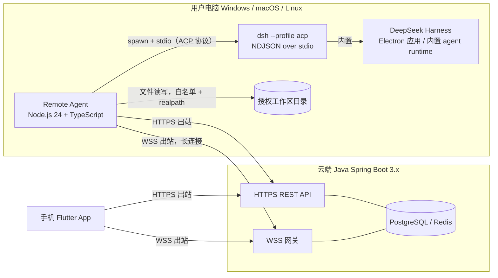
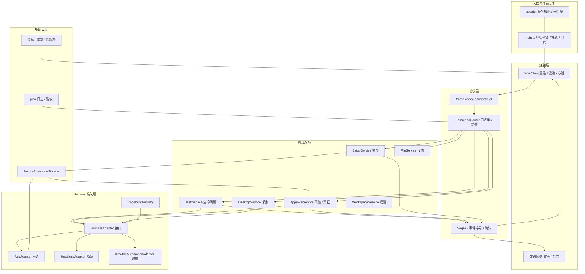
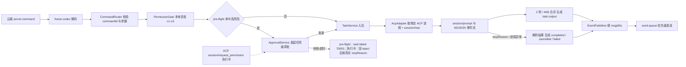
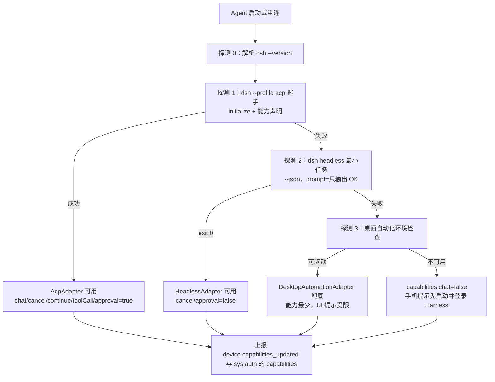
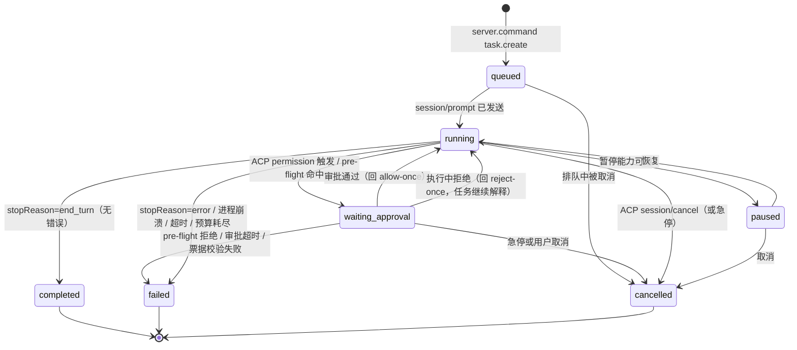
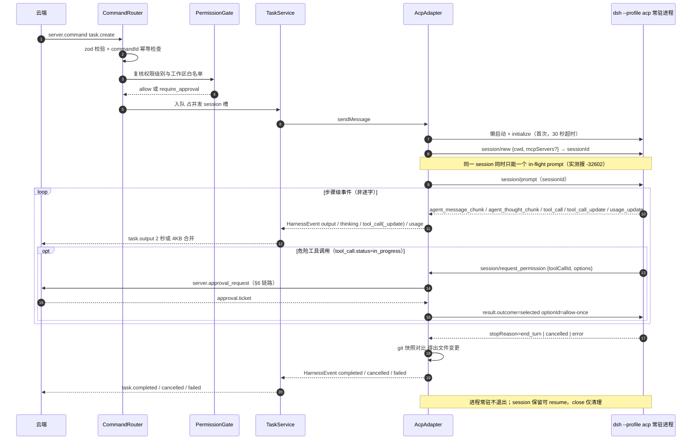
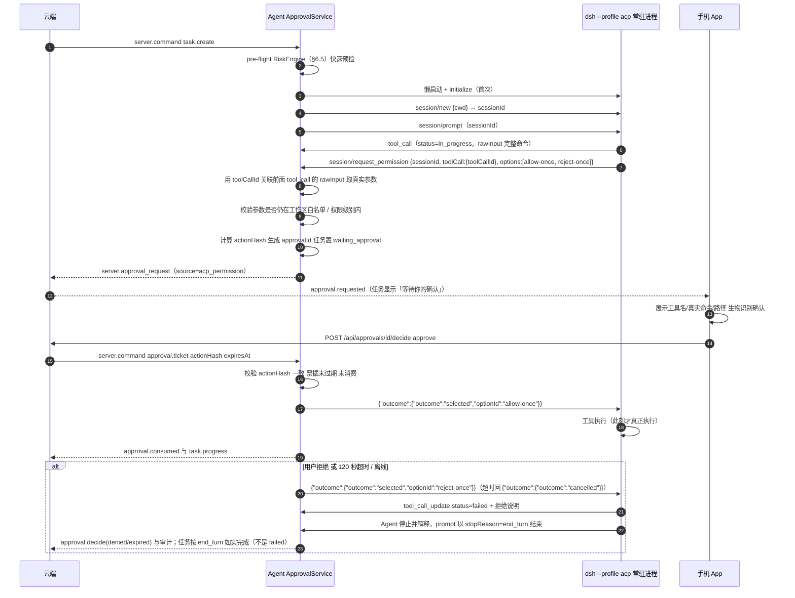

# DSRA-DESIGN-003 · Remote Agent 电脑端设计

| 项 | 内容 |
| --- | --- |
| 文档编号 | DSRA-DESIGN-003 |
| 版本 | v1.0 |
| 日期 | 2026-10-31 |
| 作者 | protocol-architect（Team Lead: lead） |
| 相关文档 | [PROTOCOL](./PROTOCOL.md)（DSRA-DESIGN-001）、[DATA_MODEL](./DATA_MODEL.md)（DSRA-DESIGN-002）、[MOBILE_UI](./MOBILE_UI.md)（DSRA-DESIGN-004）、[MVP_AND_ROADMAP](./MVP_AND_ROADMAP.md)（DSRA-DESIGN-005） |
| 状态 | 评审稿（接入路线已由 `docs/research/HARNESS_INTERFACES.md` 实测确认；剩余 4 项待验证见 §11） |
| 适用版本 | Remote Agent 0.4.x；协议 `dsremote.v1` |

> 本文回答一个问题：**电脑上那个常驻程序，凭什么可靠、安全地把「手机的一句话」变成「Harness 真正干活」，并把过程和结果可信地传回去。**
> 凡涉及 DeepSeek Harness 具体接口的分歧，本文以 `docs/research/HARNESS_INTERFACES.md` 的本机实测/源码证据为准；未证实处标注 `H-xx` 编号并列入 §11。

---

## 0. 结论先行

1. **运行时选 Node.js 24 LTS + TypeScript 5.x，外壳用 Electron**（ADR-AGENT-001）。理由不是「大家都会」，而是：DeepSeek Harness 的官方 CLI、Cordis 插件体系都在 Node/TS 生态，Agent 可以 `child_process.spawn('dsh', ...)` 直接接入；Electron 与 DSH 同栈，托盘、系统通知、`safeStorage`（DPAPI）、自动更新开箱即用；不引入 JRE/CLR 运行时。
2. **接入按能力分层、动态上报**：`AcpAdapter`（官方 `dsh --profile acp`，ACP over stdio，**首选**——已实测：`initialize`/`session/new`/`session/prompt`/`session/list`/`session/resume`/`session/close`/`session/cancel`/`session/request_permission`/`session/set_config_option`，ACP `protocolVersion=1`）→ `HeadlessAdapter`（`dsh headless`，一次性任务，无取消、无审批通道）→ `DesktopAutomationAdapter`（桌面自动化，最后兜底）。三层实现同一个 `HarnessAdapter` 接口，能力矩阵随连接上报，**云端与手机不硬编码能力假设**。
3. **Agent 必须与 Harness 同机部署，且只作出站连接**。依据（Lead 实测 + HARNESS_INTERFACES §3）：DSH 的 `127.0.0.1:62492` 端口仅绑定 loopback、端口随机、令牌每进程随机且只经 Electron IPC 下发，手机/云端无法直连且非官方公开协议；因此 Agent 主动 `wss://` 外连云端，本机不开任何对公网监听的端口；也不需要拿 62492 做任何事。
4. **单 ACP 进程 + 每任务一个 session**：MVP 阶段只维护一个 `dsh --profile acp` 子进程，每个任务 `session/new` 独立 session（实测跨 session 的 turn 可并行；同一 session 同时只允许一个 in-flight turn，第二个 prompt 报 `-32602 a prompt is already in flight`，故 prompt 串行入队）；同一工作区同时只跑 1 个写任务，全局并发默认 **2**（可配 1–5，依据 `H-10` 实测 + 模型配额保守），队列上限 10；进程异常退出时重启进程，执行中任务置 `failed{reason:"acp_process_exit"}`。
5. **任务状态机与 `tasks.task_status` 严格一致**（7 态），「等待用户授权」是**运行中**的子状态，不新增状态、不伪造「已完成」。
6. **审批以 in-flight 为主、pre-flight 兜底**：ACP 的 `session/request_permission` 让 Agent 在**危险工具调用真正执行前**阻塞，转手机确认（实测：allow-once 批准后工具才执行并写文件）。精确契约——只有 `allow_once` / `reject_once` 两个选项，**没有 allow-always**；拒绝后工具 `failed`、Agent 停止并解释、turn 仍以 `end_turn` 结束（**审批被拒 ≠ 任务失败**）；超时按 `cancelled` 应答。RiskEngine 仍在任务启动前做保守预检。headless 没有审批通道（需审批操作直接失败），此时只能 pre-flight（§6）。
7. **紧急停止本地权威**：本地 ESTOP 标志持久化在受保护存储中，云端无法远程解除；触发顺序固定为「置标志 → 中断执行 → 关桌面 → 上报审计」。
8. **最小权限**：以当前登录用户身份运行，**绝不请求 UAC 提权**；文件访问先过 `workspace_permissions` 白名单 + `realpath` 校验（防符号链接越界/TOCTOU）。
9. **凭证不明文落盘**：设备 token 用 Electron `safeStorage`（Windows DPAPI / macOS Keychain / Linux libsecret）加密，支持轮换与撤销即时生效。
10. **屏幕采集 MVP 用 ffmpeg 子进程 + H.264 编码**（`gdigrab`/`avfoundation`/`x11grab` 采集；`h264_nvenc` 优先、`libx264` 兜底），经现有 WSS 二进制帧回传（1280×720@12fps、目标 2–3 Mbps、自适应）；MJPEG 仅作局域网/演示降级档。依据 2026-10-31 本机实测（[ENVIRONMENT_REPORT.md](../research/ENVIRONMENT_REPORT.md) §5.4）：MJPEG 1280 宽 10fps 已约 13.3 Mbps、全分辨率 12fps 约 36 Mbps，公网/4G 不可接受；H.264 软编约 3.0 Mbps、NVENC 约 1.76 Mbps。WebRTC 与原生 Windows Graphics Capture 仍放 P2。
11. **不做 Windows 服务（Session 0）**：屏幕采集、全局热键、本地急停按钮都依赖交互式桌面会话，因此是「登录后自启的桌面应用」而非服务（ADR-AGENT-009）。
12. **输出是「步骤级实时」，不是逐字流式**：ACP `agent_message_chunk` 是**提交点粒度**（实测 250 字中文回答仅产生 1 个 chunk、且常在 turn 末尾一次性到达），工具调用/思考/用量各自成块到达。因此手机端按「每步/每工具完成即刷新」呈现，产品文案不得宣传「逐字打字机流式」；真正的 token 级流式只有 B 路线（Host 插件桥的 `agent/assistant-stream`）可得，非 MVP（ADR-AGENT-013）。
13. **阻塞项前置**：`H-02` 输出粒度已确认、`H-09` 桌面采集（Windows 已实测通过、macOS/Linux 待验证）、`H-13` per-session 权限 preset、`H-14` 跨进程同时 live 同一 session——安排在 M0/M2 探针复核（见 [MVP_AND_ROADMAP.md](./MVP_AND_ROADMAP.md)）；其余 H-01/04/05/06/07/08/10/11/12 已由 HARNESS_INTERFACES 实测确认，**验证前不写「已支持」**。

---

## 1. 职责与边界

### 1.1 Remote Agent 是什么

- 云端在用户电脑上的**唯一可信执行代理**：接收 `server.command`、执行、回传 `task.*` 事件；
- Harness 的**适配层**：把「ACP / headless CLI / 桌面自动化」三种接入方式收敛成一套 `HarnessAdapter`；
- 安全与权限的**最后一道闸门**：云端说「可以」，Agent 仍要按本地授权表与风险规则复核；
- 本地可见的**透明窗口**：托盘状态、连接状态、任务日志、紧急停止按钮，让用户随时知道它在做什么。

### 1.2 不是什么

| 不做 | 原因 |
| --- | --- |
| 不实现大模型推理 | 推理由 DeepSeek Harness 完成，Agent 只调用 |
| 不监听公网端口 | 无入站端口 = 不需要端口映射/防火墙放行/公网证书，攻击面最小 |
| 不替用户保存账号密码 | 登录态由 Harness 自己维护；Agent 只保存自己的设备凭证 |
| 不做多租户 | 一台电脑只属于一个账号，一个 Agent 只服务一个用户 |
| 不默认提权 | 高风险操作必须由用户审批，而不是「以管理员跑就都能干」 |

### 1.3 部署形态



要点：

- 手机与电脑**都只出站**连云端，天然穿透家庭 NAT/公司防火墙；云端是唯一汇聚点（与 PROTOCOL §3 一致）。
- Agent 与 Harness 的通信**首选 ACP over stdio**：`spawn('dsh', ['--profile','acp'], { stdio: ['pipe','pipe','pipe'] })`，按 NDJSON 收发 ACP 消息（已实测 `initialize`、`session/new`、`session/prompt`、`agent_message_chunk`、`tool_call`、`session/request_permission`、`session/cancel`、`session/list`、`resume` 闭环）；备选 `dsh headless`（一次性任务，无取消/无审批通道）；`127.0.0.1:62492` 仅 loopback 且未确认有可复用 API，**不作为接入面**。
- 一台电脑可以没有 Harness 装 Agent 吗？可以启动，但 `capabilities.chat=false`，手机端显示「请先在本机安装/启动 DeepSeek Harness」——**不做「远程安装 Harness」这种超纲功能**。

### 1.4 与其他组件的契约

| 对端 | 契约 | 出处 |
| --- | --- | --- |
| 云端（REST） | 设备凭证、配对会话、token 轮换、健康上报 | PROTOCOL §2.10、§2.18 |
| 云端（WSS） | `sys.auth`、`server.command`、`server.command_ack`、`task.*` 事件、`approval.*` | PROTOCOL §3–§8 |
| Harness | `HarnessAdapter`（§4），首选 ACP over stdio | 本文 §4 |
| 本地用户 | 托盘/窗口/热键/急停 | 本文 §7.5 |

---

## 2. 技术栈 ADR

### 2.1 ADR-AGENT-001：运行时与桌面外壳选 Node.js 24 + TypeScript + Electron

**决策**：Remote Agent 主进程 = Node.js 24 LTS + TypeScript 5.x（strict 模式）；桌面外壳 = Electron（当前稳定大版本），使用 `electron-builder` 打包、`electron-updater` 更新。

**候选对比**（权重是我给出的工程判断，理由写在表格后）：

| 维度 | Node 24 + TS + Electron（选中） | Java 17 + JavaFX/Tray | C# .NET 8 + WinUI 3 | Rust + Tauri |
| --- | --- | --- | --- | --- |
| 与 DSH 生态亲和 | **高**：CLI/插件/Cordis 都是 Node/TS，可直接 spawn、可复用插件类型 | 低：需跨进程调用 CLI | 低：同样跨进程 | 中：壳是 Rust，核心仍需 Node 子进程 |
| 子进程与 stdio 处理 | **强**：`child_process.spawn` 流式读取、信号、进程树 | 中：`ProcessBuilder` 可用但流式体验差 | 中：`Process` 可用 | 中：需自己实现 |
| 桌面能力（托盘/通知/热键/截屏） | 强：Electron 全有；全局热键需 `globalShortcut` | 中：JavaFX 托盘弱、热键需 JNI | **最强**：Windows 原生 | 中：Tauri 有插件生态 |
| 安全存储（DPAPI/Keychain） | **强**：`safeStorage` 跨平台封装 | 中：需 JNA 调 DPAPI | 强：DPAPI 直用 | 中：需自实现 |
| 安装包体积 | 约 90–150MB（Electron） | 约 200MB JRE + 应用 | 约 60–80MB（自包含运行时） | **约 10–20MB** |
| 内存占用（空闲） | 约 120–200MB | 约 150–250MB | 约 80–120MB | 约 40–80MB |
| 冷启动 | 约 1–2s | 约 2–3s | 约 1s | <1s |
| 跨平台 | **三平台一致** | 三平台（JavaFX 打包麻烦） | 仅 Windows（跨平台要 Avalonia 另算） | 三平台 |
| 自动更新 | 成熟（electron-updater + 差分） | 需自建 | 成熟（Squirrel/MSIX） | 成熟（Tauri updater） |
| 团队/招聘 | **与 DSH 团队同栈**，前端 TS 可复用 | Java 团队会写，但桌面经验少 | 生态割裂 | Rust 人才稀缺 |
| 主要风险 | 体积/内存偏大；Electron 安全基线必须做对 | 200MB JRE 拖慢安装；桌面体验差 | 锁死 Windows；与 DSH 生态无复用 | Rust + Node 双语言，维护成本高 |

**理由（为什么不是「都行」）**：

1. **接入点是官方协议子进程，不是「任意语言都能调 HTTP」**。DSH 官方给出的接入面是 `dsh --profile acp`（NDJSON over stdio）与 `dsh headless`（均已实测）。Node 运行时可以直接 `spawn` 子进程、逐行收发 JSON；换成 Java/C# 只是把同一件事包一层更重的壳，没有收益。
2. **Electron 与 Harness 同栈**，意味着桌面能力（托盘、通知、`safeStorage`、自动更新）不需要额外造轮子；DSH 本身就是 Electron 应用，打包/签名/更新的经验可以直接复用。
3. **体积换可靠**：90–150MB 的安装包在桌面软件里可接受（VS Code 同量级），换来的是三平台一致与生态复用。若未来产品要求「安装包 <30MB」，退出条件是明确的：**领域层与接入层不变，只把外壳换成 Tauri sidecar 托管 Node 守护进程**（见后果 3）。
4. **Java 的 200MB JRE 是真实成本**：用户为了一个「远程控制小工具」装 200MB 运行时，转化率会掉；且 JavaFX 的托盘/热键/打包体验明显差于 Electron。
5. **C# 锁死 Windows**：策划案 3.1 要求跨平台（macOS/Linux），选 C# 等于未来重写。

**替代方案与否决理由**：

- Java 17 + JavaFX：否。运行时体积 + 桌面能力弱 + 与 DSH 生态无复用；仅在「团队完全无 TS 能力」时重新评估。
- C# .NET 8：否。仅 Windows，与策划案跨平台要求冲突。
- Rust + Tauri：**保留为体积优化路线**，不作为首发。理由：需要 Rust + Node 双语言维护，MVP 阶段人力不划算；且 Tauri 的 WebView 在 Linux 上发行版差异大，桌面采集仍需原生代码。升级条件：安装包体积成为用户流失主因时。
- Go + Wails：否。同样双语言，且屏幕采集/热键生态弱于 Electron。

**后果**：

1. 必须做 Electron 安全基线：`contextIsolation: true`、`nodeIntegration: false`、`sandbox: true`（渲染进程）、严格 CSP、禁用 `remote`、所有 IPC 走白名单 `contextBridge`。
2. 安装包签名（Windows Authenticode / macOS notarization）是发布硬门槛，证书成本要提前排进预算。
3. 退出条件：若体积/内存成为硬指标，保留 `HarnessAdapter`/领域层/协议层，把外壳换 Tauri sidecar；**接口不变，迁移成本限制在外壳与打包**。

### 2.2 ADR-AGENT-002：单主进程 + 常驻 ACP 进程（每任务一 session）

**决策**：Agent 只有一个主进程（Electron main）；**1 个常驻的 `dsh --profile acp` 子进程**（懒启动），每个用户任务在它里面 `session/new` 独立 session；屏幕采集再起一个 ffmpeg 子进程。headless 降级路径才「每任务一个一次性子进程」。**不用 worker_threads 跑 Harness**——Harness 是外部程序，不是库。

**理由**：

- 实测单 ACP 进程可并发多 session（wall≈max 非 sum），不必为并发付多份进程/登录态成本；
- 任务隔离靠 session + cwd + 审批边界，而不是靠进程；同一 session 同时只允许一个 in-flight prompt，由队列保证串行；
- 取消语义干净：优先发 ACP `session/cancel`；进程异常时终止进程树兜底；
- 输出流天然异步，子进程的 NDJSON 事件直接映射为 `task.output` 的 `stream` 字段。

**并发策略（结论）**：

| 场景 | 策略 |
| --- | --- |
| 同一工作区 | **同时只允许 1 个写任务**（避免 git 冲突/文件互相覆盖）；只读任务可并行 |
| 全局并发 session | 默认 **2**，可配 1–5；超出的进队列（上限 10） |
| 队列满 | 拒绝新任务：`task.failed{errorCode:"50004", reason:"queue_full"}` |
| 空闲超时 | 子进程 15 分钟无输出视为挂起，Agent 主动 kill 并置 `failed{reason:"timeout"}` |

> 并发默认 2 的依据：H-10 实测「单进程多 session 可并行、同 session 串行」已确认；不直接开到 5 是保守估计
> Harness 侧（模型配额、同一 API key 的限流）而非 Agent 侧耗尽。H-10 之外的 per-session permission preset 仍待 H-13。

### 2.3 ADR-AGENT-003：模块分层与依赖方向

**决策**：单进程内分 6 层，依赖**只能向下**：

```
入口/生命周期 → 连接层 → 协议层 → 命令路由 → 领域服务 → Harness 接入层/基础设施
```

- 禁止领域层直接碰 WebSocket；禁止接入层直接写事件到连接——统一走 `EventPublisher`（内部事件总线，带 seq 与落库确认语义）。
- 边界处一律用 **zod** 校验 JSON（外部输入不可信），内部类型由 TS 保证。
- 不引入 DI 框架（NestJS 等）：模块少，构造函数注入足够，减少启动开销与学习成本。

### 2.4 ADR-AGENT-004：凭证加密存储

**决策**：所有长期秘密（设备 token、配对私钥、本地 PIN 哈希、ESTOP 标志前校验材料）通过 Electron `safeStorage` 加密后写入 `%APPDATA%\DeepSeekRemote\secrets.bin`（macOS `~/Library/Application Support/...`、Linux `~/.config/...`）。`safeStorage.isEncryptionAvailable() === false` 时**拒绝保存**并要求重新配对，绝不降级为明文。

**理由**：

- Windows 上 `safeStorage` 背后是 DPAPI（绑定当前用户账户），拿到文件也无法在另一账户/机器解密；
- 跨平台统一 API，不必为三个系统写三套原生存储；
- 「拒绝降级」比「偷偷明文」安全；Linux 无 keyring 的用户会看到明确错误提示。

**替代方案**：`keytar`（已停止维护）、自实现 AES+机器指纹（可被同机恶意程序复现，只作为最后兜底且需要用户知情）——均否。

### 2.5 ADR-AGENT-005：日志、指标与本地诊断

**决策**：`pino` 结构化 JSON 日志，按天轮转保留 7 天（单文件 10MB × 5），默认 `info`；敏感字段脱敏在**写入前**完成（`redact` 路径见 §7.6）。本地「诊断」按钮生成 zip（版本、连接状态、最近 200 行脱敏日志、能力矩阵、最近错误码），供用户发给客服。

### 2.6 ADR-AGENT-006：屏幕采集与编码（MVP）

**决策**：MVP 用 **ffmpeg 子进程**采集 + **H.264 编码**，经 WSS 二进制帧发送（PROTOCOL §7.3）：
Windows `-f gdigrab -framerate 12 -i desktop`；macOS `-f avfoundation -i "1:none"`；Linux `-f x11grab`。
编码优先 `h264_nvenc -preset p4 -tune ll`（NVENC 不可用则回落 `libx264 -preset ultrafast -tune zerolatency`）；
默认 1280×720、12fps、目标码率 **2–3 Mbps**，自适应降级顺序 **码率 → 帧率 → 分辨率**；IDR 关键帧可按手机端请求重发。
**MJPEG 只作为降级/局域网演示档**（`-c:v mjpeg -q:v 6`），不作为公网默认。

**理由**：

- **带宽实测推翻原估算**（2026-10-31，[ENVIRONMENT_REPORT.md](../research/ENVIRONMENT_REPORT.md) §5.4，本机 2560×1600 真机屏幕）：
  MJPEG 1280 宽 10fps ≈ 1.49 MB/s ≈ **13.3 Mbps**，全分辨率单帧 379KB（12fps ≈ 36 Mbps）→ 公网/4G 不可接受；
  H.264 `libx264 ultrafast` ≈ 378KB/s ≈ **3.0 Mbps**，`h264_nvenc p4 ll` ≈ 198KB/s ≈ **1.76 Mbps** → 可用。
  原设计「MJPEG 12fps 约 1.5–4 Mbps」不成立，本 ADR 按实测改为 **H.264 为主、MJPEG 仅兜底**。
- 零原生编译：不引入 N-API 原生模块，三平台都能装；编码器由 ffmpeg 提供，NVENC 不可用时自动回落软编；
- 采集/编码链路已在本机 Windows + ffmpeg 6.1.1 实测跑通（`gdigrab` 抓屏 2560×1600 成功，H.264/NVENC/MJPEG 编码器均出帧）。

**分发与合规**：正式交付需引入官方 ffmpeg Windows 构建（gyan.dev / BtbN）并锁定版本；本机验证用的是第三方软件附带的 **GPL** 构建，随 Agent 分发前需评估 GPL 义务（优先选 LGPL 构建，见 §11 A-02）。

**替代方案与升级路径**：

| 方案 | 结论 |
| --- | --- |
| Windows Graphics Capture（WinRT） | P2：性能更好、支持单窗口采集，但需要原生模块/WinRT 绑定，MVP 不做 |
| WebRTC（VP8/H.264 + DataChannel） | P2：延迟低，但需要 STUN/TURN/SFU 与信令，成本高；PROTOCOL ADR-PROTO-010 已记录 |
| 截图轮询（`screenshot-desktop`） | 否：延迟与 CPU 都不可接受，仅适合「单张截图」功能 |

**音视频合规**：采集前必须有本地可见的「正在共享屏幕」指示（托盘图标变红 + 系统通知），这是隐私底线。

### 2.7 ADR-AGENT-007：自动更新

**决策**：`electron-updater` + 签名校验 + 分阶段发布（内部 → 5% → 25% → 100%），失败自动回滚。更新包必须验证签名，否则拒绝安装。

**理由**：远程控制软件是**高危目标**，更新通道就是供应链攻击面；签名 + 分阶段是行业最低标准。

### 2.8 ADR-AGENT-008：本地 UI（托盘 + 小窗口）

**决策**：Electron 托盘（状态点：灰=未配对/黄=连接中/绿=在线/红=已急停）+ 一个 ~900×620 的小窗口（状态、最近任务、日志、设置、配对二维码）。渲染进程 `sandbox: true`，仅通过 `contextBridge` 暴露只读 API。

**理由**：用户需要一个「看得见、能控制」的本地入口；急停按钮必须**物理本地可用**，不能只依赖手机。

### 2.9 ADR-AGENT-009：桌面应用，不是 Windows 服务

**决策**：Agent 作为登录用户会话中的桌面应用运行（登录自启），**不注册为 Windows 服务**。

**理由**：

- Windows 服务的 Session 0 隔离，**无法采集交互式桌面**，也无法接收全局热键——远程桌面功能直接废掉；
- 服务需要管理员权限安装，违背「普通用户权限运行」；
- macOS/Linux 同理（launchd agent、systemd user unit）。

**替代方案**：双进程（服务 + 会话代理）——否，MVP 复杂度翻倍且收益为零。

### 2.10 ADR-AGENT-010：代码规范与依赖治理

**决策**：TS `strict`、禁止 `any`（用 `unknown` + zod 收窄）、ESLint + Prettier、依赖白名单（新增生产依赖需 code review 记录理由）、`npm audit` 进 CI。禁止引入需要原生编译的依赖（与 ADR-AGENT-006 一致）。

---

## 3. 分层架构

### 3.1 分层职责

| 层 | 模块 | 职责 | 不允许 |
| --- | --- | --- | --- |
| L1 入口/生命周期 | `main.ts`、`lifecycle/` | 单实例锁、托盘、自启、更新、优雅退出 | 业务逻辑 |
| L2 连接层 | `transport/` | WSS 建连/重连退避/心跳/发送队列/背压 | 解析业务命令 |
| L3 协议层 | `protocol/` | 帧编解码、`sys.*` 处理、事件序号与 ack、命令参数校验 | 直接执行任务 |
| L4 命令路由 | `protocol/command-router.ts` | 命令白名单、幂等（`commandId`）、分发到领域服务 | 绕过权限判定 |
| L5 领域服务 | `domain/` | 任务/审批/急停/文件/桌面/工作区 | 直接发 WS 帧（走 EventPublisher） |
| L6 接入/基础设施 | `harness/`、`infra/`、`policy/` | 适配 Harness、加密存储、日志、风险规则 | 反向依赖上层 |

### 3.2 组件图



### 3.3 目录结构（建议，非最终）

```
remote-agent/
├─ package.json
├─ tsconfig.json                  # strict: true, noUncheckedIndexedAccess: true
├─ electron-builder.yml           # 三平台打包 + 签名 + 协议注册
├─ src/
│  ├─ main.ts                     # Electron 入口：单实例锁、托盘、窗口、生命周期
│  ├─ lifecycle/
│  │  ├─ single-instance.ts       # 命名互斥，第二实例唤起已有窗口
│  │  ├─ autostart.ts             # 登录自启（注册表 Run / launchd / systemd user）
│  │  └─ shutdown.ts              # 优雅退出：通知云端、终止子进程、清理状态
│  ├─ transport/
│  │  ├─ wss-client.ts            # 连接、认证、心跳、重连状态机
│  │  ├─ backoff.ts               # 1/2/4/8/16/30s ±20% 抖动
│  │  ├─ send-queue.ts            # 背压、优先级（急停 > 状态 > 输出）
│  │  └─ frame-codec.ts           # JSON 帧 + 二进制媒体帧
│  ├─ protocol/
│  │  ├─ sys-handlers.ts          # sys.auth / ping / pong / error / ack
│  │  ├─ command-router.ts        # 命令白名单 + zod 校验 + commandId 幂等
│  │  ├─ events.ts                # 事件构造器（统一填充 msgId/ts）
│  │  └─ seq-ack.ts               # seq 分配（由云端下发序号时的本地校验）
│  ├─ domain/
│  │  ├─ task-service.ts          # 任务状态机、队列、超时、取消
│  │  ├─ approval-service.ts      # 风险判定、审批请求、票据校验、消费
│  │  ├─ estop-service.ts         # 急停标志持久化、本地恢复、热键
│  │  ├─ file-service.ts          # 下载/上传、sha256 校验、目录约束
│  │  ├─ desktop-service.ts       # 会话、采集、输入注入、自适应
│  │  └─ workspace-service.ts     # 工作区枚举、文件列表、权限校验
│  ├─ harness/
│  │  ├─ adapter.ts               # HarnessAdapter 接口 + 类型（见 §4.1）
│  │  ├─ acp-adapter.ts           # 官方 ACP over stdio（首选）
│  │  ├─ headless-adapter.ts      # dsh headless（降级/一次性）
│  │  ├─ desktop-automation-adapter.ts # 桌面自动化（兜底）
│  │  ├─ capability-registry.ts   # 能力探测、矩阵、熔断
│  │  └─ process-tree.ts          # Windows job object / POSIX 进程组 kill
│  ├─ policy/
│  │  ├─ permission-gate.ts       # L1–L6 判定（本地复核）
│  │  ├─ risk-rules.ts            # 高风险动作规则库（PROTOCOL §8.4）
│  │  └─ path-guard.ts            # realpath、白名单、符号链接、TOCTOU
│  ├─ infra/
│  │  ├─ secure-store.ts          # safeStorage 封装 + secrets.bin 原子写
│  │  ├─ logger.ts                # pino + 轮转
│  │  ├─ redact.ts                # 脱敏字段规则
│  │  ├─ metrics.ts               # CPU/内存/任务数/队列/延迟
│  │  └─ diagnostics.ts           # 诊断包生成
│  └─ ui/                         # 渲染进程（sandbox + contextBridge）
│     ├─ index.html
│     ├─ tray-menu.ts
│     └─ views/{status,tasks,logs,settings,pairing}.ts
└─ test/
   ├─ unit/                       # 风险规则、路径校验、票据校验
   ├─ integration/                # 假云端 + 假 CLI 的端到端
   └─ contract/                   # 用 PROTOCOL 的 JSON 样例做契约测试
```

### 3.4 一条命令的完整数据流



---

## 4. Harness 接入层：HarnessAdapter

### 4.1 接口定义（TypeScript，v1）

> 设计目标：**上层（TaskService/ApprovalService）只依赖此接口**，三种接入方式（ACP / headless CLI / 桌面自动化）可替换；
> 能力差异通过 `HarnessCapabilities` 暴露，而不是让上层 `if (adapter === 'acp')`。

```ts
// harness/adapter.ts —— 仅接口与类型，实现见 4.3 / 4.4 / 4.5

export type AdapterKind = 'acp' | 'headless' | 'desktop_automation';

export type HarnessCapability =
  | 'chat'              // 能执行任务
  | 'streaming'         // 能增量输出（实际为提交点粒度，非 token 级；见 §4.2 注）
  | 'structuredResult'  // 能返回结构化结果（文件列表/摘要）
  | 'cancel'            // 能程序化取消
  | 'pause'             // 能暂停/恢复
  | 'continue'          // 能继续多轮对话
  | 'sessions'          // 能列出/复用会话
  | 'sessionResume'     // 能在断线后恢复会话
  | 'toolCallDetail'    // 能拿到工具调用明细（工具名/参数/结果）
  | 'workspaceList'     // 官方接口枚举工作区与文件
  | 'fileRead'          // 官方接口读文件
  | 'fileWrite'         // 官方接口写文件
  | 'terminal'          // 能执行终端命令
  | 'approvalIntercept' // 能在执行中拦截危险动作（in-flight 审批）
  | 'modelSwitch'       // 能在会话内切换模型/推理强度（ACP session/set_config_option）
  | 'usageReport';      // 能拿到上下文占用/用量（ACP 为 {used,size}）

export interface HarnessCapabilities {
  readonly adapter: AdapterKind;
  readonly harnessVersion: string | null;
  readonly values: Readonly<Record<HarnessCapability, boolean>>;
  /** 探测依据，便于排障与契约测试：如 "dsh --version"、"probe task" */
  readonly evidence: Readonly<Record<HarnessCapability, string>>;
  readonly probedAt: string; // ISO-8601
}

export interface HarnessStatus {
  readonly running: boolean;
  readonly version: string | null;
  readonly busy: boolean;
  readonly activeSessions: number;
  readonly lastProbeAt: string;
  readonly degraded: boolean;
  readonly adapter: AdapterKind;
  readonly detail?: string;
}

export interface HarnessSession {
  readonly sessionId: string;       // ACP sessionId（headless 模式为本地生成的调用于会话映射）
  readonly workspacePath: string;
  readonly createdAt: string;
  readonly lastActiveAt: string;
  readonly title?: string;
}

export type TaskInput = {
  readonly taskId: string;              // 云端任务 ID，贯穿日志与事件
  readonly conversationId: string;
  readonly prompt: string;
  readonly workspacePath: string;
  readonly timeoutSec: number;
  readonly attachments?: ReadonlyArray<{ fileId: string; localPath: string }>;
  readonly env?: Readonly<Record<string, string>>; // 白名单注入，不透传全部环境变量
};

export interface TaskHandle {
  readonly taskId: string;
  /** ACP sessionId 之外的进程引用；headless 一次性进程为 null（不编造） */
  readonly harnessRef: string | null;
  readonly startedAt: string;
  cancel(): Promise<CancelResult>;
}

export type CancelMechanism = 'native' | 'signal_term' | 'signal_kill' | 'detach';

export interface CancelResult {
  /** Agent 是否已停止采纳输出（总是能做到） */
  readonly accepted: boolean;
  /** Harness 是否确认已真正中止（做不到时为 false，UI 必须如实展示） */
  readonly harnessAck: boolean;
  readonly mechanism: CancelMechanism;
  readonly detail?: string;
}

export type HarnessEvent =
  | { type: 'output'; stream: 'answer' | 'stdout' | 'stderr' | 'log'; text: string; at: string }
  | { type: 'progress'; progress: number; stage: string; message?: string; at: string }
  | { type: 'thinking'; text: string; at: string }                       // ACP agent_thought_chunk（整段思考，非 token 级）
  | { type: 'tool_call'; callId: string; tool: string; input: unknown; at: string }
  | { type: 'tool_call_update'; callId: string; status: 'pending' | 'in_progress' | 'completed' | 'failed'; resultExcerpt?: string; at: string }
  | { type: 'usage'; contextUsed?: number; contextSize?: number; inputTokens?: number; outputTokens?: number; at: string } // ACP usage_update={used,size}；headless step_end 给 token 数
  | { type: 'approval_request'; request: ApprovalRequest; at: string }
  | { type: 'session_message'; role: 'user' | 'assistant'; content: string; at: string }
  | { type: 'completed'; summary: string; files: ReadonlyArray<ResultFile>; at: string }
  | { type: 'failed'; errorCode: string; message: string; retryable: boolean; at: string };

export interface ResultFile {
  readonly path: string; // 工作区相对路径
  readonly change: 'created' | 'modified' | 'deleted';
}

export interface WorkspaceInfo {
  readonly workspacePath: string;   // 绝对路径（本地）
  readonly displayName: string;
  readonly isGitRepo: boolean;
  readonly branch?: string;
}

export interface WorkspaceFile {
  readonly relativePath: string;
  readonly sizeBytes: number;
  readonly modifiedAt: string;
  readonly isDirectory: boolean;
}

export type Unsubscribe = () => void;

/**
 * ACP 实测只提供两项：allow_once / reject_once（没有 allow_always）。
 * 若未来 Harness 增加永久选项，必须由云端显式开关放行，不得默认透传。
 */
export type ApprovalOptionKind = 'allow_once' | 'reject_once';

export interface ApprovalRequest {
  readonly taskId: string;
  /** 请求来源：ACP 执行中 permission / Agent 任务级风险预检 */
  readonly source: 'acp_permission' | 'preflight_rule';
  readonly toolCallId?: string;       // source=acp_permission 时对应 ACP toolCallId
  readonly tool?: string;             // 触发工具名，如 shell / fs_write
  readonly approvalType: string;      // 与 PROTOCOL §8.4 枚举一致
  readonly permissionLevel: 1 | 2 | 3 | 4 | 5 | 6;
  readonly riskLevel: 'low' | 'medium' | 'high' | 'critical';
  readonly actionHash: string;        // SHA-256(规范化 JSON)，Agent 计算
  readonly actionSummary: string;     // 给用户看的一句话
  readonly payload: unknown;          // 结构化详情（脱敏后）
  /** ACP request_permission 携带的选项；无则云端按 allow_once/reject_once 默认渲染 */
  readonly options?: ReadonlyArray<{ optionId: string; label: string; kind: ApprovalOptionKind }>;
  readonly expiresAt: string;
}

export interface ApprovalOutcome {
  readonly status: 'approved' | 'denied' | 'expired' | 'cancelled';
  readonly ticket?: string;
  readonly decidedAt?: string;
}

/**
 * Remote Agent 对 Harness 的唯一依赖面。
 * 约束：实现必须线程安全（Node 单线程但需处理并发异步）；不得抛出未分类异常——
 * 所有失败统一映射为 HarnessError（含 errorCode，见 §9）。
 */
export interface HarnessAdapter {
  readonly kind: AdapterKind;

  connect(): Promise<HarnessStatus>;
  disconnect(): Promise<void>;
  getStatus(): Promise<HarnessStatus>;
  getCapabilities(): Promise<HarnessCapabilities>;

  // 会话
  getSessions(): Promise<ReadonlyArray<HarnessSession>>;
  createSession(workspacePath: string, title?: string): Promise<HarnessSession>;
  getSessionEvents(sessionId: string, sinceSeq?: number): Promise<ReadonlyArray<HarnessEvent>>;

  // 任务
  sendMessage(sessionId: string, input: TaskInput): Promise<TaskHandle>;
  continueTask(sessionId: string, input: TaskInput): Promise<TaskHandle>;
  cancelTask(handle: TaskHandle): Promise<CancelResult>;
  pauseTask?(handle: TaskHandle): Promise<void>;   // 可选能力
  resumeTask?(handle: TaskHandle): Promise<void>;  // 可选能力

  // 工作区与文件（能走官方接口就走，否则由 WorkspaceService 兜底）
  getWorkspaces(): Promise<ReadonlyArray<WorkspaceInfo>>;
  getWorkspaceFiles(workspacePath: string, relativeDir?: string): Promise<ReadonlyArray<WorkspaceFile>>;
  readFile(workspacePath: string, relativePath: string, maxBytes: number): Promise<{ content: string; sha256: string; truncated: boolean }>;
  writeFile(workspacePath: string, relativePath: string, content: string, expectedSha256?: string): Promise<{ sha256: string }>;

  // 事件订阅（输出、进度、审批请求、完成/失败）
  subscribe(listener: (event: HarnessEvent) => void): Unsubscribe;

  // 审批：ACP 模式为执行中 permission 转人工确认；headless 模式只能在任务开始前做 pre-flight
  requestApproval(request: ApprovalRequest): Promise<ApprovalOutcome>;
}
```

**为什么用「能力矩阵」而不是版本号判断**：Harness 更新频繁，但**每个能力的可用性**才是产品行为的分支依据。
手机端根据 `capabilities` 决定是否显示「取消」「继续」「实时输出」按钮，而不是猜版本号。

### 4.2 能力矩阵（能力 → 真实接口 → 降级 / 错误码）

> 标注规则：✅ 本机实测或官方文档确认；⚠️ 待验证（不写成已支持）；❌ 不可用。
> 依据来源：harness-scout 对 DSH 0.2.1-rc.5 的本机实测（详见 [HARNESS_INTERFACES.md](../research/HARNESS_INTERFACES.md)）；
> 未实测的能力必须保留待验证编号（H-xx），**不得按「应该可以」编码**。

| 能力 | 真实接口（实测/官方） | AcpAdapter（首选） | HeadlessAdapter | DesktopAutomation | 不可用时的降级 / 错误码 |
| --- | --- | --- | --- | --- | --- |
| 执行任务 `chat` | ACP `initialize` → `session/new` → `session/prompt` 闭环；`dsh headless` 一次性任务 | ✅ | ✅ | ✅ 兜底 | 全不可用 → `50005 CAPABILITY_UNSUPPORTED` |
| 结构化结果 `structuredResult` | ACP `tool_call_update` 结果块 / 末轮 chunk；headless `--json` 末行 `final{text}` | ✅ | ✅（`--json`） | ❌ | 降级：只回文本摘要；`resultNote:"当前接入方式无法上报文件变更"` |
| 增量输出 `streaming` | ACP `session/update.agent_message_chunk` —— **提交点粒度，非 token 级**（实测 250 字中文回答只产生 1 个 chunk，常在 turn 末尾到达）；headless 同样按 step 批量 | ⚠️ 步骤级 | ⚠️ 步骤级 | ❌ | 降级：按「步骤/工具完成即刷新」呈现并标「阶段性输出」；**UI 不得宣称逐字流式**（ADR-AGENT-013） |
| 工具明细 `toolCallDetail` | ACP `tool_call`（含 `rawInput` 完整命令）/ `tool_call_update`（status+结果）；headless `--json` 同名事件 | ✅ | ✅ | ❌ | 不显示工具卡片，仅显示文本输出 |
| 程序化取消 `cancel` | ACP `session/cancel`，实测 2.5s 返回 `stopReason=cancelled`，取消后 session 可继续 | ✅ | ❌ 只能 kill 进程 | ❌ | `CancelResult.harnessAck=false` + `50003`；UI 显示「已停止接收输出，进程可能仍在运行」 |
| 暂停/恢复 `pause` | ACP/headless 均无 pause 方法（官方协议未提供） | ❌ | ❌ | ❌ | 不显示按钮；发命令则 `50005` |
| 多轮继续 `continue` | ACP 对同一 sessionId 再发 `session/prompt`，实测上下文连续 | ✅ | ⚠️ `--session-id` 可 adopt 持久化会话续跑一轮（实测），但无交互式多轮 | ❌ | headless 降级为「新一轮任务 + `--session-id` 复用持久化会话」 |
| 会话列表 `sessions` | ACP `session/list` 返回**跨进程持久化**会话（实测）；headless 无列表 | ✅ | ❌ 需已知 id | ❌ | `conversations.harness_session_id` 可空；手机端以云端会话列表为准 |
| 断线恢复 `sessionResume` | ACP `session/resume {sessionId, cwd}`（cwd 必须与创建时相同）实测上下文连续 | ✅ | ⚠️ 同 cwd + `--session-id` 可续 | ❌ | 任务不可恢复；Agent 重启置 `failed{reason:"agent_restart"}` |
| 工作区枚举 `workspaceList` | ACP **无**客户端工作区/文件方法（源码：仅注册 initialize/authenticate/session.{new,list,resume,close,set_config_option,prompt}）；cwd 由 `session/new` 固定 | ❌（Harness 无接口） | ❌（进程 cwd） | ⚠️ | 由 Agent 本地 `fs` 枚举 + `workspace_permissions` 白名单，能力标 `source:"local_fs"` |
| 读/写文件 `fileRead`/`fileWrite` | ACP **无** `fs/read_text_file`、`fs/write_text_file`、terminal 客户端方法（源码 grep 无命中）；任务内文件操作由 Harness 自己的工具完成 | ❌（Harness 无接口） | ❌ | ❌ | 由 Agent 本地 `fs` 实现（非 Harness 接口）；越界 → `70001`；上传/下载走云端文件中继 |
| 终端 `terminal` | ACP 无独立 shell 客户端通道（Agent 要执行命令只能让 Harness 工具做） | ❌ | ❌ | ⚠️ | 不直接提供 shell（避免绕过 Harness 沙箱）；终端类任务交给 ACP 工具调用 |
| 执行中审批 `approvalIntercept` | ACP `session/request_permission`：实测 allow-once 批准后工具执行并写文件；**只有 allow-once / reject-once 两个选项** | ✅ | ❌ 无审批通道，需审批动作必失败 | ❌ | headless 降级为任务级 pre-flight（§6）；ACP 不可用则只做任务级审批 |
| 模型切换 `modelSwitch` | ACP `session/set_config_option`（model / reasoning_effort），实测成功 | ✅ | ❌（bundle patch 固定） | ❌ | 不显示切换入口，用 profile 默认值 |
| 用量 `usageReport` | ACP `usage_update {used,size}` = 上下文窗口占用，**非 token 计费用量**；headless `step_end.usage` 才带 token 数 | ⚠️ 上下文占用 | ⚠️ step_end token 数 | ❌ | 不显示用量；只显示「上下文已用 x%」 |
| 桌面采集 `desktopCapture` | 不属于 Harness，Agent 自带 ffmpeg（ADR-AGENT-006） | ✅ Agent 实现 | ✅ | ✅ | 采集失败 → `sys.error 90001` 并结束桌面会话 |
| 桌面输入 `desktopInput` | Agent 原生输入注入（P2） | ❌ MVP 不开放 | ❌ | ✅ P2 | `50005 CAPABILITY_UNSUPPORTED` |

> **关于「流式」的诚实边界（重要）**：ACP 与 headless 都**没有 token 级增量**。真正的逐字流式只存在于 Host 进程内的
> `agent/assistant-stream` 事件（插件桥路线 B），本项目 MVP 不采用。手机 UI 必须按「步骤级实时」设计（见 [MOBILE_UI.md](./MOBILE_UI.md) §5.1），
> 验收时不得以「是否像打字机」判定流式能力。

**能力探测（probe）实现顺序**：



- 探测结果写入 `devices.capabilities`（DATA_MODEL §3.2），并随 `sys.auth`/`sys.ping` 上报；
  探测顺序固定 **ACP → headless → 桌面自动化**，取第一个可用者（ACP 的流式与审批能力明显更强，不做「兜底优先」）；
- 探测任务也要计入每日任务配额（避免无限空转），失败重试间隔 ≥10 分钟；
- **探测失败不得等同于「Harness 未安装」**：区分「未安装」「未登录」「版本不支持」三种提示。

### 4.3 AcpAdapter：官方 Agent Client Protocol over stdio（首选）

**已知事实**（harness-scout 对 DSH 0.2.1-rc.5 的本机实测/源码，详见 [HARNESS_INTERFACES.md](../research/HARNESS_INTERFACES.md) §7.1、§8.2）：

- 入口：`dsh --profile acp`，**JSON-RPC 2.0，逐行 NDJSON over stdio**；官方 shipped profile（`@deepseek-ai/dsh-acp-app`，MIT，npm 公开）。
- `initialize` 实测返回 `protocolVersion: 1`、`agentInfo{name:"deepseek-harness-acp", version:"0.0.1"}`、`sessionCapabilities{close,list,resume}`；
  注意 `hostProtocolVersion: 4` 是桌面 Host IPC 协议版本，**与 ACP 无关**（H-12 已确认）。
- 服务端注册的请求方法只有：`initialize`、`authenticate`、`session/new`、`session/list`、`session/resume`、`session/close`、
  `session/set_config_option`、`session/prompt`；通知只有 `session/cancel`。**没有 fs / terminal 客户端方法**（H-06 已确认）。
- 并发（实测）：**单进程可同时跑多个 session**，跨 session 的 turn 并行（wall ≈ max 而非 sum）；同一 session 同时只允许一个
  in-flight turn（第二个 prompt 报 `-32602 a prompt is already in flight for this session`）。per-session 权限 preset 未验证（H-13）。
- 事件：`session/update` 通知携带 `agent_message_chunk`（**提交点粒度，非 token 级**）、`agent_thought_chunk`、`tool_call`（含 `rawInput` 完整命令）、
  `tool_call_update`（`status: completed|failed` + 结果）、`usage_update {used,size}`（上下文窗口占用，非 token 计费）。
- 审批：`session/request_permission` 请求，`params={sessionId, toolCall:{toolCallId}, options:[{optionId:"allow-once",name:"Allow once",kind:"allow_once"},{optionId:"reject-once",name:"Reject",kind:"reject_once"}]}`；
  **没有 allow-always**；客户端应答 `{"outcome":{"outcome":"selected","optionId":"allow-once"}}` 或 `{"outcome":{"outcome":"cancelled"}}`；
  服务端映射：`cancelled→cancelled`、`allow-once→allowed-once`、其它→`rejected`。审批所需的命令/参数在请求前已通过
  `tool_call(status:"in_progress", rawInput)` 推给客户端（实测时间线：tool_call@22243ms → request_permission@22245ms，用 `toolCallId` 关联）。
- 拒绝语义（实测）：回 `reject-once` → 工具 `tool_call_update status=failed`，Agent 按工具错误"停止并解释"，prompt 以 **`end_turn`** 结束
  （不是 error、不是 cancelled），同一 session 可继续 → **审批被拒 ≠ 任务失败**。
- 取消（实测）：`session/cancel` → 当前 prompt `stopReason:"cancelled"`，session 可继续；跨进程同时 live 同一 session 未验证（H-14）。
- 会话：sessionId 是裸 UUID；`session/new {cwd, mcpServers?}` 固定工作目录；`session/resume {sessionId, cwd}` 的 cwd 必须与创建时相同；
  `session/list` 会列出跨进程持久化会话；close 后仍可 resume。
- 启动参数：`dsh --profile acp` 的 app 命令**零选项**（无 `--cwd/--model/--preset`）；cwd 由每次 `session/new` 决定，与启动进程 cwd 无关；
  默认 provider/model 由 bundle patch 决定（本机为 `deepseek-official / deepseek-v4-flash`），会话内用 `session/set_config_option` 切模型与
  `reasoning_effort`（off/low/high/max）。
- 稳定性：官方 RC 契约（runtime 0.2.1-rc.5，无随包公开 API 文档）→ 锁版本 + 忽略未知 `session/update` 类型 + 升级后跑回归探测。

**实现要点**：

| 项 | 设计 | 依据/状态 |
| --- | --- | --- |
| 进程模型 | **单 ACP 常驻子进程**（懒启动，首任务 spawn）；每任务 `session/new`；跨 session 并行、同 session prompt 串行入队；进程崩溃重启并把执行中任务置 `failed{reason:"acp_process_exit"}` | ✅ 实测跨 session 并行 |
| 启动 | `spawn(harnessExe, ['--profile','acp'], { stdio:['pipe','pipe','pipe'], shell:false, windowsHide:true })`（Electron exe + `ELECTRON_RUN_AS_NODE=1`，与 `dsh.cmd` 等价；不依赖用户 PATH） | ✅ |
| 协议帧 | 逐行 NDJSON；单行上限自定 1MB，超限视为协议错误（`90004`）并重启进程；`id` 关联请求/响应，通知无 `id` | ✅ |
| 会话 | 每任务 `session/new {cwd: workspacePath}` → `sessionId` 写入 `conversations.harness_session_id`；多轮对同一 sessionId 再 `session/prompt` | ✅ |
| 事件映射 | `agent_message_chunk`→`output{stream:'answer'}`；`agent_thought_chunk`→`thinking`；`tool_call`→`tool_call`；`tool_call_update`→更新工具卡片；`usage_update`→`usage{contextUsed,contextSize}`；`stopReason`→completed/cancelled/failed | ✅ |
| 结束语义 | `stopReason=end_turn`→completed；`cancelled`→cancelled；`refusal`/JSON-RPC error→failed（errorCode 按 §9 映射，不编造） | ✅ 实测 |
| 取消 | 发 `session/cancel`，等待 `stopReason=cancelled`；10 秒未回则 kill 整个 ACP 进程（所有 session 受影响，其余任务置 failed），`harnessAck=false` | ✅ + 兜底 |
| 审批 | `session/request_permission` → `ApprovalRequest{source:'acp_permission', toolCallId, tool?, options}` → §6 云端链路 → 回 `{outcome:{outcome:'selected',optionId}}`；无法决策（离线/超时/票据无效）**一律回 cancelled，绝不静默 allow** | ✅ 精确契约已确认（§6.4） |
| 续跑 | `session/resume {sessionId, cwd}` 后继续 `session/prompt`；仅当 Agent 侧仍有该任务记录；崩溃后不自动复活任务 | ✅；跨进程 live 待 H-14 |
| 模型切换 | `session/set_config_option`（可选能力）；默认不改，用户设置里显式切换 | ✅ 实测 |
| 权限底线 | ACP 请求的授权（如 sandbox 升级）**绝不静默批准**：要么走云端审批，要么本地弹窗由电脑前用户确认；两者都不可达则拒绝 | 安全要求 |
| 环境 | 只透传 `PATH`、`HOME`/`USERPROFILE`、`TEMP`、`APPDATA`、`SYSTEMROOT`、`LANG`；不注入用户密钥类变量 | — |
| 启动失败识别 | 进程 30 秒内未完成 `initialize` / `protocolVersion !== 1` → 判定「未安装/版本不支持」，回退 headless 探测并上报 | — |

**为什么 ACP 是首选而不是 headless**：产品需要的**步骤级实时事件、手机端审批、取消、多轮续跑、会话列表**，headless 基本都不提供
（headless 无取消协议、无审批通道、无会话列表；只能一次性任务 + `--session-id` 续一轮）。ACP 是官方协议，上述能力都有官方方法且已实测闭环，
还能单进程并发多 session。headless 的价值只剩「一次性、低风险、无人值守任务」与 M0 探针。

### 4.4 HeadlessAdapter：`dsh headless`（降级/一次性）

**已知事实**（实测，见 [HARNESS_INTERFACES.md](../research/HARNESS_INTERFACES.md) §2.3）：

- 默认 stdout 只有最终 assistant 文本；reasoning/诊断走 stderr（`dsh: reasoning:`、失败 `dsh: <message>`）；
- 退出码：`0` = `outcome.reason.kind === "completed"`，其余 `1`（实测缺凭据时 `turn_end.reason.kind=error, code=MISSING_CREDENTIAL`）；
- `--json`：逐行 NDJSON，事件 `session`（首行，回带 `sessionId` 与 `cwd`）/`status`（`turn_start|step_start|step_end|turn_end`，
  `step_end` 可带 `usage{inputTokens,outputTokens,totalTokens,...}`）/`thinking`/`text`/`tool_call`/`tool_result`（`status: completed|error`）/`final`（末行）；
  单字符串 8KB、单行 32KB 超限截断并标 `truncated:true`；
- **可续跑**：`--session-id <id>` 可 adopt 已持久化会话（要求：非 subagent、cwd 与当前进程相同、无 preset、不在本进程 live），实测 `turn` 从 2 开始、上下文连续；
- **无编程取消**（stdin 仅 `task='-'` 时读一次全文，无 cancel 协议）、**无 `--timeout`**、**无审批通道**；
- `cwd` = 启动进程的工作目录（无 `--cwd` 参数），会话持久化 `~/.dsh/sessions/<cwd 编码目录>/`，与桌面端共用同一 store；
- 每次调用 = 新进程单会话，多进程可并行（天然并发单位）。

**实现要点**：

| 项 | 设计 | 依据/状态 |
| --- | --- | --- |
| 启动 | `spawn(harnessExe, ['headless','--json',prompt], { cwd: workspacePath, stdio: ['ignore','pipe','pipe'], shell:false, windowsHide:true })`；续跑时以 `['headless','--json','--session-id',id,prompt]` | ✅ |
| 解析 | 逐行 JSON 解析：`text`→`output`、`tool_call`→`tool_call`、`tool_result`→`tool_call_update`、`final`→completed 结果、`session`→本地会话映射、`step_end.usage`→`usage` | ✅ |
| 非 JSON 兜底 | 若 `--json` 不可用（版本差异）：stdout 全文作 summary，stderr 尾部 2KB 脱敏后作错误信息 | ⚠️ 待 H-01 完整复核 |
| 取消 | 无原生取消：kill 进程树（POSIX `SIGTERM`→5s→`SIGKILL`；Windows `taskkill /PID /T /F`），`harnessAck=false`，`mechanism='signal_kill'` | ✅ |
| 超时 | 包装器计时，默认 900s、上限 3600s；到点 kill → `failed{reason:"timeout", errorCode:"50004"}` | ✅ |
| 审批 | **不可用**：需要 danger-full-access 的操作会报 `no approval channel is available` 并失败 → 映射 `70003`，提示「该任务需要交互式授权，请改用 ACP 模式」 | ✅ 实测 |
| 续跑 | `--session-id` 续一轮；跨多轮需要再次调用并再次传 id；无法列出会话 | ✅ 实测 |
| 并发 | 多进程并行（每进程一个会话），Agent 仍用全局信号量限制 | ✅ 实测支持并行 |
| 适用场景 | M0 探针、ACP 不可用环境的低风险一次性任务；**不承诺取消与执行中审批** | — |

### 4.5 DesktopAutomationAdapter：桌面自动化（最后兜底）

**定位**：仅当 ACP 与 headless 都不可用时启用，且**默认关闭**（需用户在设置中显式开启并知情）。
实现方式：UI Automation/辅助功能 API + 截图 OCR + 剪贴板回填。

**明确的能力边界**：

- 只能「模拟人在 Harness 窗口里打字、回车、读回复」；
- 无法可靠拿到结构化结果与文件变更；
- 无法安全拦截危险动作（看不到 Harness 内部计划）；
- 因此 `capabilities` 中除 `chat` 外几乎全为 false，手机端会显示「受限模式」横幅。

**为什么保留**：Harness 若某天改变 CLI/ACP 行为，用户仍有兜底手段；但绝不作为主路径，也不进入 MVP 验收。

> **关于 B 路线「插件桥」（明确边界）**：Cordis Host 插件（`agent/assistant-stream` token 级流式、`approval/request` waterfall、
> 附着桌面实例 live 会话）是官方扩展点且确实可行（第三方 `dsh-pocket` 已实现同类能力，GPL-2.0 需注意），但它要求把 Agent 能力做成
> Host 插件、随 desktop profile 安装、跟 Host 协议版本（`hostProtocolVersion=4`）演进，且**产品并不需要「附着用户正在运行的桌面会话」**
> 这一独有能力（我们的任务由 Agent 自己发起）。因此 B 路线为 **P3 备选**：仅当未来产品要做「手机接管电脑上正在跑的对话」或承诺逐字流式时再评估，
> 本文不保留按插件桥编码的设计（ADR-AGENT-012 的替代方案）。

### 4.6 适配器选择、降级与熔断

| 场景 | 行为 |
| --- | --- |
| 启动探测 | ACP → headless → 桌面自动化，取**最高可用**者，并在能力矩阵标注 `evidence` |
| ACP 连续失败 3 次（5 分钟内） | 熔断：`degraded=true`，降级为 headless，能力矩阵刷新后手机显示「实时输出、取消、执行中审批不可用」横幅 |
| 熔断恢复 | 每 10 分钟重探 ACP 一次；成功后推 `device.capabilities_updated` |
| 任务执行中被熔断 | **不允许中途切换适配器**（会让任务语义断裂）；当前任务按失败处理，后续任务用新适配器 |
| 云端/手机 | 只认能力矩阵，不认适配器类型；能力变化时收到 `device.capabilities_updated` 后刷新 UI |

---

---

## 5. 任务执行引擎

### 5.1 任务状态机（与 `tasks.task_status` 严格一致）



- 只允许图中转移；非法转移一律拒绝并回 `50002 TASK_STATE_CONFLICT`（与 PROTOCOL §1.5 一致）。
- **`waiting_approval` 属于「正在执行」大类的子状态**，在手机端显示为「等待你的确认」而不是「新任务」；它占用并发槽位：
  in-flight 审批时 ACP 的 `session/prompt` 仍被阻塞，槽位必须占用，否则并发上限会被审批中的任务绕过。
- **in-flight 拒绝不把任务降级为 `failed`**：ACP 实测拒绝后仍以 `stopReason=end_turn` 结束、任务继续解释；只有 pre-flight 拒绝
  （任务根本没启动）与审批超时才可能直接进入 `failed`。这条差异必须如实上报，不能在 UI 统一显示「任务失败」。
- 状态写入由云端 `tasks` 表负责（权威）；Agent 只负责**上报事实事件**，不直接改库。

### 5.2 队列与并发

| 规则 | 值 | 理由 |
| --- | --- | --- |
| ACP 进程数 | 1（常驻，懒启动） | 实测单进程可并发多 session；少一个进程就少一份登录态与内存 |
| 全局并发 session | **2（可配 1–5）** | 实测跨 session 可并行（wall≈max）；同 session 内 prompt 必须串行（否则报 `-32602 prompt already in flight`），由 Agent 队列保证 |
| 同工作区写任务 | 1 | 避免两个任务同时改同一仓库 |
| 队列长度 | 10，超出拒绝 | 防止用户连点堆积出「僵尸任务」 |
| 队列公平性 | FIFO；急停/取消命令**插队**（高优先级通道） | 安全操作不能被普通任务阻塞 |
| 排队超时 | 30 分钟未启动 → `failed{reason:"queue_timeout"}` | 避免永远「等待执行」 |
| 进程崩溃 | ACP 进程退出 → 所有在跑 session 置 `failed{reason:"acp_process_exit"}`，60 秒后重启进程并重新 `initialize` | 实测未见崩溃，但必须定义；不自动重放用户 prompt |

### 5.3 输出合并、进度与结果

| 项 | 设计 |
| --- | --- |
| 输出合并 | 每 2 秒或累计 4KB 触发一次 `task.output`；`offset` 单调递增且连续（客户端据此判断丢帧）。**合并只做传输节流，不制造流式假象** |
| 事件粒度（诚实边界） | ACP `agent_message_chunk` 是**提交点粒度**：实测 250 字中文回答只产生 1 个 chunk，turn 末尾一次性到达；`text` 事件同理。因此 `task.output` 是「步骤级实时」，UI 不得宣传逐字打字机流式（ADR-AGENT-013）。token 级流式只有 B 路线插件桥具备，本期不做 |
| 流区分 | `answer`（Harness 给用户的回答）、`stdout`/`stderr`（子进程原始输出）、`log`（Agent 内部诊断，仅调试模式上报） |
| 进度 | 优先用 step 事件计数：`turn_start`/`step_start`/`step_end` 推算「第 N 步」；无可靠步数时按阶段权重估算（启动 5%、首段输出 15%、持续输出至 90%、收尾 95%、完成 100%）；`progressNote` 标明「估算」 |
| 结果摘要 | 取 `final`（若 ACP 无 final 则取最后一段非空 `answer`/message chunk），截断 8KB；`structuredResult` 仅在实测确认后启用 |
| 文件变更 | **优先** `git status --porcelain` + `git diff --name-status`（任务前记录基线快照，任务后对比）；非 git 工作区用目录 mtime/size 快照对比（限制 5 万个文件）；两者都失败则 `result.files=[]` + `resultNote` |
| 子进程输出上限 | 单任务内存里只保留最近 2MB 原文，超出滚动丢弃（`offset` 继续递增）；完整日志落本地文件（7 天） |

> **文件变更为什么由 Agent 自己算**：ACP 服务端实测**没有注册任何 `fs/*` 或 terminal 客户端方法**（H-06 已确认），
> 文件读写本就是 Harness 自己用工具完成的。git 快照对比是**确定性可用**的，且不需要任何 Harness 能力，这保证了
> 「任务完成后能看到改了哪些文件」不被 H-06 阻塞。

### 5.4 取消语义（必须如实上报）

| 场景 | `CancelResult` | 手机端展示 |
| --- | --- | --- |
| ACP 原生取消成功（`session/cancel`，实测 2.5s 回 `stopReason=cancelled`） | `accepted=true, harnessAck=true, mechanism=native` | 「任务已取消」 |
| ACP 取消 10 秒未回 → kill 整个 ACP 进程（连带所有 session） | `accepted=true, harnessAck=false, mechanism=signal_kill` | 「已停止，任务进程已终止」 |
| headless 只能杀进程（SIGTERM/SIGKILL / `taskkill /T /F`） | `accepted=true, harnessAck=false, mechanism=signal_*` | 「已停止接收输出，任务进程可能仍在运行」 |
| 命令已发但进程状态未知 | `accepted=false, harnessAck=false` | 「取消请求已发送，等待电脑确认」+ 30 秒后超时提示 |
| 任务已在终态 | 代理返回 `50002` | 「任务已结束」 |

**底线**：宁可显示「可能仍在运行」，也不能显示「已取消」而实际还在跑（策划案第十章验收要求「不展示伪造的执行结果」）。

### 5.5 超时、挂起与 Agent 重启

| 情况 | 检测 | 处理 |
| --- | --- | --- |
| 单任务超时 | `timeoutSec`（默认 900，上限 3600） | 杀进程树 → `failed{reason:"timeout", errorCode:"50004"}` |
| 挂起 | 连续 15 分钟无任何输出且进程存活 | 先发一次「探活」信号（Windows 检查进程 CPU/IO 无变化），确认后 kill |
| Agent 崩溃/重启 | 启动时读本地 `runtime.json` 中 `running` 任务列表 | 全部置 `failed{reason:"agent_restart"}`；不尝试恢复进程 |
| 云端判定设备失联 | 90 秒无心跳（PROTOCOL §5.1） | 运行中任务置 `failed{reason:"device_lost"}`，Agent 重连后收到补偿命令时以云端状态为准 |
| 重复命令 | `commandId` 已执行过 | 直接回同一 `server.command_ack`，不重复执行（幂等） |

### 5.6 任务执行时序（Agent 视角）



---

## 6. 审批：waiting_approval 如何变成手机端的一次确认（独立重点）

> 这是本产品最容易被做成「假功能」的地方。§6 先定义边界，再给实现，最后明确**当前一期做不到什么**。

### 6.1 问题定义

用户发一句「帮我清理一下构建产物」，Harness 可能执行 `rm -rf dist`。产品要求（策划案 7.3）：高风险操作**执行前**必须由手机端用户确认，
并留审计。要满足它，需要回答四个问题：

1. **谁发现问题**：Agent 的风险规则（本地、保守、可审计），不是让大模型自证清白；
2. **怎么停住**：在危险动作发生**之前**把流程停住，等一个带时限的确认（ACP 的 `session/request_permission` 提供官方阻塞点）；
3. **确认怎么回来**：云端落库 + 手机生物识别 + 一次性票据，防伪造与重放；
4. **超时/拒绝怎么办**：超时一律按拒绝处理（回 `cancelled`），绝不「默认同意」；拒绝后任务是否失败由 Harness 实际
   `stopReason` 决定——ACP 实测拒绝后 Agent 停止并解释、turn 仍 `end_turn`，**不得把「用户拒绝」伪造成「任务失败」**。

### 6.2 路线结论（ADR-AGENT-011 修订）

| 路线 | 拦截时机 | 可行性（本机实测） | 结论 |
| --- | --- | --- | --- |
| **in-flight（动作级）** | Harness 执行中、危险工具调用**真正执行前**，由 ACP `session/request_permission` 阻塞 | ✅ ACP 已验证：allow-once 批准后工具才执行并写文件 | **主路线**，验收与文案按此编写 |
| **pre-flight（任务级）** | `spawn` 之前，基于任务描述/目标路径/风险规则判定 | ✅ 不依赖任何 Harness 能力 | **兜底防线**；headless 模式下是唯一可用的审批形态 |
| **输出监控（事后）** | 执行中输出命中危险模式 | ✅ 不依赖 Harness | 只做告警 + 审计，**不作为审批** |

> 一句话结论：**ACP 可用时，审批发生在危险动作真正执行之前（可拦截、可拒绝）；只有 headless 时只能做任务级预检，
> 手机端必须明确显示「当前接入方式无法执行中确认」，不得承诺动作级拦截。** 两种模式都绝不允许「默认同意」。

### 6.3 in-flight 审批的完整链路（ACP `session/request_permission`）



**Agent 侧处理原则（安全底线）**：

| 原则 | 实现 |
| --- | --- |
| **绝不静默批准** | 任何 `request_permission` 都必须有云端审批结果或电脑本地确认；Agent 不得自动回 `allow-once`，也不得用「无人在线」当默认同意；无法决策时回 `{"outcome":{"outcome":"cancelled"}}` |
| **只有「一次」没有「永久」** | ACP 实测只提供 `allow-once` / `reject-once` 两个选项，**没有 allow-always**；因此不存在「本任务内允许同类」按钮，手机端只渲染「允许本次」与「拒绝」 |
| **参数越界直接拒绝** | tool_call 的 `rawInput` 必须仍在工作区白名单与云端权限级别内；越界不发起审批，直接回 `reject-once` 并记 `critical` 审计 |
| **拒绝 ≠ 失败** | 回 `reject-once` 后工具失败、模型收到「用户拒绝」并停止解释，实测 prompt 仍以 `end_turn` 结束、session 可继续；任务终态按真实 `stopReason` 上报，**不得写「任务失败」** |
| **超时即拒绝** | 120 秒未决 / 手机离线 / 票据校验失败 → 回 `cancelled`（服务端映射为 `cancelled`）；手机端显示「确认超时，动作未执行」 |
| **一动作一票** | actionHash 绑定 `toolCallId` + 参数摘要 + 任务，票据不可跨动作/跨任务复用 |
| **同一任务串行审批** | 一个任务同时只有一个 pending permission，避免手机端连弹多个确认（ACP 同一 session 本身也是串行 turn） |

### 6.4 permission 精确字段与手机端展示映射（H-11 已实测确认）

**ACP 实际请求**（源码 `dsh-acp/lib/index.js:1158-1181` + 实测）：

```json
{
  "jsonrpc": "2.0",
  "id": 17,
  "method": "session/request_permission",
  "params": {
    "sessionId": "3f7c1e0a-9b2d-4c55-8a01-6d0e9b7f21ac",
    "toolCall": { "toolCallId": "call_00_3Xk..." },
    "options": [
      { "optionId": "allow-once",  "name": "Allow once", "kind": "allow_once" },
      { "optionId": "reject-once", "name": "Reject",     "kind": "reject_once" }
    ]
  }
}
```

**Agent 应答**（二选一，或超时/离线）：

```json
{"jsonrpc":"2.0","id":17,"result":{"outcome":{"outcome":"selected","optionId":"allow-once"}}}
```
```json
{"jsonrpc":"2.0","id":17,"result":{"outcome":{"outcome":"cancelled"}}}
```

> 服务端映射（实测）：`cancelled → "cancelled"`、`optionId==="allow-once" → "allowed-once"`、其它 → `"rejected"`。
> **options 里没有命令内容**：真实参数来自请求前 2ms 已推送的 `tool_call`（`status:"in_progress"`，`rawInput` 含完整命令），按 `toolCallId` 关联。

| 来源字段（实测） | 手机端展示 | 规则 |
| --- | --- | --- |
| `params.toolCall.toolCallId` | 不展示（显示为「操作编号」后四位可选） | 写入 `approvals.payload` 与审计，用于与 `tool_call` / `tool_call_update` 对账 |
| 前置 `tool_call.tool.name`（如 `shell` / `fs_write`） | 动作类型标题：「执行命令」「写入文件」「删除」 | 图标 + 风险色；**不展示模型对动作的自然语言自述** |
| 前置 `tool_call.rawInput`（完整命令/参数） | 结构化卡片：**命令全文 / 文件绝对路径 / 参数** | 必须展示真实参数原文；长文本截断 +「展开」；参数缺失时按「未知操作」高亮警告 |
| `params.options[]`（只有两项） | 按钮：「允许本次执行」/「拒绝」 | 无「始终允许」；critical 风险要求生物识别 + App PIN 双因子（MOBILE_UI §6） |
| 决策结果 `outcome` | 任务时间线记「已允许 / 已拒绝 / 超时未执行」 | 拒绝后任务可能继续解释，UI 不得显示「任务失败」 |
| `workspacePath`（Agent 从 session 上下文取） | 「在哪个项目内」 | 帮助用户判断影响范围 |
| `source` | 来源标记：「执行中确认」（`acp_permission`）/「任务开始前确认」（`preflight_rule`） | 两种来源的文案与倒计时不同 |

> 手机端**不展示**未经校验的模型自述（例如「只删除临时文件」），只展示工具名、真实参数、路径与风险规则命中项。

### 6.5 pre-flight 兜底（保留，headless 模式唯一形态）

即使 ACP 可用，`spawn` 前仍跑一次 RiskEngine，命中「系统路径/未授权目录」直接 `deny`（连审批机会都不给，防误点）：

| 要点 | 实现 |
| --- | --- |
| 规则引擎输入 | `prompt`（NFKC 规范化 + 中文关键词词典）、`taskType`、`workspacePath`、附件路径、`permissionLevel` |
| 规则命中 | 命中 ≥1 条即 `require_approval`；多条取最高 `riskLevel`；`deny` 规则优先生效 |
| `actionHash` | `SHA-256(canonicalJSON({taskId, approvalType, targets[], paramsDigest}))`；canonical = 键升序、无空白、路径 `toLowerCase` 且统一分隔符——**与云端共用契约测试** |
| `approvalId` | Agent 生成 ULID，云端落 `approvals` 表；同一任务同一 actionHash 不重复申请 |
| 等待窗口 | 120 秒；期间任务占并发槽（headless 下不启动子进程，危险动作零发生） |
| 票据校验 | ticket 32B 随机、云端只存哈希、120 秒一次性；Agent 内存 `pendingApprovals` 校验 `actionHash` 一致 + 未过期 + 未消费 |
| 重启语义 | Agent 重启后所有未消费审批作废（云端置 `expired`），任务 `failed`，绝不「恢复后自动放行」 |
| 与急停交互 | 急停时 pending 审批全部 `rejected(expired)`，等待 Promise 立即失败，任务取消 |

### 6.6 headless / 降级模式下的已知限制（必须写进产品说明）

1. **headless 没有审批通道**：需要 danger-full-access 的操作会报
   `Error: sandbox escalation to "danger-full-access" requires approval, but no approval channel is available` 并失败
   → 映射 `70003`，提示「该任务需要交互式授权，请改用 ACP 接入模式」。这不是超时或配置问题，而是 headless profile 没有组装审批应答者。
2. **headless 没有编程取消**：只能 kill 进程树，取消语义必须如实显示「已停止接收输出，任务进程可能仍在运行」。
3. **只能拦「任务描述里能看出来的危险」**：任务级预检看不到未来动作。缓解：`OutputGuard` 在 `answer/stdout` 中匹配
   `rm -rf`、`del /s`、`format`、`diskpart`、`git reset --hard` 等模式，命中后记 `audit_logs{severity:"critical"}` 并向手机推
   `sys.error{code:70005}`「检测到高风险输出，建议立即停止」；**默认不自动 kill**，可在设置中开启「检测到高风险自动停止」。
4. **规则是保守的**：宁可多问一次；规则库版本号随能力上报，便于回溯「为什么当时没弹审批」。
5. **审批的信任边界是手机**：生物识别由手机系统完成，服务端只记录 `verifiedBy`；高风险审批要求 PIN + 生物识别双因子（MOBILE_UI §6），
   手机丢失/被解锁 = 审批可能被冒充，这是产品必须告知的残余风险。

### 6.7 审批相关的审计与指标

- 审计三行（PROTOCOL §8.3）：`approval.request`、`approval.decide`、`approval.consume`，`severity='critical'`，保留 ≥180 天；
  记录 `source`（acp_permission / preflight_rule）、`toolCallId`、`optionKind`、`verifiedBy`；
- 指标：`approval_request_total{source,type}`、`approval_denied_total`、`approval_timeout_total`、`approval_latency_ms`；
- 每次「未弹审批却执行了文件删除」都应能在审计中解释——这是 M4 验收的硬指标。

---

## 7. 安全设计

### 7.1 威胁模型（STRIDE 摘要）

| 威胁 | 场景 | 对策 |
| --- | --- | --- |
| Spoofing | 伪造云端/伪造手机 | WSS TLS + 设备凭证 + 用户 JWT；Agent 只信任配置的云端域名 |
| Tampering | 篡改指令/事件 | TLS；`msgId` 幂等；审批 `actionHash` 绑定动作 |
| Repudiation | 用户否认批准过 | 审计三行 + `verifiedBy` + 服务端时间戳 |
| Information disclosure | 日志/抓包泄漏代码与密钥 | 日志脱敏（§7.6）；token 不放 URL；TLS |
| DoS | 高频指令打爆电脑 | 云端限流 + Agent 队列上限 + 并发上限 + 背压 |
| Elevation of privilege | 越权访问非授权目录/系统 | 白名单 + realpath + 六级权限本地复核 + 高风险审批 |

### 7.2 配对与设备凭证

1. Agent 首次启动生成 **Ed25519 密钥对**（私钥 `safeStorage` 加密），公钥随配对请求上报；
2. 本地创建 `pairing-session`（TTL 5 分钟），展示二维码 `dsremote://pair?v=1&pid=..&tok=..&api=..`；
3. 手机扫码 → `POST /api/devices/pair` → 云端校验 → 经配对 WS 向 Agent 下发设备凭证（`deviceId` + `deviceToken`）；
4. Agent 用 `safeStorage` 加密保存 `deviceToken`，**不写日志、不回显**；
5. 所有 WSS 连接首帧携带凭证，云端每次连接校验；撤销后云端推 `device.revoked`，Agent 收到后清除本地凭证并退出登录态；
6. token 轮换：云端支持 `/api/agent/token/rotate`，Agent 收到新 token 后原子替换（旧 token 宽限 60 秒）。

### 7.3 六级权限的本地复核（双层防线）

云端已判一次（PROTOCOL §1.6.3），Agent **必须再判一次**：

| 级别 | 含义 | Agent 本地动作 |
| --- | --- | --- |
| L1 | 状态查看、设备信息 | 直接执行（只读 RPC） |
| L2 | AI 对话、创建任务 | 校验工作区在授权列表内，否则拒绝 |
| L3 | 文件上传/下载、读取目录 | 校验路径白名单 + 大小限制 |
| L4 | 文件修改/删除、执行命令 | 强制审批（ACP permission 优先；即使云端已批，也要有有效 ticket） |
| L5 | 远程桌面控制、安装软件 | 强制审批 + 会话级授权（`desktop_sessions.mode='control'`） |
| L6 | 系统级/不可逆操作 | 默认拒绝，需用户在电脑本地手动放行（App 端不提供入口） |

**为什么本地再判**：云端被攻破或被内鬼利用时，不能让攻击者直接拿到用户电脑的完全控制权；这是纵深防御的最低成本做法。

### 7.4 风险规则库

```ts
// policy/risk-rules.ts —— 规则是数据，不是散落的 if
export interface RiskRule {
  readonly id: string;                  // 如 "file_delete_unix"
  readonly version: string;             // 规则库版本，随 capabilities 上报
  readonly match: (ctx: RiskContext) => boolean;
  readonly approvalType: string;        // 与 PROTOCOL §8.4 枚举一致
  readonly riskLevel: 'medium' | 'high' | 'critical';
  readonly permissionLevel: 4 | 5 | 6;
  readonly deny?: boolean;              // true = 直接拒绝，不给审批机会
}

export interface RiskContext {
  readonly prompt: string;              // 已 NFKC 规范化
  readonly taskType: string;
  readonly workspacePath: string;
  readonly targetPaths: ReadonlyArray<string>; // realpath 后
  readonly isFirstDesktopControl: boolean;
}
```

规则清单与 PROTOCOL §8.4 完全一致（删除/覆盖/批量 >10/高风险命令/系统配置/装软件/未授权目录/首次桌面控制），此处不重复。

### 7.5 紧急停止本地实现

| 项 | 实现 |
| --- | --- |
| 触发 | 托盘红色按钮、全局热键 `Ctrl+Alt+Shift+F12`（Electron `globalShortcut`，注册失败要提示占用）、云端 `emergency.stop` |
| 状态 | `ESTOP` 标志加密持久化在 `secrets.bin`；重启不丢失；**只能本地解除** |
| 顺序 | ① 置 ESTOP → ② 拒绝所有新远程指令（回 `30006`）→ ③ 终止运行中任务（原生取消或 kill 进程树）→ ④ 关闭桌面采集与输入通道 → ⑤ 上报 `device.emergency_stopped` → ⑥ 写审计 |
| 本地恢复 | 托盘菜单「恢复远程控制」→ 输入本地 PIN 或 Windows Hello → 清除标志 → 上报 `emergency.resume`（自定义审计事件） |
| 热键冲突 | 注册失败时降级为「托盘按钮」并在 UI 提示，不得静默失败 |

### 7.6 日志脱敏规则（写入前执行）

| 类别 | 规则 |
| --- | --- |
| token/secret | 任何 `token`、`authorization`、`deviceToken`、`ticket` 字段整值替换为 `***` |
| 用户提示词 | **不落日志**；只记录 `promptLength` 与 `promptHash`（SHA-256 前 8 位），便于排障关联 |
| 文件内容 | 永不落日志；只记录路径、大小、hash |
| 路径 | 保留盘符与末两级，中间目录替换为 `…`（如 `D:\work\proj-a\…\AuthController.java`） |
| IP | 保留前三段，末段打 `*` |
| 命令行 | 记录时把疑似密钥参数（`--token=`、`password=`）值替换 |

### 7.7 文件系统边界

1. **白名单**：只允许 `workspace_permissions` 中 `is_active` 且 `path_prefix` 命中（realpath 后）的路径；
2. **防符号链接逃逸**：`realpath` 解析后再做前缀比较；POSIX 用 `O_NOFOLLOW` 打开；Windows 检查 `FILE_ATTRIBUTE_REPARSE_POINT`；
3. **TOCTOU**：打开后用 `fstat` 校验文件标识（device+inode / Windows file index）与校验时一致；不一致拒绝；
4. **禁止区域**：Windows 目录、`Program Files`、启动目录、`.ssh`/`.aws` 等密钥目录（除非用户显式加入白名单并审批）；
5. **大小与数量**：单文件 100MB、单任务 500 个文件；超出拒绝并提示；
6. **写冲突**：带 `expectedSha256` 的写操作做乐观锁，不匹配回冲突（与 PROTOCOL 幂等语义一致）。

### 7.8 更新与隐私

- 更新包必须签名校验；分阶段发布；可回滚；
- 屏幕采集前托盘图标变红 + 系统通知（不可关闭的指示）；
- 不使用摄像头/麦克风；不上传屏幕内容到除用户自己会话之外的地方（媒体帧只在用户主动发起的桌面会话中经云端转发）；
- 崩溃上报默认关闭，开启时只上传脱敏堆栈与版本信息。

---

## 8. 可观测性与健康

| 指标 | 类型 | 用途 |
| --- | --- | --- |
| `ws_connected` | gauge | 连接状态 |
| `ws_reconnect_total` | counter | 网络质量 |
| `task_queue_depth` | gauge | 是否堆积 |
| `task_duration_ms` | histogram | 性能与超时调优 |
| `task_failed_total{reason}` | counter | 按原因定位 |
| `adapter_probe_fail_total{adapter}` | counter | Harness 接入健康 |
| `approval_request_total{type}` / `approval_timeout_total` | counter | 审批有效性 |
| `estop_total{trigger}` | counter | 安全事件 |
| `event_send_lag_ms` | histogram | 事件回传延迟 |

- 本地「健康检查」：WS 连接、Harness 探测、磁盘剩余（≥500MB）、时钟偏差（>5 分钟告警）、ESTOP 状态；
- 托盘 tooltip 直接显示健康摘要；手机端「电脑控制」页可看到同一份健康信息（经 `device.status.probe` RPC）。

---

## 9. 错误处理与重试矩阵

| 场景 | 重试策略 | 最终结果 | 错误码 |
| --- | --- | --- | --- |
| WSS 断开 | 指数退避重连（1→30s），无限重试 | 连接恢复后补发本地缓存的未确认事件（同 `msgId`，云端去重） | 4008/4009 |
| 事件发送失败（连接在但写失败） | 本地缓冲（上限 1000 条/10MB），重连后重发 | 超出缓冲丢弃最旧 `task.output`，状态事件不丢 | — |
| 云端 5xx | 指数退避 3 次（1s/2s/4s） | 仍失败 → 记本地日志，等待重连补发 | 90001 |
| `dsh` 不存在（ENOENT） | 不重试；立即重探能力 | `task.failed`；能力置 `chat=false` | 50005 |
| `dsh` 未登录 | 不重试 | `task.failed`，`errorMessage` 提示「请在电脑上登录 DeepSeek Harness」 | 50005 |
| 子进程启动失败 | 重试 1 次（排除端口/临时文件冲突） | `task.failed` | 90001 |
| 子进程超时 | 不重试 | kill + `failed{reason:"timeout"}` | 50004 |
| 审批超时 | 不重试 | `failed{reason:"approval_timeout"}` | 70003 |
| 审批拒绝 | 不重试 | `failed{reason:"approval_denied"}` | 70003 |
| 设备被撤销 | 不重连 | 清凭证，退出登录态 | 30003 |
| 设备被急停 | 远程指令一律拒绝 | 回 `accepted:false, reasonCode:30006` | 30006 |
| 云端要求的能力不支持 | 不重试 | `task.failed{reason:"capability_unsupported"}` | 50005 |

**重试总原则**：只重试「幂等且错误可恢复」的操作（连接、事件补发）；**任务执行本身不自动重试**——
重复执行删除/修改类任务可能造成二次破坏，必须由用户重新发起（手机端提供「重试」按钮，等同于新任务）。

---

## 10. 与云端协议的对接点（实现清单）

| 协议帧（PROTOCOL） | Agent 侧处理 | 关键校验 |
| --- | --- | --- |
| `sys.auth`（发） | 携带 `deviceId`/`deviceToken`/`capabilities`/`harness` | token 从 SecureStore 解密 |
| `sys.auth.ok`（收） | 记录 `heartbeatIntervalMs`/`idleTimeoutMs`/`features` | 版本协商 |
| `sys.ping`（发） | 每 20 秒，带 `lastSeqByDevice`、Harness 状态、指标 | — |
| `sys.pong`（收） | 校准时钟偏差 | — |
| `sys.ack`（收） | 清理本地已发送队列 | 累计语义 |
| `server.command`（收） | `CommandRouter` 分发；`commandId` 幂等 | 参数 zod 校验、权限复核 |
| `server.command_ack`（发） | 每条命令必回；含 `accepted`/`reasonCode` | 不允许静默丢弃命令 |
| `task.*` 事件（发） | 由 `EventPublisher` 生成；`ts` 用本地 UTC | 不伪造 `harnessRef` |
| `server.approval_request`（发） | 审批申请 | `actionHash` 规范化一致 |
| `approval.ticket`（收） | 票据校验与消费 | 一次性、未过期、`actionHash` 匹配 |
| `device.emergency_stopped`（发） | 急停完成上报 | 含受影响任务列表 |
| `server.response`（发） | RPC 响应（`workspace.list` 等） | 10 秒内必回 |

---

## 11. 待验证项（阻塞设计，不阻塞文档）

| 编号 | 问题 | 状态（2026-10-31） | 影响 | 验证方式 | 负责里程碑 |
| --- | --- | --- | --- | --- | --- |
| H-01 | `dsh headless` 输出契约（文本/JSON、退出码语义） | ✅ 已实测：默认 stdout 最终文本；`--json` 为 NDJSON（session/status/thinking/text/tool_call/tool_result/final）；exit 0=完成、1=错误 | `task.completed.result` 解析、错误映射 | 探针已跑通，M0 固化契约测试 | M0 |
| H-02 | 输出增量粒度 | ✅ 已确认：**只有提交点粒度**。ACP 实测 250 字中文回答只产生 1 个 message chunk + 1 个 thought chunk，turn 末尾一次性到达；headless 的 text/thinking 按 step 批量；token 级仅 B 路线插件桥 | `task.output` 实时性、UI 文案 | 已实测；M0 固化「步骤级」验收口径 | M0 |
| H-03 | 多轮会话/续接 | ✅ ACP 实测：同一 sessionId 再发 `session/prompt` 上下文连续；`session/list` 可用；`session/resume` 恢复成功；headless 可用 `--session-id` adopt 续一轮 | `continue`、`conversations.harness_session_id` | — | M0 |
| H-04 | 能否程序化取消 | ✅ ACP `session/cancel` 实测 2.5s 返回 `stopReason=cancelled`；headless 无取消协议（只能 kill） | `task.cancel`、`harnessAck` | — | M0 |
| H-05 | 能否执行中拦截危险动作 | ✅ ACP `session/request_permission` 实测：allow-once 批准后工具才执行并写文件；headless 无审批通道（需审批动作必失败） | in-flight 审批、§6 全章 | — | M0 |
| H-06 | 官方工作区/文件接口 | ✅ 已确认**不存在**：ACP 服务端只注册 initialize/authenticate/session-*/prompt，无 `fs/*`、无 terminal 客户端方法；文件读写由 Harness 工具完成，Agent 用本地 `fs` + 白名单兜底 | `workspaceList`/`fileRead`/`fileWrite` 的实现路径 | 源码 grep 已确认 | M1 |
| H-07 | 并发调用与登录态共享 | ✅ 已确认：headless 每次调用独立进程可并行；ACP 并发见 H-10（单进程多 session 可并行） | 并发上限、队列策略 | — | M0 |
| H-08 | 62492 是否可复用本地 API | ✅ 已确认不可作接入面：仅 loopback、端口随机、launch-token + HttpOnly cookie 栅栏、协议无文档 | 是否可替代子进程 | — | M0 |
| H-09 | 桌面采集在三平台的可用性 | ⚠️ **Windows 已实测**：gdigrab 抓屏 2560×1600 成功，H.264/NVENC/MJPEG 编码器均出帧，带宽实测见 [ENVIRONMENT_REPORT.md](../research/ENVIRONMENT_REPORT.md) §5.4（MJPEG 13.3 Mbps 不可用 → 改用 H.264 约 1.8–3.0 Mbps）；macOS `avfoundation`/Linux `x11grab` 与屏幕录制授权**未验证** | 桌面查看/控制 | 三平台手测（Windows 已过） | M4 |
| H-10 | ACP 并发与 session 复用 | ✅ 实测：单进程可并发多 session（wall≈max 非 sum）；同一 session 同时只能一个 in-flight prompt（第二个报 `-32602 prompt already in flight`）；session 跨进程持久化、resume 需相同 cwd | 进程模型（单常驻进程 + 每任务 session）、并发默认 2 | — | M0 |
| H-11 | `request_permission` 精确契约 | ✅ 实测+源码：params=`{sessionId, toolCall:{toolCallId}, options:[allow-once, reject-once]}`；应答 `{outcome:{outcome:"selected",optionId}}` 或 `{outcome:{outcome:"cancelled"}}`；无 allow-always；真实参数来自前置 `tool_call.rawInput` | §6.3/§6.4 链路与 UI 映射、审计字段 | — | M0 |
| H-12 | ACP 协议版本稳定性与升级兼容 | ✅ 协议版本=1（`initialize.protocolVersion`）；包为 `0.2.1-rc.5`（RC，无公开 API 文档）→ 锁版本、只做加法、升级后跑回归探测 | 适配器版本适配、Agent 升级策略 | 每次 DSH 升级重跑 §4.2 探测 | M1 |
| H-13 | ACP 是否支持 per-session 权限 preset（不同任务不同沙箱级别） | ⚠️ 未验证：`session/new` 能否传 preset 未知 | 能否让「高风险任务」使用更严 preset、而非全局 workspace-write | 探针：session/new 参数与行为 | M1 |
| H-14 | 跨进程同时 live 同一 session 的行为 | ⚠️ 未验证：桌面端与 Agent 同时 resume 同一 session 的冲突语义 | 是否可能与用户桌面会话互相干扰 | 双进程实验 | M3 |
| A-01 | Electron `safeStorage` 在 Linux 无 keyring 时的行为 | ⚠️ 未验证 | 凭证存储降级策略（不可用则拒绝保存） | 三平台实测 | M1 |
| A-02 | ffmpeg 构建的分发合规 | ⚠️ 部分确认（ENVIRONMENT_REPORT §5.4）：本机仅第三方软件附带的 **GPL** 构建可用；正式交付需引入官方构建（gyan.dev/BtbN）、锁版本并评估 GPL/LGPL 义务 | 安装包合规 | 法务/构建检查 | M4 |
| A-03 | 全局热键在游戏/远程桌面场景的可靠性 | ⚠️ 未验证 | 急停可用性 | 手测 + 冲突回退 | M3 |
| A-04 | Windows job object 对子进程树的终止可靠性 | ⚠️ 未验证 | 取消语义 | 手测 `taskkill /T` vs Job Object | M0 |

---

## 12. ADR 索引

| ADR | 决策 | 理由 | 替代方案与代价 |
| --- | --- | --- | --- |
| ADR-AGENT-001 | Node.js 24 + TS + Electron | 与 DSH 同生态、直接 spawn ACP/CLI 子进程、桌面能力齐全 | Java 200MB JRE / C# 锁 Windows / Rust 双语言（见 §2.1 表） |
| ADR-AGENT-002 | 单主进程 + **1 个常驻 ACP 进程（懒启动，每任务一 session）**；headless 降级时每个任务一个一次性子进程 | 实测单 ACP 进程可并发多 session、同 session prompt 串行；常驻省登录态与内存，隔离靠 session 而非进程 | 每任务一个 ACP 进程：启动开销大、登录态多份；worker_threads 跑不了外部程序 |
| ADR-AGENT-003 | 六层单向依赖 + zod 边界校验 | 可测试、可替换适配器 | DI 框架增加启动开销与复杂度 |
| ADR-AGENT-004 | `safeStorage` 加密凭证，不可用则拒绝保存 | DPAPI/Keychain 系统级保护，不降级明文 | keytar 已停维护；自研 AES 抗同机攻击弱 |
| ADR-AGENT-005 | pino JSON 日志 + 写入前脱敏 | 排障且不泄密 | 明文日志不可接受 |
| ADR-AGENT-006 | ffmpeg 采集 + **H.264 编码**（NVENC 优先→libx264 兜底，2–3 Mbps），MJPEG 仅局域网/演示降级 | 实测 MJPEG 1280×10fps ≈13.3 Mbps、公网不可用；H.264 约 1.8–3.0 Mbps 可用；零原生编译、三平台可装 | WGC 性能更好但需原生；WebRTC 需 TURN/SFU；沿用 MJPEG 公网带宽不可接受 |
| ADR-AGENT-007 | 签名校验 + 分阶段自动更新 | 更新通道是供应链攻击面 | 无更新：用户长期带病运行 |
| ADR-AGENT-008 | 托盘 + 本地小窗口 | 用户要看得见、能急停 | 纯无头：用户不信任且无法本地急停 |
| ADR-AGENT-009 | 桌面应用而非 Windows 服务 | Session 0 无法采集桌面/热键 | 服务+会话代理：复杂度翻倍 |
| ADR-AGENT-010 | strict TS + 依赖白名单 + 禁原生编译依赖 | 降低供应链与安装失败风险 | 允许原生模块：三平台安装问题陡增 |
| ADR-AGENT-011 | 审批 in-flight 为主（ACP `session/request_permission`），pre-flight 兜底；**超时回 cancelled、拒绝回 reject-once 且不伪造任务失败** | 实测 allow-once 批准后工具才执行，动作级可拦截；拒绝后 turn 仍 end_turn、会话可继续 | 只用 pre-flight：执行中危险动作无法拦截，等于「假审批」；把拒绝写成失败：违反「不展示伪造结果」 |
| ADR-AGENT-012 | 接入协议首选 ACP（headless 仅一次性/降级） | 官方 Agent Client Protocol：会话/事件/取消/审批/续跑实测闭环，正好覆盖产品全部交互需求 | 只用 headless：流式、取消、审批都无法承诺；自建插件桥：ACP 已覆盖，无需额外供应链 |
| ADR-AGENT-013 | 输出按**步骤级实时**呈现，不承诺逐字流式 | ACP/headless 实测都只有提交点粒度；诚实标注比假打字机更符合验收「不展示伪造执行结果」 | 用插件桥拿 token 级：引入 desktop profile 与 GPL 参考实现的耦合，收益不抵成本 |

---

## 13. 与策划案章节对照

| 策划案要求 | 本文落点 | 状态 |
| --- | --- | --- |
| 3.1 Remote Agent 定位（唯一执行入口、状态监控、安全控制） | §1.1、§1.2 | ✅ |
| 3.2 接入优先级（Remote API/Gateway → CLI/SDK → 插件 → 桌面自动化） | §4.2、§4.3、§4.6（官方 ACP 首选、headless 降级、桌面兜底） | ✅ 以官方协议替代「插件扩展」层 |
| 3.3 HarnessAdapter 抽象（connect/sendMessage/cancelTask/workspace 等） | §4.1 完整 interface | ✅ 方法全含 |
| 3.4 能力探测与版本适配 | §4.2 能力矩阵 + probe 流程 | ✅ |
| 4.2 Agent 通过云端与手机通信、仅出站 | §1.3 部署图 | ✅ |
| 4.4 本地连接、启动、状态显示 | §1.3、§2.8、§8 | ✅ |
| 5.2 敏感凭证不得明文 | §7.2、ADR-AGENT-004 | ✅ |
| 7.2 六级权限 | §7.3 本地复核表 | ✅ |
| 7.3 高风险操作需确认 + 审计 | §6 全章 | ✅ 执行中确认（ACP 实测）+ 任务级兜底 |
| 7.4 紧急停止 | §7.5 | ✅ |
| 8 章 连接中/离线/执行中/失败等状态 | §5.1 状态机 + 手机端映射（MOBILE_UI） | ✅ |
| 9 章 阶段划分 | M0 验证接入、M1 Agent 骨架、M2 任务中心与步骤级实时、M3 权限审批急停 | ⏳ 详见 MVP_AND_ROADMAP |
| 10 章「不展示伪造结果」「失败原因可见」 | §5.4、§9 | ✅ |

---

## 14. 变更记录

| 版本 | 日期 | 变更 | 作者 |
| --- | --- | --- | --- |
| 1.0 | 2026-10-31 | 初版：技术栈 ADR、分层、HarnessAdapter 接口与能力矩阵、任务执行、审批独立章节、安全与急停、待验证清单 | protocol-architect |
| 1.1 | 2026-10-31 | 依据 harness-scout 对 DSH 0.2.1-rc.5 的本机实测（`docs/research/HARNESS_INTERFACES.md`）：接入首选从 headless 改为 **ACP over stdio**；能力矩阵重写（ACP/headless/桌面三列）；新增 AcpAdapter 章节、审批改为 in-flight 为主 + pre-flight 兜底、新增 H-10/H-11/H-12、ADR-AGENT-011 修订并新增 ADR-AGENT-012；删除插件桥主线设计 | protocol-architect |
| 1.2 | 2026-10-31 | 依据 H-10/H-11 第二轮实测修正：**单常驻 ACP 进程 + 每任务一 session**（并发默认 2）、同 session prompt 串行；审批选项改为仅 `allow-once`/`reject-once`（无 allow-always）、真实参数来自前置 `tool_call.rawInput`、拒绝后 `end_turn` 且不伪造失败、超时回 `cancelled`；输出明确为步骤级实时（新增 ADR-AGENT-013）；文件接口确认不存在（Agent 本地 fs 兜底）；能力矩阵、§5 状态机/时序/取消、§6 全章、§11、§12 同步更新，H-02/06/10/11/12 转 ✅、新增 H-13/H-14 | protocol-architect |
| 1.3 | 2026-10-31 | 依据 [ENVIRONMENT_REPORT.md](../research/ENVIRONMENT_REPORT.md) §5.4 本机真机实测**修正屏幕采集方案**：MJPEG 1280×10fps ≈13.3 Mbps、全分辨率 12fps ≈36 Mbps（公网不可用），改为 **H.264 编码为主**（NVENC 约 1.76 Mbps → libx264 约 3.0 Mbps）、MJPEG 仅局域网/演示降级；§0 第 10 条、§2.6 ADR-AGENT-006、ADR 索引、H-09/A-02 状态同步更新；补 ffmpeg 官方构建与 GPL 合规待办 | protocol-architect |


